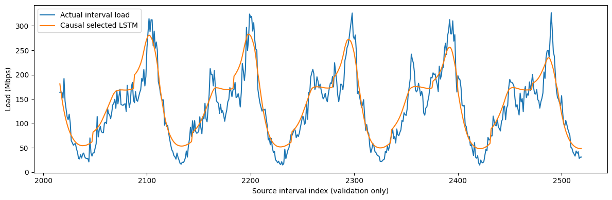
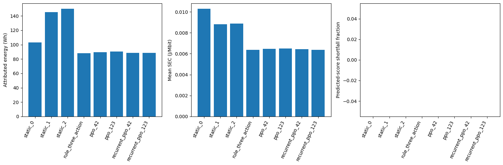
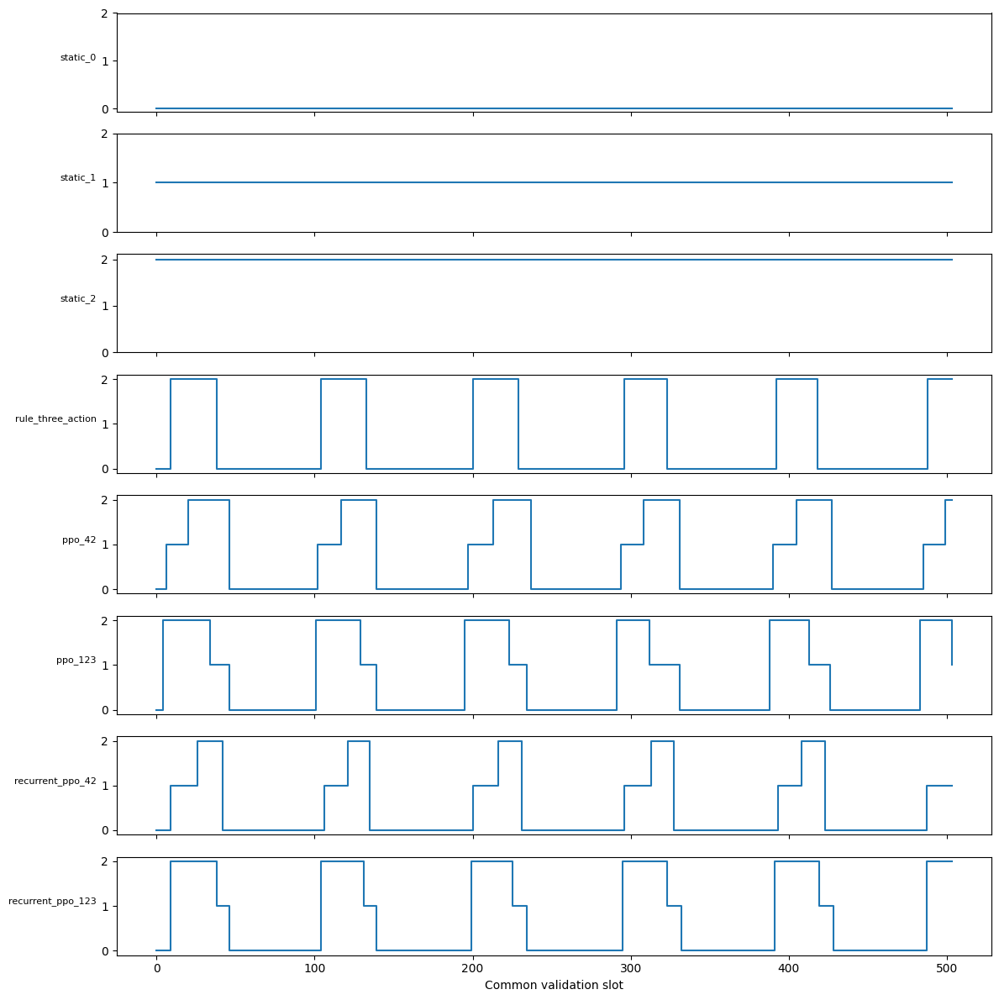

# Corrected controller pipeline and claims pilot — COMCOM-D-26-01061

**Outcome:** the corrected pipeline executes reproducibly, but this small pilot
**does not support PPO energy superiority over the fair three-action rule**.
Both PPO families improve on static provisioning, meet the frozen twin's point
composite-score target on validation, and use within-USR scaling. The recurrent
policy also scales, and neither family reduces type switches relative to the
rule. These are exploratory, validation-selected, model-conditional findings;
they are not final generalization evidence or measured deployment QoS.

Work date: **23 October 2026**. Branch: `revision/comcom-clean-evaluation`, HEAD
`c0734715418d3f6d10785e5174aebb4bac24d0da`. All 335 previously recorded scientific
revision files, original code/data/models/results, and the manuscript are
preserved. No traffic final-test controller evaluation, DQN, broad sensitivity
campaign, commit or push occurred. **Stop after Stage 3.**

## 1. Architecture and frozen pilot

[The fixed protocol](stage3/protocol.json) was written before scientific fitting.
The [implementation guide](stage3/README.md) gives exact commands, feature order,
methodological changes and reproduction requirements.

```text
original Netflix traffic + approved training-only workload scaling
    → chronological training / validation horizons
    → expanding-prefix causal LSTM forecast ledger
    → common observation and actuator contract
    → PPO / RecurrentPPO / three-action rule / three static controllers
    → executed action + realized interval load
    → explicit frozen revision twin
    → common energy, SEC, score and event accounting
```

Only `comcom.revised_twin.v1` is used for the principal results. Identity:
`80866f0adf81c3f144190fe49d8cf74e2d5eefe95c90b63a2924fb8da67c465e`.
The [frozen twin report](FINAL_DIGITAL_TWIN_VALIDATION.md) remains authoritative
for model provenance, grouped profiling validation, power attribution and QoS
limitations. No surrogate was retrained or reselected using controller outcomes.

The [runtime/protocol snapshot](reports/stage3/pilot_protocol_frozen.json) pins
all four model manifests, weights, input preprocessing, score definition,
implementation hashes, forecast CSV hash, cached prediction hash and runtime.
Before training, every cached Netflix training/validation action prediction is
compared **exactly** with real frozen-twin inference. The cache is only an
optimization; missing or invalid values raise errors. No historical twin or
historical test-selected policy is a fallback.

The workload remains the approved 60/15/25 split of 3,360 quarter-hour intervals:
training indices 0–2015; validation 2016–2519; final test 2520–3359. After the
common 96-slot context warmup, each training episode scores **1,920 slots**.
Validation scores **all 504 identical timestamps**, 22 April 2019 00:00 through
27 April 05:45, 126 hours. Horizon hash:
`1d0955ec0c78322db213461b94c8bc4a17d38cfb10679a98994ea3200a0ce0c4`.
The source clock is timezone-naive; no timezone conversion is invented.

Two independent seed labels, **42 and 123**, were fixed for each algorithm.
Each run collected exactly **32,768 interactions**, using four training
environments, 1,024 rollout steps/environment, batch 64, ten optimizer epochs,
lr=.0001, gamma=.995, GAE=.90, entropy=.15, clip=.20 and target-KL=.03.
Recurrent PPO uses one shared 128-unit LSTM and no separate critic LSTM.
Both families use the **same hybrid observation**. This matches information for
an algorithm pilot; it does not replicate the historical FF-hybrid versus
recurrent-history pairing or replace a future observation ablation.

The four environments repeat the same deterministic training trajectory; they
are collectors, not independent workloads. Both algorithms receive equal
interaction budgets; this does not imply equal optimizer work or wall time.
CPU inference/training uses the frozen TensorFlow profile, Torch deterministic
operations and one Torch thread. Runtime versions include Python 3.12.3,
TensorFlow 2.20.0, Keras 3.13.2, NumPy 2.4.2, PyTorch 2.10.0+cu128,
SB3/sb3-contrib 2.7.1 and Gymnasium 1.2.3. GPU training is not used.

## 2. Forecast reconstruction, causality and accuracy

The saved historical predictor has SpatialDropout(.1), LSTM(128) → LSTM(64),
Dropout(.2), Dense(64,ReLU), Dropout(.2), and a linear output. The recovered
training script fits MinMaxScaler on the complete series before splitting, then
uses its chronological evaluation suffix for early stopping. A later calendar
predictor family was selected by test RMSE. Historical archived forecasts and
accuracy tables are therefore not leakage-free forecasts for this pilot.

The corrected pilot retains the **128/64 LSTM hidden widths and 96 completed
interval input window**. Exactly two candidates, load-only and calendar-augmented,
were trained for eight epochs each, seed 42, batch 128, Adam .001. Known
calendar features are decision-time sin/cos, weekday sin/cos, weekend and
business-hour indicators. All are available at interval start.

Explicit departures are: recurrent dropout .2→0 for efficient CPU execution;
training-prefix maximum scaling instead of whole-series min/max scaling; and a
softplus head producing nonnegative scaled-load predictions. Input/output
regularization remains present. These are a prespecified small forecasting
budget, not a faithful historical retraining or an extensively tuned forecast.
No negative forecast was clipped. The calendar candidate won on **validation
RMSE only**; neither candidate or epoch budget was changed afterwards.

| Forecast / scope | N | MAE Mbps | RMSE Mbps | Bias Mbps | R² |
|---|---:|---:|---:|---:|---:|
| Load-only LSTM, validation | 504 | 34.744672 | 45.533988 | −4.800617 | .623718 |
| **Calendar LSTM, validation** | **504** | **23.105853** | **28.508475** | **+9.134476** | **.852501** |
| Persistence reference, validation | 504 | 15.274211 | 20.810623 | +.247486 | .921402 |
| Expanding-prefix training ledger | 1,920 | 38.017166 | 51.358767 | +9.330035 | .531704 |
| Persistence reference, training horizon | 1,920 | 15.943239 | 21.795658 | +.030644 | .915660 |

**The selected LSTM is worse than persistence** in this budget. It remains the
controller forecast to meet the declared methodology; persistence was not
silently substituted, and the search was not expanded to obtain favorable PPO
results. Forecast quality is a material pilot limitation. No claim that these
values reproduce the submitted 19.12-Mbps result is made.

To avoid in-sample forecasting leakage in RL observations, the selected
architecture is fitted independently to prefixes ending at indices **192, 608,
1024, 1440 and 1856**, then predicts only the subsequent training block up to
2016. Scalers and all targets stay within each earlier prefix. Weights remain
fixed within a block while newly completed interval loads enter subsequent input
windows. This is blocked walk-forward inference, not an oracle or an at-every-
interval refit. Calendar choice uses validation as allowed model selection;
individual forecasts never use validation/future outcome labels for parameter
fitting.

The first **96 training decisions, indices 96–191 (5% of scored training)**,
use an explicit persistence cold start because a 96-slot sequence model cannot
already be trained at the first decision. All validation predictions use the
selected full-training-prefix LSTM. This initial fallback is labelled per row,
retains the common training horizon, and is not described as a neural forecast.
No validation or final-test observation is used to train the prefix models.
The approved workload scaling to a 400-Mbps training peak is retained as offline
workload design, distinct from these prefix-fitted forecast scalers.

[Selection](reports/stage3/forecast_selection.json),
[all 2,424 issued forecasts](reports/stage3/forecasts.csv),
[accuracy](reports/stage3/forecast_accuracy.json), and
[seven model manifests](models/stage3/forecast/) retain exact targets, input
cutoffs, fit cutoffs, scalers, model hashes, training losses and runtime.
The selected validation model is
[calendar LSTM](models/stage3/forecast/lstm_calendar/manifest.json), not a
walk-forward prefix checkpoint. The model is reloaded and reproduces the stored
ordered validation predictions exactly under the fixed profile.



## 3. Environment, reward and learning corrections

The new [controller implementation](stage3/pipeline.py) reuses the corrected
foundation rather than editing `src/`. At the start of interval t, the
109-element hybrid observation contains:

- Last **completed** load; previous executed interval's score, attributed power
  and SEC; a previous-outcome-valid mask.
- Three executed-configuration indicators and cooldown state.
- Four correctly aligned decision-calendar sin/cos features.
- 95 completed load values and the causal forecast for interval t.

Load fields divide by the declared 400-Mbps training reference. VecNormalize
then learns observation moments **only during policy training**, with clip=10;
rewards are unnormalized. At reset, configuration is DPDK, cooldown is eligible,
and previous outcome is missing with mask zero. There is no invented telemetry
from an unexecuted preceding configuration. Actual interval-t aggregate traffic
is used only after action selection for scoring, never as a current observation.

For action 0/1/2 = DPDK/USR(1)/USR(2), the existing contract applies:

`r = −100*(power_W/max(actual_load_Mbps,1e−6)) −30*max(0,.90−Q)
     −.030*switch_to_DPDK −.012*USR_instances_launched −.003*USR_scale_down`.

Thus DPDK→USR(2) costs .024, USR(1)→USR(2) costs .012, USR(2)→USR(1)
costs .003, and either USR configuration→DPDK costs .030. This implements the
approved corrected contract rather than the historical symmetric .030 type
switch. Costs apply only to **executed changes**. After a change at t, requests
at t+1..t+3 are blocked and discarded; t+4 is eligible. No request queue, physical
startup delay, transient power or safety override is introduced.

Energy is `sum(P_W*.25 h)` in **Wh**. SEC is **J/Mbit** (numerically W/Mbps).
Mean slot SEC and aggregate energy per offered traffic are different metrics.
Energy, predicted score, requested/executed actions, launches, within-USR scaling,
type switches, blocked commands and reward components are logged separately.

[The training runner](stage3/pilot.py) uses explicit algorithm seeds. Recurrent
PPO maintains its `(hidden, cell)` state across all validation decisions and
resets it only at episode start. It does not inspect a nonexistent policy
`is_recurrent` flag. Selected recurrent evaluations make **504 stateful calls**;
minimum recorded state norms are 5.44/5.75 for seeds 42/123.

Each run saves **four complete policy/normalizer bundles**, after optimizer
updates at 8,192, 16,384, 24,576 and 32,768 interactions. The final post-update
endpoint is included. Evaluation loads those paired states with normalizer
updates disabled. Best checkpoint maximizes **validation total reward**, with
earlier interaction count as tie-breaker; it is not selected by energy or final
outcomes. Both repeated evaluations of each selected bundle match exactly.
No historical test-selected PPO weights are loaded.

| Algorithm / seed | Selected interactions | Selected total reward |
|---|---:|---:|
| FF PPO / 42 | 32,768 | −326.050504 |
| FF PPO / 123 | 24,576 | −327.738670 |
| Recurrent PPO / 42 | 16,384 | −324.918910 |
| Recurrent PPO / 123 | 24,576 | −321.510944 |

Every run still collected the full 32,768 interactions. Earlier selection does
not shorten its budget. [Run ledger](reports/stage3/candidate_runs.jsonl),
[all 16 paired checkpoints](models/stage3/controllers/), checkpoint validation
metrics and [execution log](reports/stage3_pilot.log) preserve successful and
unfavorable endpoints. No run was retried or hyperparameter changed to rescue a
result. Per-update optimizer loss diagnostics were not separately exported;
checkpoint optimizer state, training configuration, validation trajectory and
normalizer state are preserved. This is a pilot logging limitation for later
convergence analysis, not an excuse to rerun these seeds selectively.

## 4. Fair baselines and controller comparison

All baselines receive the common causal observation interface, start in eligible
DPDK and use the same guard/accounting. Static commands ignore the signals.
The new rule queries all three profiling curves at the **same causal forecast**,
prefers QoS≥.90 configurations then minimum attributed power, and otherwise
chooses highest score then lower power. A prespecified **2% relative-power
deadband** retains the current feasible configuration for small savings.
No threshold was tuned after seeing controller results. Every command goes
through the same cooldown. This is a new transparent, model-informed curve
baseline; it is not the historical two-action utility code or a claim of perfect
physical feasibility. The rule knows the offline fitted curves, not realized
future traffic.

All rows below score exactly the same 504 validation intervals. QoS denotes the
predicted **composite score**, not measured service safety.

| Controller | Energy Wh | Mean SEC J/Mbit | Aggregate SEC J/Mbit | Mean Q | Min Q | Q<.90 slots | Total reward |
|---|---:|---:|---:|---:|---:|---:|---:|
| Static DPDK | 103.264594 | .01029214 | .00619928 | .980784 | .967396 | 0/504 | −518.724017 |
| Static USR(1) | 145.257591 | .00879901 | .00872024 | .933149 | .917614 | 0/504 | −443.482319 |
| Static USR(2) | 149.924831 | .00886988 | .00900043 | .935353 | .907887 | 0/504 | −447.065704 |
| **Three-action rule** | **88.255351** | **.00636931** | **.00529823** | .965729 | .907887 | 0/504 | **−321.307122** |
| FF PPO / 42 | 89.324371 | .00646342 | .00536241 | .962642 | .907887 | 0/504 | −326.050504 |
| FF PPO / 123 | 90.477171 | .00649656 | .00543161 | .961105 | .907887 | 0/504 | −327.738670 |
| Recurrent PPO / 42 | 88.528959 | .00644121 | .00531466 | .966614 | .908883 | 0/504 | −324.918910 |
| Recurrent PPO / 123 | 88.475354 | .00637305 | .00531144 | .962288 | .907887 | 0/504 | −321.510944 |

FF energy is **89.900771±.815152 Wh** (sample SD across two seeds), **1.864% more**
than rule; mean SEC is 1.738% more. Recurrent energy is **88.502157±.037904 Wh**,
**.280% more** than rule; mean SEC is .594% more. Relative to static DPDK,
FF/recurrent mean energy is 12.94%/14.30% lower. None of the four learned runs
beats the rule in energy or total reward. Near parity for recurrent PPO is
interesting, but is not evidence of superiority or equivalence.

Two seeds and one validation trajectory do not justify inferential significance,
a convergence claim, or seed-population confidence intervals. The mean±SD is
purely descriptive. Validation has selected forecasts/checkpoints; these results
must not be presented as an untouched held-out test.



All controller shortfall frequencies, unconditional mean severity and maximum
severity are zero in the principal point-model evaluation. Conditional severity
is **undefined** (null), rather than zero estimated risk, because there are no
predicted-shortfall slots. Every row's QoS penalty magnitude is zero. Energy-term
magnitudes and orchestration penalties are:

| Controller | Sum 100×SEC | Sum orchestration penalty |
|---|---:|---:|
| Static DPDK | 518.724017 | 0 |
| Static USR(1) | 443.470319 | .012 |
| Static USR(2) | 447.041704 | .024 |
| Rule | 321.013122 | .294 |
| FF / 42 | 325.756504 | .294 |
| FF / 123 | 327.426670 | .312 |
| Recurrent / 42 | 324.636910 | .282 |
| Recurrent / 123 | 321.201944 | .309 |

This horizon does not discriminate a predicted QoS/energy tradeoff: all choices
avoid point-model shortfalls. That cannot establish that the QoS weight is
unimportant or that actual service is safe. Profiling validation already showed
substantial false-safe outcomes; those limitations remain binding.

[Full metrics](reports/stage3/controller_comparison.json),
[claim arithmetic](reports/stage3/claim_diagnostics.json), and per-controller
`*_steps.csv` files retain every interval, forecast, request, outcome and term.
The static energy values reproduce the prior frozen-twin validation results.

## 5. Switching, scaling and action distributions

| Controller | DPDK / USR1 / USR2 slots | Type switches | Scale up | Scale down | USR launches | Blocked requests |
|---|---|---:|---:|---:|---:|---:|
| Static DPDK | 504 / 0 / 0 | 0 | 0 | 0 | 0 | 0 |
| Static USR1 | 0 / 504 / 0 | 1 | 0 | 0 | 1 | 0 |
| Static USR2 | 0 / 0 / 504 | 1 | 0 | 0 | 2 | 0 |
| Rule | 348 / 0 / 156 | 11 | 0 | 0 | 12 | 0 |
| FF / 42 | 294 / 88 / 122 | 11 | 6 | 0 | 12 | 21 |
| FF / 123 | 286 / 66 / 152 | 11 | 0 | 6 | 12 | 8 |
| Recurrent / 42 | 333 / 97 / 74 | 11 | 5 | 0 | 11 | 0 |
| Recurrent / 123 | 306 / 43 / 155 | 11 | 0 | 5 | 12 | 3 |

**Both policy families use all three configurations and within-USR scaling.**
This disproves an unqualified extrapolation of the historical observation that
only feedforward PPO uses scaling. Type switches remain **11 in every learned
run, equal to rule**; additional within-USR changes increase total reconfiguration
counts to 16–17 versus rule's 11. Scaling is not shown to substitute for switches
or cause the energy advantage over static provisioning.

Rule has access to USR(2) and occupies it for 156 slots even though its within-USR
scale-event count is zero: its changes are DPDK↔USR(2), counted as type switches.
Action availability, configuration occupancy and event type must not be conflated.
Blocked requests are discarded, not delayed/queued; request and executed action
counts differ accordingly.



## 6. Retained-twin sensitivity

Selected policy weights, paired normalizers and forecasts remain fixed.
[Diagnostic replay](stage3/sensitivity.py) changes only USR power to the retained
Task 2D constrained neural model, QoS to the Task 2H training-load-mean curves,
or both. Earlier resulting telemetry changes, so later learned actions may
change. The rule also queries the alternative curves. These scenarios have
separate identities, use validation only, and do not retrain/reselect any model
or checkpoint. They are not calibrated uncertainty intervals or measured risk.

| Scenario | Rule Wh | FF42 Wh | FF123 Wh | Recurrent42 Wh | Recurrent123 Wh |
|---|---:|---:|---:|---:|---:|
| Frozen principal twin | 88.255351 | 89.324371 | 90.477171 | 88.528959 | 88.475354 |
| Retained USR neural power | 88.713487 | 89.899451 | 91.040069 | 88.791414 | 89.493717 |
| Load-mean QoS references | 88.255351 | 89.324371 | 90.477171 | 88.566726 | 88.475354 |
| Both alternatives | 88.713487 | 89.789566 | 91.040069 | 88.791414 | 89.497579 |

**No learned seed beats the rule under any retained alternative.** The lack of
PPO-over-rule energy superiority is stable across these checks, within their
limited scope. Close FF/recurrent relationships and behavior are less stable.
Changing USR power changes the rule's requests at **134/504 slots**, with occupancy
339/121/44 rather than 348/0/156. Learned request changes are 0–5 per scenario;
small behavior changes can coexist with altered energy accounting.

Principal learned runs retain zero predicted shortfalls in all these alternative
replays. Static USR(1), however, has **9/504** below-.90 outcomes with load-mean
QoS: conditional mean shortfall .00028758, maximum .00044916, unconditional
mean .00000514. Thus zero shortfalls is not invariant to estimator choice even
for these deterministic workloads. This alternative still does not represent
physical safety certification. Neither alternative spans campaign/hardware,
packet-loss semantics or unmodelled multi-instance uncertainty.

[Full sensitivity metrics](reports/stage3/twin_sensitivity.json),
[alternative artifact/scenario identities](reports/stage3/sensitivity_identities.json), and scenario
step files preserve predicted score, severity, requests, SEC, energy and events.
The QoS label definition and reward weights are unchanged in every scenario.

## 7. Verification, failures and reproducibility

**Before PPO training: 238 tests passed**, 28 Keras array-copy deprecation
warnings, 26.83 seconds. Tests covered the complete prior revision suite plus
causal observation/forecast construction, exact saved forecast reload, training-
only prefix scalers, final-test environment rejection, reward and launch costs,
blocked actions/cooldown, recurrent state persistence/reset, real PPO/recurrent
policy save/reload without parameter updates, normalizer immutability and
post-update checkpoint timing. [Preflight log](reports/stage3_preflight_final.log).

**After the pilot: 241 tests passed**, 28 warnings, 26.70 seconds. Added checks
verify all four completed runs, exactly four checkpoint pairs/run, fixed budgets,
validation-only selection, exact artifact hashes, expected training-only
normalizer sample counts, identical controller timestamps/actuator behavior,
energy arithmetic and validation-only sensitivity. No scientific policy training
is performed by these tests. Existing profiling tests perform their previously
specified tiny synthetic reproducibility fits.
[Full final test log](reports/stage3_final_tests.log).

Initial preflight failures are retained. Importing SB3 can import TensorFlow via
TensorBoard before the twin CPU profile, causing the frozen adapter to reject
that process. Stage 3 now initializes the CPU runtime before importing SB3;
historical code is unchanged. A history-vector assertion also assumed that
float32 conversion before division was bit-identical to conversion after division;
it now allows the known float32 representation error while checking the intended
completed history. One attempted test command used unavailable system `python`;
execution consistently uses `.venv/bin/python`. No RL run had begun during these
failures. No scientific training retry or parameter change followed pilot results.

The exact [training protocol](reports/stage3/pilot_protocol_frozen.json),
[forecast protocol](reports/stage3/forecast_protocol_frozen.json), paired artifact
manifests and code hashes permit reconstruction. Writers refuse to overwrite
existing scientific outputs. Use a fresh output workspace/namespace with the
pinned prior artifacts and external profiling sources. Post-pilot artifact tests
skip before those outputs exist. The [README commands](stage3/README.md) document
execution order. The pilot training ledger records every run's start/completion;
no failed or unfavorable endpoint is discarded.

The [integrity record](reports/stage3/integrity.json) checks the preservation
[snapshot](reports/stage3_prior_sha256.json), frozen twin identity/artifacts,
source/protocol hashes, branch and unchanged tracked files. The
[new-file manifest](reports/stage3/file_manifest.json) lists every scientific
addition and SHA-256, excluding incidental bytecode and the manifest itself.
All implementation, new forecast/policy models, tests and evidence remain under
`revision/`. No original experiment configuration was overwritten. Model and
external measurement backups remain necessary; hashes alone are not backups.

## 8. Explicit claim assessment and next-stage boundary

| Central claim | Pilot assessment | Required qualification |
|---|---|---|
| PPO improves energy efficiency against fair baselines | **Supported against static provisioning; unsupported against the corrected three-action rule in this pilot.** All four learned seeds have higher energy/SEC and worse total reward than rule. | No general PPO superiority claim, significance, equivalence or held-out confirmation. The small interaction budget does not establish final convergence. |
| Energy improvements have acceptable composite QoS | **The predicted .90 point-score target is met relative to static provisioning. Acceptable physical QoS/risk is not established.** | No risk tolerance has been approved. Profiling false-safe errors and composite-score semantics preclude measured safety/5QI conclusions. Zero predicted penalties are not a risk estimate. |
| Learned policy uses scaling and switching as claimed | **All learned runs scale and switch, but the specific scaling-over-switching/FF-only narrative is unsupported.** | Recurrent PPO also scales; type switches equal rule and total reconfigurations are higher. Scaling is observed behavior, not isolated evidence of its causal energy benefit. |

The foundation is ready for controlled further experiments, but **these findings
do not justify launching a full campaign designed merely to confirm the original
claims**. Preserve the negative result and prespecify the next scientific design.
Recurrent near parity with rule and both families' static savings make a carefully
budgeted convergence/robustness campaign reasonable if its purpose is honest
hypothesis testing, including possible null or negative conclusions.

Remaining reviewer work, not performed here:

1. Freeze a full training/convergence budget and log optimizer/episode diagnostics;
   the present 32,768-step pilot is much smaller than the historical 300,000 target.
   Use validation for any new prespecified tuning, preserve unsuccessful runs and
   keep the final 840-slot test untouched until all decisions are frozen.
2. Address the demonstrated LSTM-versus-persistence weakness with a separately
   declared forecasting budget/protocol, rather than opportunistic search on
   controller outcomes. Decide how the early walk-forward cold start should be
   scoped in the final campaign. Do not relabel this undertrained pilot forecast
   as the manuscript's historical calendar predictor.
3. Prespecify independent seed count, endpoints, effects/uncertainty and multiple
   comparison handling. Two seeds cannot settle robustness. Extend to observation
   ablations, a real dueling-DQN comparator and reward-weight/cooldown sensitivity
   only under their later authorized reviewer protocols.
4. Retain full action parity and explicit baseline definition; use matched
   workloads/forecasts, paired checkpoint normalizers and proper recurrent state.
   Separate scaling occupancy, within-USR scaling events and type switches.
5. Evaluate transfer/new traffic and a final test only after the source protocol,
   forecast selection, policy tuning and evaluation contracts are frozen. This
   stage does not grant that authorization.
6. Carry forward all frozen-twin limitations: process-attributed versus server
   power, per-direction load mapping, packet-loss denominator, uncalibrated tails,
   single-campaign correlation, absent idle and transition measurements, balanced
   USR(2) approximation and no physical service-continuity validation. Those
   require new evidence for stronger physical claims; more seeds cannot fix them.
7. Perform literature/editorial and manuscript-method corrections later. No text,
   tables or historical published results are replaced in this stage.

**Stage 3 is complete. No full reviewer campaign is started.**
