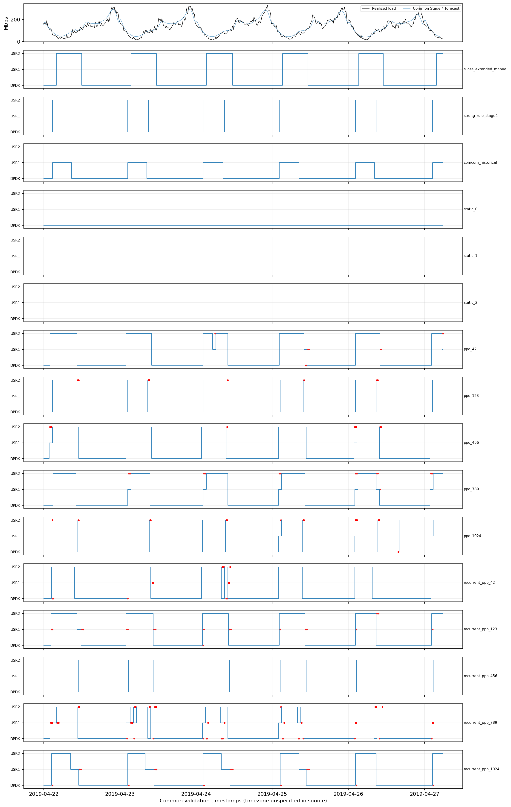

# Final baseline comparison — COMCOM-D-26-01061

**Stage 5 complete.** Both PPO families beat the frozen SLICES manual extension
and the executable historical binary rule on this validation workload. Against
the unchanged strong three-action rule, selected mean energy advantages remain
only **0.030% (PPO)** and **0.121% (recurrent PPO)**. This supports conditional
competitiveness, not robust learning superiority or physical QoS guarantees.

Work date: 23 October 2026. Branch `revision/comcom-clean-evaluation`; HEAD
`c0734715418d3f6d10785e5174aebb4bac24d0da`. No policy/surrogate training,
checkpoint reselection, reward change, default-twin change, manuscript edit,
traffic final-test evaluation, commit or push occurred.

## Frozen definitions and source audit

The [versioned protocol](stage5/protocol.json),
[pre-evaluation freeze](reports/stage5/baseline_frozen.json) and
[threshold/hysteresis reconciliation](stage5/THRESHOLD_HYSTERESIS_AUDIT.md)
define three distinct comparators. Rules were fixed from source principles and
profiling curves before this replay; no baseline parameter search used workload
outcomes or PPO results. Stage 4 validation/PPO outcomes were already exposed,
so this is transparent reuse, not a newly blind experiment.

| Identity | Selection objective | Actions | Hysteresis / execution |
|---|---|---|---|
| `slices_extended_manual` | .2×100Q + .8×100(Wmax−P)/(Wmax−Wmin); efficiency score bounded [0,100] | DPDK/USR1/USR2 | 26-Mbps interior margin around utility-envelope boundaries; shared t+4 guard |
| `strong_rule_stage4` | Prefer Q≥.90, then least power; otherwise highest Q then least power | DPDK/USR1/USR2 | Keep current feasible action for saving ≤2%; shared t+4 guard |
| `comcom_historical` | .3Q + .7×100(3.58−P)/3.58; historical mixed score scales retained | DPDK/USR1 | No active traffic margin; shared t+4 guard |

A uses an explicit three-configuration generalization, not a claim that the
published two-mode algorithm already specified scaling. Its performance score is
100 times the **current frozen composite Q**, replacing the paper's different
polynomial KPI aggregation. Global power normalization covers the fixed synthetic
.02–400 Mbps study domain across all three actions. Profiling normalization is Wmin=0.000267760330 W and Wmax=3.433256049296 W. No physical predictions are
clipped. The uploaded SLICES PDF and conference copy agree on the relevant
formula/parameters; PDF hashes differ because the copies have different packaging.
[Source reconciliation](reports/stage5/uploaded_source_reconciliation.json)
records both identities. The primary online source is linked in the audit.

The new A crossovers are **15.781867 and 87.370037 Mbps**, yielding USR1 → USR2 →
DPDK utility regions. With the fixed 26-Mbps margin, USR1 has no entry interior;
USR2 accepts entry strictly between **41.781867 and 61.370037**; DPDK accepts
entry above **113.370037**. Otherwise executed state is retained. Thus A has
three available actions but no USR1 occupancy from DPDK initialization. Overlapping
bands explicitly retain state; no intermediate region was forced, threshold
reordered, or old 95.6-Mbps crossover reused. This is a meaningful manual-design
limitation, not evidence that every reasonable manual extension must behave so.
The .25-Mbps scan/refined roots are numerical profiling constructs, not proof
against narrower unsampled regions; inconsistent runtime winners fail explicitly.

B imports the **original Stage 3/4 class directly**, without copying or changing
its logic. All original Stage 4 rule metrics reproduce exactly. A reward-aligned
one-step alternative is documented in the audit but **neither selected nor run**:
its myopia and forecast-error tradeoffs require a separately frozen training-only
development protocol. No validation-tuned improvement is mislabeled as independent.

C is the direct utility ranker actually executed in `main`'s evaluator and also
present in the publication compiler. The constructor-generated threshold plots
and ±23-Mbps lines do **not** affect that loop. The manuscript's shared-action
claim, 90.47/87.13-Mbps explanation and scaling dead-band narrative therefore do
not establish the executed algorithm. Two archived threshold JSONs give only
Th1 (90.479001 or 90.339350 Mbps), with multi-USR disabled; neither authenticates
87.13 as an active scaling boundary. The separate selector even compares DPDK
with USR(k), rather than directly comparing USR1 with USR2. C preserves binary
availability, mixed scales and no active margin; the new frozen-twin implicit
crossover is **89.111956 Mbps**. Exact revised inference replaces old nearest
lookups explicitly. Stored 720/721-row baseline CSVs have distinct hashes; the
complete submitted-table generation chain remains unauthenticated. This is a
faithful source-based **adaptation**, not reproduction of the submitted numbers.
[Historical inventory](reports/stage5/historical_source_inventory.json).

## Common validation comparison

Every row uses the frozen `comcom.revised_twin.v1` identity
`80866f0adf81c3f144190fe49d8cf74e2d5eefe95c90b63a2924fb8da67c465e`,
the identical Stage 4 LSTM forecasts, initial eligible DPDK, common actuator,
reward and accounting. The horizon is **504 quarter-hour slots**, 22 April 2019
00:00–27 April 05:45, **126 hours**, identity
`1d0955ec0c78322db213461b94c8bc4a17d38cfb10679a98994ea3200a0ce0c4`.
Decisions use completed telemetry and causal forecasts; realized same-interval
traffic enters scoring only. A change at t permits another at t+4; blocked
requests are discarded. No duplicate rule timer or startup energy is added.

Energy is process-attributed **Wh**, `sum(P_W×.25 h)`; SEC is **J/Mbit**.
Mean slot SEC differs from aggregate energy/offered-traffic SEC. The reward is
unchanged: −100×SEC −30×score shortfall −.030 switch-to-DPDK −.012 per USR launch
−.003 within-USR scale-down. Costs are reward penalties, not physical Wh.

| Controller | Energy Wh | Mean SEC | Aggregate SEC | Total reward | Mean Q | Min Q |
|---|---:|---:|---:|---:|---:|---:|
| slices_extended_manual | 90.382301 | 0.00662686 | 0.00542592 | -334.287763 | 0.964903 | 0.907887 |
| strong_rule_stage4 | 88.277182 | 0.00637538 | 0.00529954 | -321.613068 | 0.966645 | 0.907887 |
| comcom_historical | 88.957901 | 0.00652120 | 0.00534041 | -328.890507 | 0.970590 | 0.917614 |
| static_0 | 103.264594 | 0.01029214 | 0.00619928 | -518.724017 | 0.980784 | 0.967396 |
| static_1 | 145.257591 | 0.00879901 | 0.00872024 | -443.482319 | 0.933149 | 0.917614 |
| static_2 | 149.924831 | 0.00886988 | 0.00900043 | -447.065704 | 0.935353 | 0.907887 |
| ppo_42 | 88.109757 | 0.00635016 | 0.00528949 | -320.363312 | 0.964002 | 0.907887 |
| ppo_123 | 87.940790 | 0.00633730 | 0.00527935 | -319.693836 | 0.965765 | 0.907887 |
| ppo_456 | 88.316767 | 0.00636145 | 0.00530192 | -320.911117 | 0.963377 | 0.907887 |
| ppo_789 | 88.126808 | 0.00635464 | 0.00529051 | -320.570750 | 0.964820 | 0.907887 |
| ppo_1024 | 88.759984 | 0.00639021 | 0.00532853 | -322.414721 | 0.964433 | 0.907887 |
| recurrent_ppo_42 | 88.222109 | 0.00636675 | 0.00529624 | -321.232084 | 0.965729 | 0.907887 |
| recurrent_ppo_123 | 88.017581 | 0.00633511 | 0.00528396 | -319.586635 | 0.963825 | 0.907887 |
| recurrent_ppo_456 | 88.143064 | 0.00635574 | 0.00529149 | -320.623349 | 0.964392 | 0.907887 |
| recurrent_ppo_789 | 88.333644 | 0.00637334 | 0.00530293 | -321.678256 | 0.964575 | 0.907887 |
| recurrent_ppo_1024 | 88.134760 | 0.00634973 | 0.00529099 | -320.332396 | 0.964347 | 0.907887 |

All **1,512 static action/load combinations** meet point Q≥.90. Consequently every
controller has 0/504 predicted shortfall slots, zero mean/max shortfall and zero
QoS penalty; conditional shortfall severity is **undefined**, not demonstrated
zero physical risk. This horizon cannot distinguish QoS-control quality. The
severe profiling false-safe errors, composite-score semantics and unvalidated
5QI/service-continuity claims remain binding.

| Controller | DPDK/USR1/USR2 slots | Type switches | Scale up/down | Blocked | USR launches | Reconfiguration penalty |
|---|---|---:|---|---:|---:|---:|
| slices_extended_manual | 335/0/169 | 11 | 0/0 | 0 | 12 | 0.294 |
| strong_rule_stage4 | 359/0/145 | 11 | 0/0 | 0 | 12 | 0.294 |
| comcom_historical | 368/136/0 | 11 | 0/0 | 0 | 6 | 0.222 |
| static_0 | 504/0/0 | 0 | 0/0 | 0 | 0 | 0.000 |
| static_1 | 0/504/0 | 1 | 0/0 | 0 | 1 | 0.012 |
| static_2 | 0/0/504 | 1 | 0/0 | 0 | 2 | 0.024 |
| ppo_42 | 326/10/168 | 11 | 1/3 | 7 | 13 | 0.315 |
| ppo_123 | 349/0/155 | 11 | 0/0 | 8 | 12 | 0.294 |
| ppo_456 | 320/8/176 | 11 | 2/0 | 9 | 12 | 0.294 |
| ppo_789 | 335/24/145 | 11 | 5/1 | 18 | 12 | 0.297 |
| ppo_1024 | 332/16/156 | 13 | 4/0 | 15 | 14 | 0.348 |
| recurrent_ppo_42 | 348/0/156 | 13 | 0/0 | 13 | 14 | 0.348 |
| recurrent_ppo_123 | 326/5/173 | 11 | 0/1 | 24 | 12 | 0.297 |
| recurrent_ppo_456 | 332/0/172 | 11 | 0/0 | 0 | 12 | 0.294 |
| recurrent_ppo_789 | 329/29/146 | 15 | 7/4 | 47 | 20 | 0.462 |
| recurrent_ppo_1024 | 330/41/133 | 11 | 0/4 | 18 | 12 | 0.306 |

A/B both occupy USR2 without within-USR scale events: DPDK→USR2 is a type switch
and two launches, not a USR1→USR2 scaling event. C excludes USR2 by definition.
Every learned selected run has at least as many type switches as the rules' 11.
All requested/executed actions, per-slot terms, timestamps and forecasts are in
the `*_steps.csv` files. [Full comparison](reports/stage5/comparison.json),
[common CSV](reports/stage5/comparison.csv) and
[family effects](reports/stage5/family_summary.json) retain unrounded values.

## Scientific answers and attribution limits

| Comparison | FF PPO | Recurrent PPO |
|---|---:|---:|
| Mean ± sample SD Wh, five seeds | 88.250821 ± .314243 | 88.170231 ± .116933 |
| Mean energy vs SLICES extension | −2.358%; 5/5 seed wins | −2.447%; 5/5 seed wins |
| Mean energy vs historical binary | −.795%; 5/5 seed wins | −.885%; 5/5 seed wins |
| Mean energy vs strong rule | −.030%; 3/5 seed wins | −.121%; 4/5 seed wins |
| Total-reward wins vs strong rule | 4/5 | 4/5 |

1. **Does PPO beat the traditional manual baseline?** Yes for this declared A
   extension and adapted C on this reused validation workload; all ten learned
   runs also have higher reward than either. This is not a claim about every
   manual rule, the original SLICES numerical experiment, or final generalization.
2. **How competitive is it against the strong rule?** Near parity in selected
   mean energy. FF saves .026361 Wh, recurrent .106951 Wh. Five seeds on one
   validation-selected workload, prior checkpoint selection and surrogate error
   do not establish robust superiority, equivalence or statistical significance.
3. **Do original qualitative COMCOM conclusions survive?** Savings versus static
   provisioning and learned use of multiple configurations survive conditionally
   on this twin. A general learning advantage, fewer disruptive switches,
   feedforward-only scaling, causal scaling benefit and physical QoS preservation
   are unsupported. Recurrent PPO scales too; several strong selected policies
   make no within-USR changes. Numerical historical claims are not restored.
4. **What explains the differences?** A and B have the same available actions yet
   differ by **2.105118 Wh**, demonstrating substantial sensitivity to manual
   utility/hysteresis design. C versus any three-action method also changes USR2
   access. PPO versus B controls action availability, but the tiny differences
   still mix policy design, training/selection and curve approximation; A/C wins
   cannot isolate a benefit from learning. Useful USR2 occupancy is distinct from
   learning or within-USR scaling. No causal attribution is claimed.
5. **Which matched ablations are needed?** Prespecify two-action and three-action
   versions of manual/strong rules and separately trained PPO families with the
   same actions, observations, forecast stream, guard and budgets. Hold utility
   fixed when varying action availability; hold actions fixed when varying utility
   or hysteresis. To isolate within-USR transitions, a separate transition-matched
   ablation must retain DPDK↔USR2 access while controlling USR1↔USR2 changes;
   simply deleting action 2 conflates scaling with two-instance provisioning.
   No such retraining or policy intervention was performed here.
6. **Claim status:** twin-conditional static savings, A/C comparisons and observed
   configuration use are supported on validation. General PPO-over-strong-rule
   superiority and learning-specific benefit remain uncertain. Operational safety,
   fewer type switches and FF-exclusive scaling are unsupported by this evidence.

No superiority p-value or per-slot pseudo-replication is used. The final 840-slot
test is untouched. All ten exact selected checkpoint/normalizer bundles come from
`stage4_rng_isolated`; both inference repeats match and all Stage 4 metrics are
reproduced exactly. No initial RNG-affected campaign or new selection is pooled.
Forecast weakness versus persistence, exposed validation reuse, unstable late
training and all frozen-twin physical/model limitations remain unresolved.

## Reproducibility, preservation and stop

**272 tests passed, 3 deselected in 27.19 seconds.** This comprises 19 new Stage 5
checks and 253 existing checks. The deselected cases actually train synthetic
neural/RL fixtures; they were deliberately not run under this task's no-training
restriction. No warning or test failure occurred. Before evaluation, 15 tests
passed and the pending output check skipped; later provenance tests were added
without changing any frozen request logic. [Test log](reports/stage5/tests.log).

Coverage includes utility scales, deterministic ties, strict hysteresis boundaries,
overlaps, rejected-request state handling, nonmonotone/dominated regions, all 512
nine-command binary sequences for historical/common cooldown equivalence, source
call-path evidence, uploaded PDF identity, exact horizons/forecasts/workloads,
energy arithmetic, unchanged Stage 4 results and immutable paired normalizers.
No model optimization was performed by this verification run.

Created files: `stage5/` contains versioned rule/config/freeze/replay/plot/report
code, README and historical audit; `tests/test_stage5.py` contains focused checks;
`reports/stage5/` contains primary/main source extracts, profiling grid, frozen
definitions, source inventory, 16 trajectories, common tables, family summaries,
threshold audit, six PNG/PDF plots and logs. This report and the pre-work
`reports/stage5_prior_sha256.json` complete the additions. The user uploaded the
reference PDF during the task; it was inspected and hashed without modification.
No preexisting file was edited. The
[package freeze manifest](reports/stage5/baseline_freeze_manifest.json) lists all
new paths/hashes and selected inputs; [integrity](reports/stage5/integrity.json)
checks all **2,000** pre-work scientific files, original tracked state, branch/HEAD
and frozen models. Hashes establish identity, not a separate backup.
[Commands](stage5/README.md) require a fresh output workspace and refuse overwrite.

**Next-stage recommendation:** retain all three baselines and the Stage 4 negative/
near-parity evidence. Before changing PPO, freeze a limited training-only development
protocol for any cost-aware comparator and a matched-action-space attribution
experiment. Define primary endpoints and disclose validation reuse. Preserve the
final test until model/controller decisions are frozen and testing is explicitly
authorized. More tuning to make PPO beat B would not establish the original claim.

**Stopped after Stage 5.** No controller improvement campaign starts automatically.
