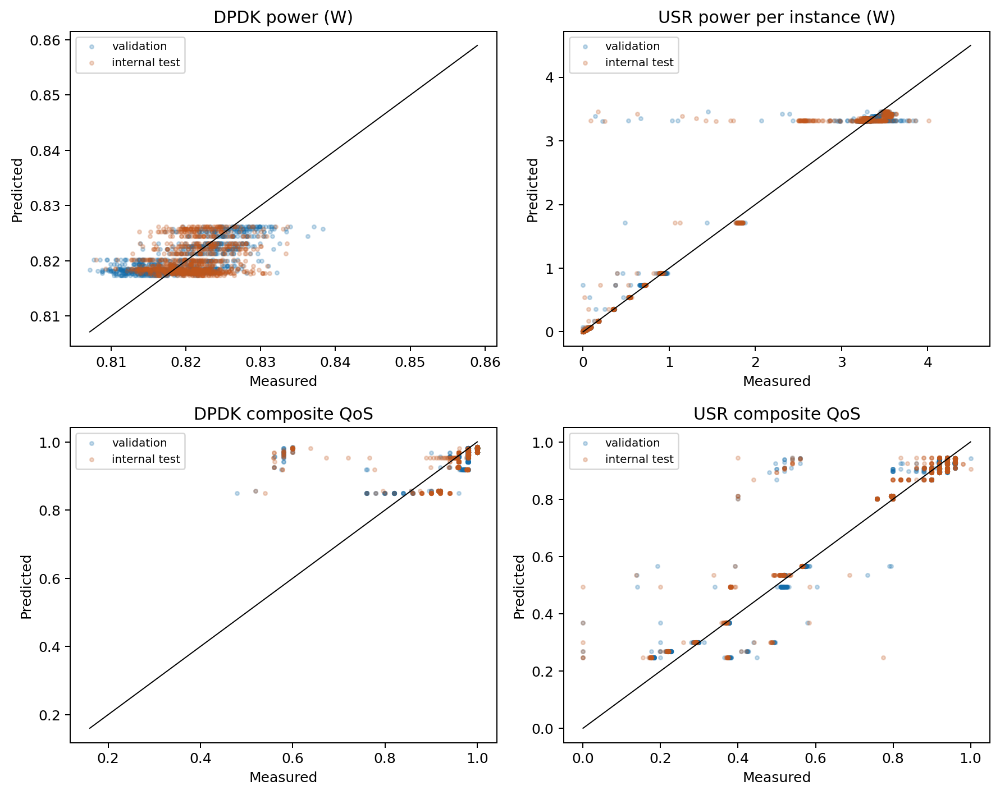
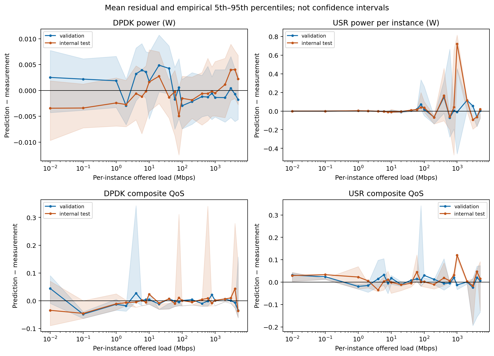
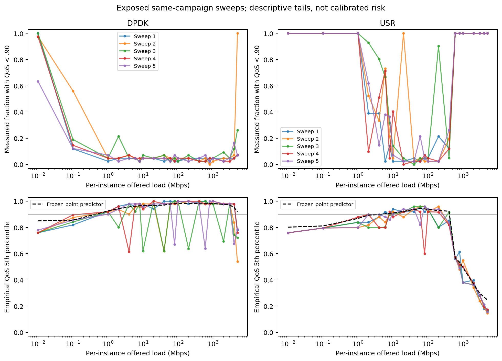
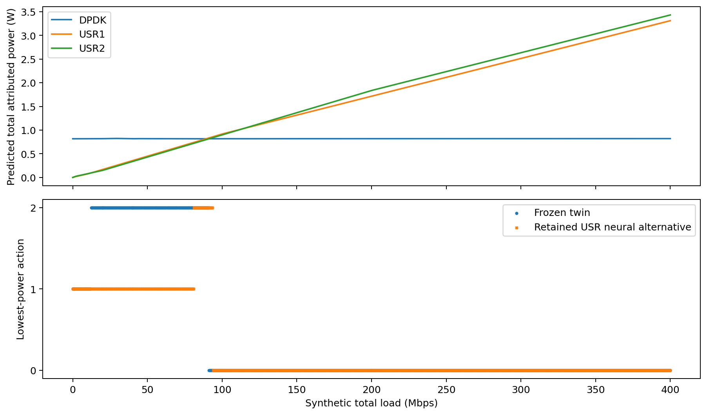

# Final digital-twin validation — COMCOM-D-26-01061

**Decision: freeze `comcom.revised_twin.v1` for an exploratory, offline,
model-conditional controller pilot.** The four selected models are numerically
valid over the audited training/validation inputs and reproducibly load through
one adapter. They support testing algorithm behavior conditional on the twin;
they do **not** establish measured QoS safety, deployment energy savings, or the
submitted PPO advantage. No controller training is started or automatically
authorized by this report. Digital-twin investigation is closed for that limited
scope; the unresolved physical issues below remain limits on stronger claims.

Work was performed on `revision/comcom-clean-evaluation`, HEAD
`c0734715418d3f6d10785e5174aebb4bac24d0da`, on 22 October 2026.
Historical artifacts, the historical default twin and all earlier revision
experiments are preserved. No manuscript edits, traffic final-test controller
evaluation, RL training, commit or push occurred.

## 1. Frozen models and integration

| Component | Final choice | Reason |
|---|---|---|
| DPDK power | Dense(16, ReLU) → softplus in watts, seed 123 | Lowest profiling-validation RMSE among five prespecified candidates; retains historical hidden architecture |
| USR power | Task 2C seven-knot nonnegative piecewise-linear regression | Removes the negative-power defect; substantially smaller low-load errors than the retained Task 2D neural alternative |
| DPDK composite QoS | Task 2H original hidden architecture + sigmoid, seed 123 | Frozen validation-selected conditional point predictor; modest improvement over the training constant |
| USR composite QoS | Task 2H original hidden architecture + sigmoid, seed 42 | Frozen validation-selected conditional point predictor; captures broad load dependence |

The revised twin contains **three neural networks and one regression**, rather
than four neural networks. This methodological change must be stated accurately.
USR power is not chosen to improve controller energy results. The low-load
tradeoff was documented in Tasks 2C/2D before these workload diagnostics; it is
not a formal equivalence test with a prespecified acceptance margin.

Use [RevisionTwin](evaluation/revised_twin.py), explicitly imported as
`from revision.evaluation.revised_twin import RevisionTwin`. The historical
`FittedUPFTwin` and original `src/` pipeline remain unchanged. The
[versioned configuration](configs/revised_twin_v1.json) pins the score,
implementation files, model manifests, weights and embedded preprocessing states.
Its integrated identity is
`80866f0adf81c3f144190fe49d8cf74e2d5eefe95c90b63a2924fb8da67c465e`.

| Artifact | Manifest/JSON SHA-256 |
|---|---|
| [DPDK power](models/final_dpdk_power/neural_seed_123/manifest.json) | `f8776d3dfa57846ae3da58d98a2c387d38b0f48836cf3be40d63f290057b551c` |
| [USR power](models/task2c/selected_usr_power.json) | `3fc2b6b3b9cedb0c8abd17ea0740a6f721628c93c607e4397bb5fb1155f5c7f8` |
| [DPDK QoS](models/task2h/dpdk/original_hidden_sigmoid_seed_123/manifest.json) | `76e1e0ea4f086f0e2504164f9d7a4e4cf97f097bc9367d190c7ed39fe8eae759` |
| [USR QoS](models/task2h/usr/original_hidden_sigmoid_seed_42/manifest.json) | `78dd56a681ccdd264e7a23cdf08b8e0da8b3eb5a8ec24469b0e9047cb1151f7e` |

Weight hashes, scaler values, training rows, seeds and parent configuration hashes
are recorded in these manifests and the [integrated manifest](reports/final_twin/integration/frozen_manifest.json).
Neural inputs use training-only standardization of `log1p(load)`; outputs are
physical watts or the original dimensionless score, with no centered inverse
target transform. USR regression uses float64 Mbps and watt-valued coefficients.
No post-hoc output clipping, imputation, idle subtraction or extrapolation occurs.

## 2. What validation means here

All four fits use complete profiling sweeps **1–3 for training, 4 for validation,
5 for internal evaluation**. DPDK has 2,760/916/918 rows; USR has
2,736/915/913. Each role includes all 22 measured load levels, 0.01–5,000 Mbps.
No case block crosses roles. Preprocessing is fitted on training only;
validation selects neural checkpoints/candidates. There is no training-plus-
validation refit or model selection from controller results.

These are **disjoint sweeps within exposed campaigns**, not newly acquired,
independent or fully blind physical tests. DPDK measurements span 3–4 January
2025; USR measurements are from 13 January 2025. Within-block samples are
temporally correlated and all use 1,250-byte packets. The original random 80/20
split put all sweeps on both sides and reused evaluation rows for early stopping.
Historical-model metrics below are therefore descriptive and non-independent.

Frozen selections precede internal scoring in the new DPDK experiment and the
Task 2H QoS experiment. Losing neural candidates are not scored on internal test.
Task 2C already exposed internal scores for its three regression alternatives;
its validation-selected seven-knot model was retained despite better internal
RMSE for 22 knots. Reuse is disclosed rather than presented as a fresh blind test.

## 3. Consolidated four-model performance

V = validation sweep 4; T = exposed internal sweep 5. Power errors are **watts
per instance**; QoS errors are dimensionless. Bias is prediction − measurement.
These values use the integrated adapter's fixed, scalar-per-load inference profile.

| Component | Role | MAE | RMSE | R² | Bias |
|---|---|---:|---:|---:|---:|
| DPDK power | V | .003364 | .004153 | .434199 | +.000514 |
| DPDK power | T | .003352 | .004174 | −.118908 | −.000446 |
| USR power | V | .079240 | .266462 | .969316 | +.009571 |
| USR power | T | .105602 | .309299 | .956931 | +.039595 |
| DPDK QoS | V | .036185 | .080406 | .147794 | −.001208 |
| DPDK QoS | T | .038030 | .082881 | .056080 | −.002544 |
| USR QoS | V | .036183 | .078010 | .908083 | +.006717 |
| USR QoS | T | .040726 | .083342 | .904454 | +.014718 |

[Machine-readable metrics](reports/final_twin/integration/four_model_metrics.json),
[row residuals](reports/final_twin/integration/profiling_predictions.csv),
[load errors](reports/final_twin/integration/errors_by_load.csv),
[sweep errors](reports/final_twin/integration/errors_by_sweep.csv), and
[variance decomposition](reports/final_twin/integration/variance_decomposition.json)
retain denominators, signed residual quantiles and all training results.





Both plots also have PDF exports in the same directory. Residual shading is
empirical 5th–95th percentiles of correlated observations, not confidence intervals.

### DPDK power: physical validity and new grouped comparison

The historical Dense(16, ReLU) → linear network is finite and positive on the
20,000-point diagnostic domain grid (range approximately .81848–.82497 W).
It has no nonnegativity guarantee by construction. Its descriptive V/T RMSE is
.004202/.003835 W, R² .420866/.055667, MAE .003409/.003069 W and bias
+.000708/−.000253 W. Its favorable internal score is not an unbiased comparison:
historical fitting included rows from sweep 5.

For a consistently grouped revision model, the
[prespecified budget](configs/final_dpdk_power_v1.json) compared a nonnegative
training constant, nonnegative affine regression, seven-knot regression and
two minimal 16-unit softplus networks. Neural seeds 42/123 ran 143/135 epochs,
278 total of an 800-epoch cap; no search expansion occurred. Targets are watts,
inputs are training-standardized log-load, and best validation weights are restored.

| DPDK candidate | Validation RMSE W | Validation MAE W | Validation R² |
|---|---:|---:|---:|
| Training constant | .005586 | .004672 | −.023360 |
| Nonnegative affine | .004661 | .003829 | .287490 |
| Seven-knot regression | .004492 | .003668 | .338066 |
| Neural seed 42 | .004189 | .003399 | .424365 |
| **Neural seed 123** | **.004153** | **.003364** | **.434202** |

The [selection](reports/final_twin/dpdk_power/selection_frozen.json) was frozen
before internal evaluation and workload scoring. Selected internal R² is negative:
the model is worse than the internal sweep's own mean, and is **not** established
as a generally superior DPDK power predictor. It is retained under the frozen
selection rule, with small absolute error (about .51% of .821 W) and this
limitation. Narrow target variation makes R² sensitive to small curve and sweep
differences; it must not be dismissed or hidden behind the absolute RMSE.
DPDK sweep mean powers range .819572–.821401 W and within-sweep SDs
.003948–.005525 W. On internal test, 76.63% of target variation is within identical
loads. These statistics do not separate physical noise, attribution error and
unobserved state. Low-load (≤20 Mbps) V/T RMSE is .004607/.004162 W.

[Candidate metrics](reports/final_twin/dpdk_power/metrics.json),
[domain checks](reports/final_twin/dpdk_power/domain_checks.json), and load/sweep
CSV breakdowns preserve every candidate. Batch-profile candidate scores differ
from scalar integrated scores by approximately 10⁻⁸ W; this does not change the
winner. Fixed ordered scalar calls and reloads are exactly repeatable.

### USR power: final choice and consequences

The original standardized linear head returns negative watts at measured-range
loads: at 2/4 Mbps it predicts −.021882/−.053532 W, versus measured means
.017470/.034704 W. This was unconstrained interpolation error, not a scaler swap
or idle subtraction. The seven-knot model predicts .019097/.033080 W instead.
Its knots are .01, 1, 10, 100, 400, 1,000 and 5,000 Mbps, fitted by nonnegative
least squares on training rows. Between knots, predictions are convex
combinations of nonnegative watt values; physical sign validity is continuous.

| USR alternative | V/T overall RMSE W | V/T ≤20 Mbps RMSE W |
|---|---|---|
| **Frozen seven knots** | **.266462 / .309299** | **.009086 / .010058** |
| Task 2D selected constrained NN | .263503 / .306927 | .020966 / .021716 |
| Original NN, non-independent | .264858 / .302618 | .044541 / .045022 |

The constrained NN has a small global-RMSE advantage but 2.31×/2.16× low-load
RMSE, and significant positive low-load bias. Positivity alone does not provide
equivalent decision quality. The seven-knot model is the final scientific choice
for this model-conditional study; no further power search was performed. Its
three training-sweep jackknife refits are a sensitivity envelope, not calibrated
uncertainty. They can miss common approximation bias. See the unchanged
[Task 2C](TASK2C_REPORT.md) and [Task 2D](TASK2D_REPORT.md) evidence.

## 4. QoS definition, point prediction and threshold errors

The frozen [score specification](specifications/qos_score_v1.json) reproduces
all 9,158 historical labels to floating-point serialization precision:

`Q = .40*T + .20*D + .20*J + .20*B`, where

- `T = clip(DN_Rx_Mbits/s / (Objective Throughput (DL/UL) + 1e-9), 0, 1)`.
- `D = 1 − clip(downlink_delay_ms, 0, 40)/40`.
- `J = 1 − clip(RAN_jitter, 0, 10)/10`, with jitter in **microseconds**.
- `B = 1 − clip(100*RAN_PLR_interval, 0, 5)/5`; the stored loss value is a fraction.

Component clipping is part of the recovered label definition, distinct from
post-hoc model-output repair, which is not used. The manuscript's three-component
formula is a reporting discrepancy; no historical targets were altered. PCA
`QoS_dd` was exploratory and is not the regression target.

The two selected sigmoid networks estimate conditional point values. The simple
references use only training data: a constant and interpolation through training
load-level means. Full MAE/RMSE/R²/bias and threshold breakdowns for every
candidate/reference remain in [Task 2H metrics](reports/task2h/metrics.json).

| Mode / reference | V RMSE / R² | T RMSE / R² |
|---|---|---|
| DPDK selected NN | .080406 / .147794 | .082881 / .056080 |
| DPDK training constant | .087565 / −.010724 | .085939 / −.014859 |
| DPDK load-mean curve | .084049 / .068820 | .087281 / −.046812 |
| DPDK historical NN, non-independent | .081410 / .126371 | .083176 / .049337 |
| USR selected NN | .078010 / .908083 | .083342 / .904454 |
| USR training constant | .257309 / −.000006 | .269742 / −.000869 |
| USR load-mean curve | .080354 / .902476 | .082616 / .906113 |
| USR historical NN, non-independent | .078698 / .906456 | .080449 / .910972 |

The USR curve has slightly better internal RMSE than the selected NN; NN MAE is
lower. This does not change the frozen validation winner. Within ≤400 Mbps,
internal NN R² is .079436 DPDK and .280871 USR; USR(2)'s ≤200-Mbps per-instance
scope gives .300388. High full-range USR R² is helped by large degradation above
the study range, not proof of precise threshold discrimination at study loads.

False-safe (FS) means predicted ≥.90 and measured <.90. False-unsafe (FU)
means the reverse. Severity is **.90 minus measured score**, conditional on FS.

| Model / role | FS / all rows | FS / predicted safe | FU / all rows | Safe coverage | FS shortfall mean / p95 / max |
|---|---|---|---|---|---|
| DPDK V | 37/916 | 37/834 (4.44%) | 36/916 | 91.05% | .297534 / .340069 / .340165 |
| DPDK T | 43/918 | 43/836 (5.14%) | 51/918 | 91.07% | .278458 / .340990 / .341950 |
| USR V | 62/915 | 62/417 (14.87%) | 57/915 | 45.57% | .110119 / .380396 / .404195 |
| USR T | 60/913 | 60/415 (14.46%) | 51/913 | 45.45% | .102732 / .380201 / .500495 |

Internal FS optimism (prediction − label) reaches .407474 DPDK and .543916 USR.
Within ≤400 Mbps, FS among predicted-safe rows is 24/543 DPDK and 60/415 USR;
USR ≤200 Mbps gives 49/373. A measured-centered ±.05 band hides severe errors
outside that band: [both band definitions](reports/task2h/near_threshold_metrics.json)
are retained. USR's measured-band V/T RMSE is .017942/.022193, but all 62/60 FS
rows occur in the prediction-centered band. Neither model is a reliable sole
safety signal on this evidence. No acceptable operational risk threshold or
probability is inferred.

**What load cannot predict:** DPDK NN RMSE improves on the training constant by
8.18% V / 3.56% T. Yet 80.69%/89.48% of DPDK target variance is within identical
loads, and 94.39% of internal target variation remains unexplained by the NN.
The in-sample per-load means on evaluation labels yield R² only .193076/.105224;
these are descriptive references, not trained benchmarks or universal ceilings.
Realized received throughput and omitted state account for score variation that
a load-only conditional mean cannot observe. This evidence supports modest mean
prediction, not the claim that a larger load-only network resolves individual
failure outcomes.

### Conditional tails across complete sweeps

[Per-sweep/load tails](reports/final_twin/integration/conditional_qos_tails.csv)
record sample counts, minima, empirical 5th/10th percentiles, unsafe counts,
fractions and 95th-percentile prediction optimism. All five sweeps are used
descriptively after freezing; these diagnostics do not fit a guard or change reward.

For USR at 20 Mbps, the fixed point prediction is .922190, but sweep means range
.878132–.933533 and observed below-.90 fractions range **0–100%**. At 200 Mbps,
the point prediction is .929167 and observed below-target fractions range
2.44–90.24%. DPDK at 10 Mbps predicts .967359; observed fifth percentiles range
.619866–.979920 across sweeps, despite means .943712–.963267. Correlated samples,
small sweep count and shared systematic error preclude treating these tails as
calibrated future risks or seed-based confidence intervals.



## 5. Physical interpretation: resolved evidence and remaining limits

| Issue | Established evidence / exact unresolved limit | Effect on claims |
|---|---|---|
| DPDK power attribution | **All 4,594 labels match the sum of the catalogued UPF process exports divided by 10⁶**, within the explicit 6-second matching window. Individual process values match none. Surviving campaign code also filters those PIDs and sums equal timestamps. Exact historical join/aggregation code is not authenticated. | Supports attributed-watt units and multi-process numeric lineage; not total-server electricity or calibrated accuracy. |
| USR power attribution | All 4,564 labels match Scaphandre process microwatts/10⁶ for `/openair-upf/bin/oai_upf`; 31 require a nearby rather than nearest timestamp value. Zeros can have multiple matching samples. | No introduced idle subtraction; timestamp association and attribution uncertainty remain. |
| Offered/received throughput | Packet bytes × packet rate ×8/10⁶ exactly gives the recorded offered objective. DN Rx matches raw `Kbits Rx/s`/1,000 at 4,572 DPDK and 4,554 USR rows; remaining exact timestamps are missing. | Offered objective and received goodput are different quantities. SEC uses offered load, not successfully delivered traffic. |
| Direction/workload mapping | Objective is labelled **DL/UL per direction**. DN receive, RAN jitter/loss and a downlink-delay summary are mixed in the historical score. End-to-end tester flow mapping and conversion from aggregate workload load are not authenticated. | Retain historical numerical mapping explicitly; do not silently double loads or claim validated directional equivalence. |
| Delay/jitter | Stored delay is ms. RAN jitter exactly matches `Avg us` at 4,576 DPDK / 4,549 USR rows, with missing exact matches elsewhere. The cap is 10 **µs**, not 10 ms. | Correct score units; stored summary delay does not prove packet-tail latency guarantees. |
| Packet loss | Raw cumulative loss and clipped casewise counter differences explain 4,593 DPDK / 4,564 USR loss numerators. Four standard Tx/Rx delta denominator candidates do not reconstruct the saved positive interval ratios. | Denominator and reset/aggregation handling remain unauthenticated; exact composite-label reproduction is not physical packet-loss certification. |
| USR(2) | Equal division, doubled per-instance power and unchanged per-instance QoS are implemented exactly. | No measured multi-instance interference, imbalance, shared-host overhead or joint failure evidence. |
| Idle/uncertainty/diversity | No true zero-offered-load experiment, calibrated metering uncertainty or packet-size diversity. Same-campaign correlated repeats are the available evidence. | Reject zero/out-of-domain loads; no whole-server idle baseline or cross-hardware confidence claim. Fresh campaigns are required for confirmatory physical transfer. |
| QoS versus 5QI | The recovered weighted score is a compensating composite objective. Even exact measured Q≥.90 permits throughput score .75 or an individual other component .5. Predicted Q supplies still weaker evidence. | Do not call it formal 5QI compliance, full-throughput delivery, or a hard individual-KPI constraint. No transition continuity/safety guarantee is implemented. |

The new [DPDK raw aggregation check](reports/final_twin/dpdk_power_aggregation_provenance.json)
includes source/PID/code hashes and [row matches](reports/final_twin/dpdk_power_raw_aggregation_matches.csv).
Its preceding individual-process probe is retained, rather than hidden. USR
lineage is in [Task 2C](reports/task2c/measurement_provenance.json); raw units,
counter evidence and failed loss-denominator candidates are in
[Task 2G](reports/task2g/raw_unit_counter_summary.json). Numerical matches establish
lineage, not authenticated timing or physical measurement precision. Newer
aggregated exports with mismatching means were not substituted.

These unresolved points **do not prevent an explicitly conditional software
experiment**. They do prevent claiming that a favorable PPO result establishes
physical QoS guarantees, calibrated real-world energy savings or deployed
generalization. They are closed as limitations of this evidence package, rather
than promises to recover unavailable proof from the same files.

## 6. Operating domain, workload validity and validation-only integration

The mathematical interpolation domain is .01–5,000 Mbps per instance; accuracy
between the 22 measured levels is not physically validated. All three actions
share total-load domain .02–5,000 Mbps. DPDK softplus is nonnegative for finite
latent values; USR interpolation is convex/nonnegative; QoS sigmoid is bounded.
Finite parameter/grid checks complement, but do not replace, those constructions.
The original and new DPDK domain grids are recorded in
[domain checks](reports/final_twin/dpdk_power/domain_checks.json); preserved Task
2C/2H checks cover the other frozen components. Zero, nonfinite and unmeasured
out-of-domain inputs raise errors; they are never clamped to appear valid.

The fresh [input census](reports/final_twin/integration/input_census.json) queried
every action at every training/validation source load: **15,120 outcomes, zero
invalid power or QoS outputs**. Netflix has 2,016 training and 504 validation
rows per action; YouTube has the same date-block sizes and remains transfer-only.
After 96-row history warmup, training scored rows are 1,920; validation retains
all 504 rows with preceding causal context. There is no traffic final-test query.

| Workload / block | Total load Mbps | USR(2) per-instance Mbps |
|---|---:|---:|
| Netflix training | 8.720405–400 | 4.360202–200 |
| Netflix validation | 14.434169–326.989279 | 7.217085–163.494639 |
| YouTube training-date block | 6.921086–295.395417 | 3.460543–147.697709 |
| YouTube validation-date block | 13.605696–223.685221 | 6.802848–111.842611 |

All static checks use exactly 504 Netflix validation timestamps, 22 April 2019
00:00–27 April 05:45, end-exclusive 06:00: **126 hours**. Horizon hash is
`1d0955ec0c78322db213461b94c8bc4a17d38cfb10679a98994ea3200a0ce0c4`.
Both repeated runs are exactly equal for every baseline.

| Static action | Frozen twin Wh | Task 2A Wh | Change Wh | Predicted score violation rate |
|---|---:|---:|---:|---:|
| DPDK | 103.264594 | 103.344021 | −.079427 | 0 |
| USR(1) | 145.257591 | 150.060349 | −4.802757 | 0 |
| USR(2) | 149.924831 | 151.085224 | −1.160393 | 0 |

These are **simulated attributed energies and surrogate-score rates**, not measured
workload QoS. Zero predicted violations coexist with the profiling false-safe
errors above. Power integration is `sum(W × .25 h)` in Wh; per-slot SEC is
W/Mbps = J/Mbit. Mean SEC is .010292143/.008799014/.008869875 J/Mbit;
aggregate energy/offered-traffic SEC is .006199280/.008720245/.009000433 J/Mbit.
The distinct metrics can order configurations differently.

Initial state is eligible DPDK with four elapsed cooldown slots. Type-switch
counts are 0/1/1; USR instances launched 0/1/2; scale and blocked-event counts
are zero. Existing contract tests verify rejected requests are discarded, no
queue exists and another change is eligible at t+4. Reward launch penalties do
not become integrated startup energy. The existing causal start-of-interval
contract and reward are unchanged. [Static evidence](reports/final_twin/integration/static_validation.json)
and step CSVs preserve outcomes, events, timestamps and units.

## 7. Configuration-ranking sensitivity

Model choice was frozen **before** these diagnostics. We compared the selected
USR power curve with the preserved Task 2D neural alternative, and selected QoS
networks with the training-only load-mean reference. No controller is fitted or
selected. At fixed positive load, lower power also means lower SEC and slot
energy; it need not maximize the full reward or a cooldown-constrained trajectory.

The error scenario uses each power model's **95th absolute validation residual**
at bracketing measured load levels (taking the larger), scaled by instance count.
A configuration choice is ambiguous when a rival's lower scenario value overlaps
the nominal winner's upper value. The bounds are arithmetic sensitivity devices,
not repaired predictions or calibrated intervals. Adversarial error signs can
be incompatible when the same surrogate is shared between actions.

| Diagnostic scope | Loads | Lowest-power action changes with USR NN | USR(1)/USR(2) ordering changes | Ambiguous under residual scenario | QoS classification disagreements with load-mean reference |
|---|---:|---:|---:|---:|---:|
| Synthetic .02–400 Mbps | 1,009 | 181 | 555 | 417 | 34 |
| Netflix validation | 504 | 153 | 277 | 343 | 9 |

The final column counts **action-level disagreements**, out of 3×loads possible
classifications, rather than falsely implying all are distinct workload slots.
Grid frequencies depend on sampling. Validation counts describe these actual
loads but are not rollout outcomes, measured unsafe frequencies or probabilities
of a policy changing action. Neither uncertainty propagation nor retained-model
agreement proves physical ranking correctness. Profiling FS measurements provide
the separate physical evidence about threshold errors.



[Detailed comparisons](reports/final_twin/integration/ranking_sensitivity.csv)
and the [summary](reports/final_twin/integration/sensitivity_summary.json) preserve
all points and assumptions. This sensitivity is material: conclusions that only
hold for one mean-power curve should not be presented as robust physical
advantages. The simple QoS reference and retained neural power model remain
appropriate predefined sensitivity controls for a later pilot; they do not
silently replace the frozen objective or default twin.

## 8. Provenance, execution and acceptance checks

External profiling sources are unchanged:

- `/home/ubuntu/DDT_UPF_Selection_DRL/data/processed/dpdk_processed.csv`, SHA-256
  `dcd7ed0d22a1d7368331c7d81032c418c9f5c5a8d5685cc834a80348fa18d484`.
- `/home/ubuntu/DDT_UPF_Selection_DRL/data/processed/oai_processed.csv`, SHA-256
  `72e8772f555babfec66b695fe0b31a7366ebc13b3b125413f8d7823b000f5d20`.

External campaign exports, PID catalogues, profiling scripts and their hashes
remain dependencies. Hashes do not make them part of Git; they need separate
backup alongside historical ignored checkpoints and audit files. Original
artifact identity is pinned in the unchanged `twin_artifacts_v1.json`.

Execution uses Python 3.12.3, TensorFlow 2.20.0, Keras 3.13.2, NumPy 2.4.2,
SciPy 1.17.0 and scikit-learn 1.8.0 through `.venv`, deterministic CPU inference,
oneDNN disabled and controlled threading. Runtime metadata is saved in the
[DPDK protocol](reports/final_twin/dpdk_power/protocol.json) and integrated manifest.
Selected scalers are explicit JSON, avoiding historical sklearn pickle-version
dependence. Historical comparisons still emit the known sklearn 1.7.2→1.8.0
warning; their archived numerical differences are not retroactively explained
by this refit. The new frozen results are a regenerated evidence family.

Numerically reproduced evidence includes the recovered composite labels, frozen
Task 2C regression metrics and exactly repeated static evaluations. This is
distinct from the new grouped within-campaign error estimates and from the
unverified physical assumptions in Section 5. No historical PPO energy table is
replaced, and matching old rounded scores is not independent model validation.

Principal commands, all with `PYTHONDONTWRITEBYTECODE=1` and `.venv/bin/python`:

```text
-m revision.profiling.final_dpdk_power
-m revision.diagnostics.finalize_twin
-m revision.diagnostics.trace_dpdk_power
-m revision.diagnostics.plot_final_twin
-m pytest revision/tests -q -p no:cacheprovider
```

Scientific output writers intentionally refuse to overwrite existing experiment
files. Reproduction requires a fresh workspace with the pinned prior revision
artifacts and external sources, but without this task's generated outputs; do
not rerun writers over the preserved evidence. The exact scalar inference
profile, versions, model state and input hashes matter; cross-hardware or
arbitrary batch-shape bitwise invariance is not claimed.

**Final full relevant revision suite: 218 passed, 28 warnings in 22.43 seconds.**
This includes the prior foundation, model/provenance/split tests and final adapter
tests, not only newly added cases. Coverage includes training-only scalers,
disjoint sweeps, fixed candidate budget, validation selection, bounded heads,
continuous interpolation, tampering rejection, deterministic loading/inference,
all actions, USR balancing, common timestamps, energy units, cooldown/events
and absence of traffic final-test data in the census. The two preexisting
two-epoch synthetic unit-test fits check reproducibility; they are not scientific
candidate searches. [Full test log](reports/final_twin_tests_full.log).

The 28 warnings are Keras/NumPy array-copy deprecations in the preexisting neural
power tests, not invalid predictions. TF also logs a no-GPU initialization
message; inference is explicitly CPU. One initial DPDK run stopped **before
training** because the shared simple-artifact writer required missing descriptive
configuration metadata. The log and initial protocol are preserved; metadata
was supplied without changing splits, candidates, hyperparameters or selection.
Both subsequently planned neural fits completed, with no scientific retry or
test-driven search. [Training log](reports/final_dpdk_training.log),
[initial failure](reports/final_dpdk_initial_failure.log),
[integration log](reports/final_twin_integration.log).

New additions comprise the DPDK config/training module and five model artifacts,
the frozen twin config/adapter, integration/provenance/plot diagnostics, final
tests, proposed manuscript text, this report and generated evidence. Their exact
paths/hashes are in the [new-file manifest](reports/final_twin/file_manifest.json).
[Integrity evidence](reports/final_twin/execution_and_integrity.json) and the
[prior-file hash snapshot](reports/final_twin/prior_artifacts_sha256.json) verify
all **268 prior revision files in the preservation snapshot** unchanged, tracked repository files
unchanged, and the same branch/HEAD. No manuscript source is modified.

## 9. Final readiness decision and manuscript material

**Ready for a small exploratory model-conditional controller pilot using the
explicit frozen revision adapter.** This closes the twin work for the intended
offline scientific comparison. There is no demonstrated invalid-output blocker
on the complete training/validation inputs. The pilot should ask whether PPO
improves the declared objective relative to controllers with identical actions,
information, timestamps and actuation constraints; it cannot assume the original
paper's rankings will survive. Model sensitivity must remain visible when
interpreting any later advantage. Controller integration/training is the next
stage, and is deliberately not performed here.

No model is accepted as a sole physical safety gate. Fresh measurement campaigns,
authenticated direction/loss semantics, metering uncertainty, multi-instance
testing and transition measurements would be required to strengthen deployment
or QoS-guarantee claims. No acceptable risk tolerance has been invented, and
mean score has not been replaced by a quantile, probability or guard. These are
limits of the completed model-conditional evidence, not another numbered
digital-twin task.

[Proposed LaTeX methodology, score equation, table/figure captions and limitations](proposals/final_twin_methodology.tex)
are prepared for later editorial use. Required corrections include the recovered
four-component score, microsecond jitter normalization, three-neural-plus-one-
regression architecture, grouped validation, conditional QoS language,
process-attributed watts and J/Mbit SEC units. No text is inserted into the
manuscript, no old result is relabelled as corrected, and the submitted PPO
claims remain unconfirmed until new controlled experiments are completed.

**Stopped after the consolidated digital-twin task.**
