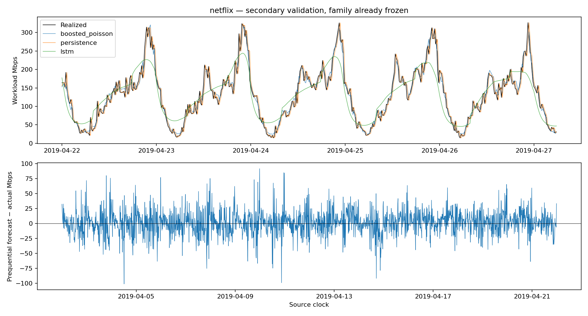
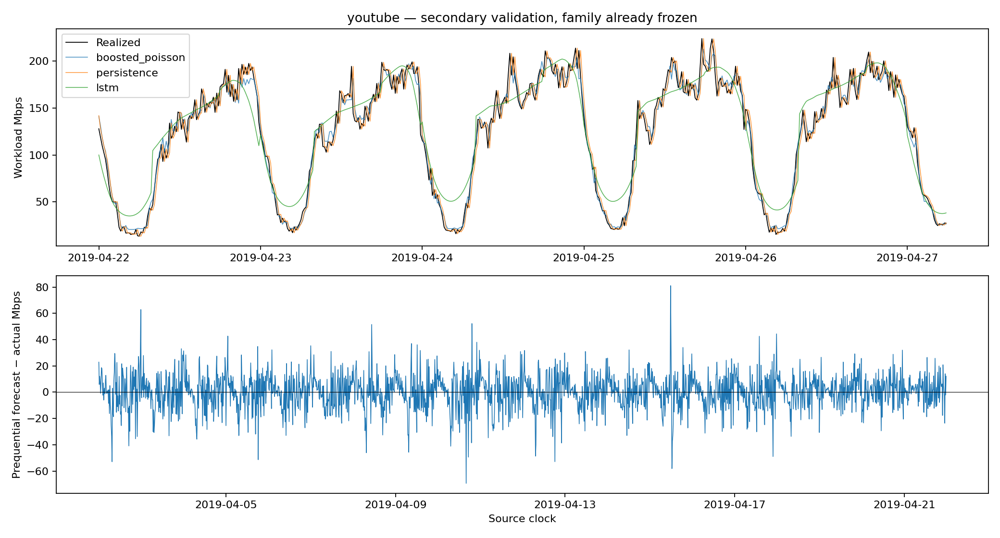

# Final forecasting validation — COMCOM-D-26-01061

**Recommendation:** use separately fitted **Poisson gradient-boosted forecasters**
for Netflix and YouTube in the next explicitly authorized diagnostic campaign,
while retaining persistence as a mandatory comparator and declared cold start.
Both families were selected by training-only rolling backtests, then remained
unchanged through calibration and secondary validation. The large LSTM is not
supported as the forecasting default by this limited search. Forecast accuracy
alone does not establish PPO superiority, reliable physical QoS, or deployment
readiness.

Work date: **23 October 2026**. Branch `revision/comcom-clean-evaluation`, HEAD
`c0734715418d3f6d10785e5174aebb4bac24d0da`. All earlier artifacts/results are
preserved. No RL training, policy modification, controller/baseline replay,
digital-twin/reward change, final-test target evaluation, manuscript edit,
commit or push occurred. This task trains **forecast models only**.

## 1. Forecast target, units, information and audit

At the start of interval t, predict its offered load from the **96 completed
intervals t−96…t−1**. This is one 15-minute interval ahead of the last completed
sample, not an additional 15-minute delay after the decision. `forecast_timestamp`
and `target_timestamp` both label interval start t; `observed_through` labels
t−1. Decision-time calendar features are known; realized t load is scored later.
The source clock is timezone-naive and is not relabeled UTC or Europe/Rome.

Only the raw processed `Traffic_bps` column is read, divided by 10^6 and multiplied
by the already approved common Netflix-training workload factor
**0.19358590710547752**. Netflix's training peak is 400 Mbps; YouTube's is
295.395417 Mbps. These are study load-scaled Mbps, not a new certification of
NetMob's original physical units or a runtime cap. Archived forecasts and scaled
columns are ignored. There is no trimming beyond the common 96-slot context,
no sorting/resampling, backward fill or forecast clipping.

The common multiplier is the predeclared **offline workload design**, retained to
keep the controller problem unchanged. It is distinct from forecasting input
normalization. Every learned forecast input scaler is fitted to its own available
past prefix; no validation/final-test observation fits it. Each full model uses
its workload's training data; YouTube is not normalized to a new 400-Mbps peak.
The parser stops at row 2520 and never converts subsequent final-test targets.
Authorized-prefix fingerprints and exact sources are in each workload's
`data_manifest.json`.

The [Stage 4 audit](reports/forecast_service/stage4_forecasting_audit.json)
confirms correct corrected-pipeline target alignment and reconstructs its saved
calendar-LSTM validation predictions to **5.68×10⁻14 Mbps**, consistent with CSV
round-trip precision. No additional input/target rescaling or index defect was
demonstrated in that path. Historical full-series scaler fitting and validation
reuse remain separate known methodological problems; this does not exonerate
the historical predictor.

The original calendar LSTM has **123,265 parameters**. Its first prefix at row 192
used **76 gradient targets**, a 20-target stopping suffix, and selected **epoch 1**.
Across its next 416 forecasts, actual mean was 137.137627 Mbps, prediction mean
226.520473 Mbps, RMSE 117.740903 and bias +89.382847. Only 4/416 targets exceeded
that prefix's fitted scale, so scale extrapolation alone does not explain the
widespread optimism. Later prefixes excluded 103, 186, 269 and 352 recently observed
rows from gradient updates while using them for stopping. Parameter fitting was
causal, but tiny samples, large capacity, stopping instability, lack of full-prefix
refitting and changing traffic distributions are supported contributors. They
are not isolated causal effect estimates. The Stage 4 choice of forecasting
family itself used external validation, unlike this task.

## 2. Prespecified training-only protocol

[Protocol](forecast_service/protocol.json) and
[pre-fit commitment](reports/forecast_service/protocol_frozen.json) were frozen
before candidate outcomes. Source hashes pin the Stage 4 report/code, Stage 5
baseline comparison, submitted manuscript and uploaded SLICES paper. No search
was expanded in response to results.

Both workloads retain train rows 0–2015 and secondary-validation rows 2016–2519;
the final 840 rows2520–3359 remain untouched. YouTube-specific forecast fitting
is newly authorized here; it does not silently amend the earlier transfer-only
controller experiment.

| Purpose | Forecast targets, half-open | Issuing parameter/history cutoff |
|---|---|---|
| Common context warmup | 0–96 | No scored decisions |
| Minimum-history cold start | 96–672 | Persistence; no learned model |
| Development fold1 | 672–1008 | Prefix ending672 |
| Development fold2 | 1008–1344 | Prefix ending1008 |
| Development fold3 | 1344–1680 | Prefix ending1344 |
| Separate training calibration | 1680–2016 | Prefix ending1680; family already frozen |
| Secondary validation | 2016–2520 | Full training prefix ending2016 |

Seven days (672 samples) is a declared practical minimum for learned fitting,
compared with the old two-day first prefix. It is **not** proven sufficient for
every model or weekly effect. Development has 1008 targets, calibration 336 and
secondary validation 504. Fold boundaries are clock-contiguous and identical
across candidates. Validation is exposed development evidence, never a newly
blind selection set; model/family/margin selection does not use it.

Five fixed families use the same causally available information:

- Persistence uses the last completed load; daily persistence uses lag 96.
- LSTM retains Stage 4's SpatialDropout(.1), LSTM 128→64 with dropout(.2),
  Dense 64 ReLU/dropout(.2), softplus, 96-step input and six known calendar fields.
- GRU uses 32 units, Dense 16 ReLU and softplus with the same history/calendar.
- Histogram gradient boosting uses Poisson loss,100 iterations, depth 3,
  at most 7 leaves, learning rate .05, minimum 20 leaf samples and L2=1.
  Its features are 96 lags, six calendar fields and deterministic means/increment
  from that same history. It receives no extra future information.

Neural runs fix seed 42, Adam .001, batch 128, maximum 60 epochs, patience 10 and
scaled-MSE improvement1e−6. The last 96 targets **within each available prefix**
choose an epoch using a scaler fitted only before that stopping suffix. A fresh
same-seed initialization then learns **all** available prefix targets for that
many epochs with a newly past-prefix-fitted scaler. No subsequent forecast block
chooses epochs. Boosting has no random early-stopping split. Softplus or Poisson's
exponential inverse link supplies nonnegative outputs by construction; failures
would raise errors rather than be repaired.

The family minimizes pooled three-fold development RMSE; exact ties favor the
simpler reference order fixed in the protocol. Both selections were written at
cutoff 1680 **before calibration**. No practical-equivalence margin was invented
and no claim follows from tiny numerical rank differences alone. All candidates
were retained. Full-prefix learned fits provide prespecified secondary diagnostics;
they do not change the already frozen family.

There are **30 learned artifacts**: 20 neural models with 40 inner/refit optimization
stages and 10 boosted models. Neural training used **1387 of 2400 permitted epochs**.
Every fit completed; no scientific retry or extra candidate fit occurred. The
per-workload `fit_ledger.jsonl` and histories preserve the full budget.

## 3. Candidate prediction quality

All errors/bias are study Mbps; bias is prediction−actual. D = training-only rolling
development (N=1008), C=reserved training calibration (N=336), V=secondary exposed
validation (N=504). C/V outcomes do not alter family selection.

| Workload | Family | Role | MAE | RMSE | R² | Bias |
|---|---|---|---:|---:|---:|---:|
| netflix | persistence | D | 15.713093 | 21.807952 | 0.917075 | +0.080188 |
| netflix | seasonal_daily | D | 27.931253 | 40.178767 | 0.718519 | +4.284252 |
| netflix | lstm | D | 30.052275 | 38.823245 | 0.737191 | +13.871708 |
| netflix | gru | D | 22.247202 | 29.361834 | 0.849678 | +6.910976 |
| netflix | boosted_poisson | D | 14.877297 | 19.919238 | 0.930817 | +1.993120 |
| netflix | persistence | C | 15.035356 | 20.302265 | 0.882573 | -0.178389 |
| netflix | seasonal_daily | C | 26.532119 | 35.276888 | 0.645466 | +0.563705 |
| netflix | lstm | C | 29.098678 | 39.082219 | 0.564853 | +15.044318 |
| netflix | gru | C | 19.142214 | 23.983138 | 0.836134 | +14.549572 |
| netflix | boosted_poisson | C | 14.268831 | 18.547246 | 0.901998 | +2.798195 |
| netflix | persistence | V | 15.274211 | 20.810623 | 0.921402 | +0.247486 |
| netflix | seasonal_daily | V | 19.712853 | 25.864689 | 0.878589 | -2.226399 |
| netflix | lstm | V | 28.313114 | 36.190504 | 0.762299 | -2.741327 |
| netflix | gru | V | 13.709879 | 17.907721 | 0.941800 | -2.209528 |
| netflix | boosted_poisson | V | 12.659981 | 16.848565 | 0.948481 | +0.431087 |
| youtube | persistence | D | 10.762815 | 14.303813 | 0.951643 | +0.020210 |
| youtube | seasonal_daily | D | 21.356674 | 33.222768 | 0.739130 | +1.139397 |
| youtube | lstm | D | 21.833032 | 29.280468 | 0.797368 | +7.745114 |
| youtube | gru | D | 16.626413 | 24.722852 | 0.855539 | +6.818213 |
| youtube | boosted_poisson | D | 10.159852 | 14.191888 | 0.952397 | +1.797105 |
| youtube | persistence | C | 8.812118 | 11.300883 | 0.952093 | -0.025988 |
| youtube | seasonal_daily | C | 15.786815 | 20.408972 | 0.843751 | +4.804881 |
| youtube | lstm | C | 19.495995 | 24.236792 | 0.779644 | +14.122598 |
| youtube | gru | C | 13.205743 | 16.761840 | 0.894606 | +6.971908 |
| youtube | boosted_poisson | C | 8.353154 | 10.545565 | 0.958283 | +1.474561 |
| youtube | persistence | V | 10.172133 | 13.068220 | 0.953875 | +0.226863 |
| youtube | seasonal_daily | V | 13.439437 | 17.796632 | 0.914459 | -3.837024 |
| youtube | lstm | V | 15.681078 | 19.098755 | 0.901483 | +5.204207 |
| youtube | gru | V | 10.735204 | 13.786501 | 0.948666 | +1.889982 |
| youtube | boosted_poisson | V | 8.331513 | 10.895034 | 0.967940 | +0.245832 |

Netflix boosting improves pooled development RMSE by **8.66%** over persistence,
winning 3/3 development blocks; its calibration and secondary-validation reductions
are 8.64% and19.04%. YouTube's development gain is only **.78%**, with 2/3 block
wins and a worse first block (17.225832 versus15.449207 Mbps). Its later calibration
and validation gains are 6.68% and16.63%. Those checks support the frozen choices
but do not make the narrow YouTube development difference statistically decisive.
No independent-campaign confidence interval or universal architecture ranking is
claimed from three correlated blocks, one seed and one city/period.

The new full-prefix LSTMs selected only 3 Netflix epochs and 2 YouTube epochs under
the fixed past-only stopping rule. Their weak results are retained, not rescued
by another stopping/search budget. Thus a larger minimum prefix alone does not
make this architecture reliable. GRU is smaller and useful but did not win the
training-only criterion; no validation-based switch to it was made.

### Original LSTM comparison — descriptive only

| Reference | Workload evaluated | Validation MAE | RMSE | R² | Bias |
|---|---|---:|---:|---:|---:|
| Saved Stage 4 Netflix LSTM | netflix | 20.506871 | 25.690384 | 0.880220 | +7.062608 |
| Saved Stage 4 Netflix LSTM | youtube | 26.871425 | 34.275895 | 0.682694 | +10.989491 |

The Netflix reference was selected using that same validation interval; the YouTube
row is **transfer of that Netflix-trained model**, not a recovered YouTube-specific
historical fit. Neither selected these new providers. The new LSTM candidates
retain its hidden architecture but use the revised training-only procedure;
they are separate identities, not renamed historical weights. The submitted
19.12-Mbps result belongs to another historical predictor/version and is not
presented as this protocol's held-out result.

## 4. Causal training forecasts and reliability limits

An eventual winning family is **not backfilled into earlier RL observations**.
At each origin, the issuing provider minimizes errors on already completed earlier
development blocks only. Persistence supplies the 576 minimum-history decisions
and the first 336 comparative decisions. Each forecast row records fit and family-
selection cutoffs <= its target index, plus provider identity and issuance history.

Netflix ultimately uses 912 persistence and 1008 boosted forecasts; YouTube uses
1584 persistence and336 boosted forecasts. Thus 30% of the common training horizon
is minimum-history cold start; actual persistence occupancy is 47.5%/82.5% after
also accounting for unavailable or unfavorable comparative evidence. This is an
explicit changing provider, not a claim that every training row comes from the
final boosted model. It preserves **all 1920 original training decisions** and
all 504 validation decisions without hiding warmup losses.

| Workload / scope | N | MAE | RMSE | R² | Bias |
|---|---:|---:|---:|---:|---:|
| netflix: Prequential training service | 1920 | 15.426802 | 20.794659 | 0.923229 | +1.534700 |
| netflix: Persistence, same training horizon | 1920 | 15.943239 | 21.795658 | 0.915660 | +0.030644 |
| netflix: Final boosted model in-sample — descriptive | 1920 | 12.250528 | 16.508538 | 0.951615 | +0.009444 |
| youtube: Prequential training service | 1920 | 10.404699 | 13.661971 | 0.954682 | +0.264530 |
| youtube: Persistence, same training horizon | 1920 | 10.485017 | 13.767248 | 0.953981 | +0.001934 |
| youtube: Final boosted model in-sample — descriptive | 1920 | 7.812197 | 10.578507 | 0.972830 | +0.008042 |

Netflix's old training-prefix ledger RMSE was 66.333705 Mbps; the new causal service
is 20.794659. The comparison changes minimum history, fallback share, models and
stopping/refitting, so it does not isolate a single improvement mechanism.
YouTube's all-training gain is small because most issued forecasts remain
persistence. Final-model in-sample error is **not** an estimate of causal RL
training performance.

All candidate metrics by load, day and rise/fall are in
[reliability strata](reports/forecast_service/reliability_by_stratum.csv).
The selected provider's validation behavior illustrates the remaining lag:

| Workload / realized direction | N | MAE | RMSE | Bias |
|---|---:|---:|---:|---:|
| netflix: rising | 232 | 13.188074 | 18.114844 | -11.491093 |
| netflix: falling | 272 | 12.209549 | 15.687942 | +10.600005 |
| youtube: rising | 240 | 8.667846 | 11.523881 | -7.090601 |
| youtube: falling | 264 | 8.025756 | 10.290061 | +6.915317 |

Realized direction is used **only for post-hoc error analysis**, never as an
unavailable input. Rising periods remain underpredicted, falling periods
optimistic. Selected-model validation RMSE by actual-load bands0–50,50–100,
100–200,200–400 Mbps is 7.979/13.368/16.632/25.995 for Netflix and
5.045/9.578/11.853/19.126 for YouTube. YouTube calibration contains only 3 rows
above 200 Mbps; it cannot establish reliable peak behavior.

Near the frozen Stage 5 profiling boundaries, ±10 Mbps is a declared diagnostic
band, **not a tuned margin**. Crossing disagreement compares forecast with realized
load; it is not a replayed action or a QoS false-safe count.

| Workload | Boundary Mbps | Calibration disagreements /336 | Validation disagreements /504 | Validation near-band N | Near-band MAE |
|---|---:|---:|---:|---:|---:|
| netflix | 15.781867 | 1/336 | 3/504 | 26 | 7.144159 |
| netflix | 87.370037 | 15/336 | 34/504 | 41 | 8.697094 |
| netflix | 89.111956 | 16/336 | 27/504 | 43 | 9.302326 |
| youtube | 15.781867 | 0/336 | 4/504 | 58 | 3.760765 |
| youtube | 87.370037 | 7/336 | 7/504 | 20 | 10.001338 |
| youtube | 89.111956 | 7/336 | 7/504 | 21 | 10.441182 |

[Full boundary analysis](reports/forecast_service/decision_boundary_errors.csv)
retains over/under directions and all five candidates. The strong rule has
state-dependent feasibility/power boundaries, so these fixed utility crossings
are diagnostic anchors, not its complete transition surface. No twin outcome or
controller energy was computed in this task.

## 5. Compute and reproducible service interface

| Workload | Family | Full-prefix fit seconds | Warm single-call median / p95 ms |
|---|---|---:|---:|
| netflix | persistence | 0.000 | 0.050 / 0.057 |
| netflix | seasonal_daily | 0.000 | 0.049 / 0.057 |
| netflix | lstm | 37.758 | 216.340 / 230.609 |
| netflix | gru | 44.092 | 146.884 / 149.014 |
| netflix | boosted_poisson | 0.180 | 0.633 / 0.679 |
| youtube | persistence | 0.000 | 0.051 / 0.058 |
| youtube | seasonal_daily | 0.000 | 0.050 / 0.058 |
| youtube | lstm | 33.396 | 218.584 / 219.478 |
| youtube | gru | 25.580 | 149.313 / 153.442 |
| youtube | boosted_poisson | 0.174 | 0.719 / 0.772 |

Total measured fit time is429.78s Netflix and412.20s YouTube (workers ran
concurrently). These include the fixed comparison budget; final boosting fits
are below .2s each. Timings use pinned deterministic CPU execution, 40 warm calls
after 3 warmups, and include window checks/features. Eager Keras, not a compiled
serving optimization, is measured. They are local measurements, not inherent
architecture speed limits or an NWDAF deployment/network-latency benchmark.

[Service API and commands](forecast_service/README.md) load either workload through
`load_service(workload).predict(context)`, returning the existing `Forecast`
structure. The controller's observation dimensions and forecast meaning do not
change with architecture. Full-prefix providers refuse retrospective training
issuance; RL training must consume the prequential ledger. No HTTP/NWDAF standards
binding is implemented or claimed; these artifacts are an external-provider
interface suitable for later integration.

Selected services: [Netflix](reports/forecast_service/netflix/service.json) and
[YouTube](reports/forecast_service/youtube/service.json). The referenced manifests
pin weights/joblib bytes, prefix scalers/rows, code/config/dependency versions,
seed, stopping/refit history and training cutoffs. All five families' ordered
validation predictions reload **exactly** under the frozen runtime. Same-call
API inference is deterministic; bitwise equivalence across batch sizes/hardware
is not promised. Nonfinite/negative outputs and corrupted identities raise errors.

## 6. SLICES hysteresis recalibration — specification only

The [supplied SLICES paper](reference/Dynamic_UPF_Cyprus_2025_SLICES.pdf) explicitly uses `margin=k×MAE_in_sample`, reports 26 Mbps
and a 24.70-Mbps training MAE. Their approximate ratio 1.05263 is **not an
authenticated exact historical k**. We do not automatically reuse 26 or infer
that it remains appropriate for a changed predictor.

The pre-fit protocol declares **k=1**, without tuning to controller results.
The proposed new specification is **margin=k×selected-family OOF MAE on the
separate 1680–2016 training-calibration block**. Replacing in-sample error by OOF
error is an explicit methodological correction for optimism, not a claim that
the paper originally used it. The literal final-model in-sample alternative is
reported separately:

| Workload | Proposed OOF-MAE margin Mbps | Literal in-sample MAE Mbps | Calibration fraction with absolute error ≤ proposed margin |
|---|---:|---:|---:|
| netflix | 14.268831 | 12.250528 | 61.61% |
| youtube | 8.353154 | 7.812197 | 58.33% |

MAE is not a 95% uncertainty bound. Calibration p95 absolute errors are 37.754987
and 21.082787 Mbps, with maxima 65.522539 and 32.030787. No unique optimal k follows from forecast scores alone: k=1 expresses one mean
absolute error in load units, while acceptable control reactivity remains a later
declared design decision. A symmetric MAE band neither
removes systematic directional bias nor guarantees stable/safe decisions. Only
one 3.5-day same-period calibration block is available, and full-prefix refitting
can change residuals. A claim of a desired coverage probability would require a
separate declared calibration method and evidence; none is invented here.

Future recalibration must create a **new SLICES-based baseline identity**, pin
this provider/workload/margin, apply the explicitly defined multi-region overlap
rule and common actuator, and regenerate the comparison only when authorized.
All frozen Stage 5 baselines, their26-Mbps primary margin, thresholds and outcomes
remain byte-for-byte unchanged. No geometric/energy parameter was optimized to
make PPO win. Strong-rule and historical-rule logic should retain their definitions
and receive the same newly frozen forecast stream; do not silently add a traffic
margin to the historical direct ranker.

## 7. Explicit answers and next-stage boundary

1. **Which architecture?** Use the two frozen workload-specific Poisson boosted
   models as the next experimental forecasting providers. They win the fixed
   training-only criterion, remain nonnegative, cost little to fit/serve and
   outperform these neural candidates. Persistence remains a mandatory simpler
   reference and cold start. The small YouTube development difference and limited
   time coverage preclude universal or statistically established superiority.
2. **Does it beat persistence on training-only backtests?** Yes: 19.919238 versus
   21.807952 RMSE for Netflix and 14.191888 versus 14.303813 for YouTube over 1008
   development targets. Wins are 3/3 and 2/3 blocks, respectively; both also win the
   separate training calibration block. No favorable controller outcome selected it.
3. **Are training forecasts reliable and causal?** The ledger is causally valid,
   deterministic and materially improves Netflix's previous unstable prefix path.
   It is sufficient for an explicitly scoped exploratory modeling experiment,
   not a forecast-error or QoS guarantee. Seven days is a practical minimum,
   cold-start/persistence shares are large, and directional/peak errors remain.
   No new RL training is authorized by this report itself.
4. **Workload specificity?** Fit preprocessing/weights only on each workload's
   historical training prefix, retain common units/splits/API and freeze services
   separately. A Netflix-trained policy later paired with a YouTube-trained
   forecaster is **policy transfer with target-specific analytics**, not an unseen
   end-to-end zero-training pipeline. That changed transfer condition must be
   named explicitly; original transfer evidence is preserved separately.
5. **What margin follows?** Propose fixed k=1 training-calibration MAE margins
   14.268831/8.353154 Mbps, with the limitations above. These are a frozen proposal,
   not executed baseline changes, a risk tolerance, or a reuse of historical26.
6. **What is required for fair retraining/comparison?** Freeze this service protocol,
   temporal provider choices and cold-start strategy first. A future authorized
   campaign must retrain PPO/RecurrentPPO from scratch on the same new prequential
   forecasts, preserve paired normalizers/proper recurrent state/RNG isolation,
   use equal seed/budget/selection rules, and give all three baselines identical
   new forecast streams. Preserve old A and separately label recalibrated A; keep
   B/C decision objectives and the twin/reward fixed unless separately changed.
   Match action availability in any learning-attribution ablation. Old policies
   trained on different forecasts cannot provide a clean new training comparison.
   Freeze endpoints/statistics and transfer definitions before separately
   authorizing final testing; use validation only with its repeated reuse disclosed.

More accurate forecasts may also improve non-learning rules. No inference about
PPO's small Stage 5 advantage follows from forecast RMSE, and no controller was
replayed. The final test is still needed after all model/control decisions freeze.
The limited single-city/period traces, uncertain raw-unit lineage and all frozen
twin power/QoS/multi-instance limitations survive this forecasting improvement.

## 8. Tests, preservation and artifacts

**81 tests passed**: 15 new forecasting checks and 66 existing data/split/selection/
contract checks. No test performs RL training or scientific controller replay.
Coverage includes target/future poisoning,96-slot indexing, same known-calendar
features as Stage 4, disjoint roles, training-only scalers/epoch selection,
chronological provider choice without backfilling, all model/ledger reloads,
artifact tampering, bounded-domain input checks, nonnegative idle-history outputs,
common forecast schema and a poisoned final-test sentinel proving the prefix
reader never parses those targets. [Final log](reports/forecast_service/final_tests.log).
The initial preflight was 7 passed/2 pending output checks; all 15 new checks are
included at completion. No scientific fit failed or was retried.

New code/config/API/README are under `revision/forecast_service/`; tests are in
`revision/tests/test_forecast_service.py`; model/scaler/manifests/histories under
`revision/models/forecast_service/{netflix,youtube}/`; chronological candidate,
training and validation ledgers, all metrics/strata/latencies, original-LSTM audit,
margin proposals and PNG/PDF plots under `revision/reports/forecast_service/`.
The [freeze manifest](reports/forecast_service/forecast_freeze_manifest.json)
lists every new file and its hash. The
[integrity record](reports/forecast_service/integrity.json) verifies all **2063**
pre-task scientific files unchanged, earlier source identities and Git branch/HEAD.
No prior file, source dataset, model, baseline, manuscript or Git reference was
modified. The existing Stage 4/5 packages remain authoritative for their old runs.

**Stopped after forecasting validation.** No subsequent controller campaign starts
automatically.
