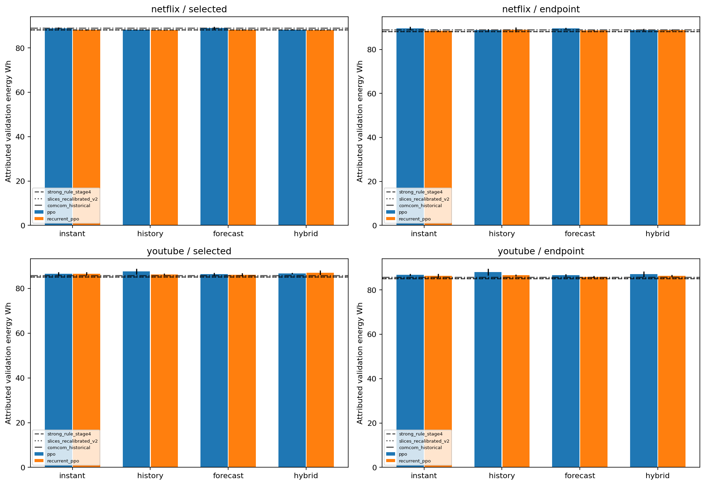
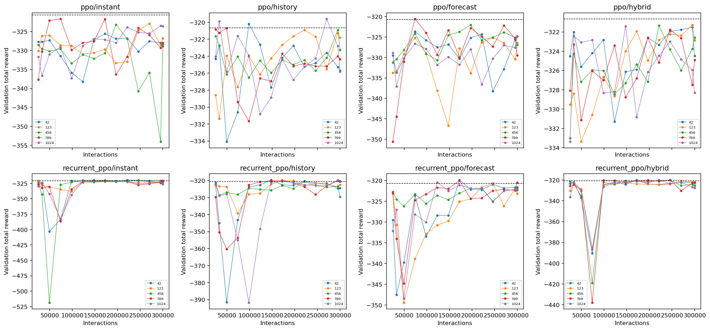
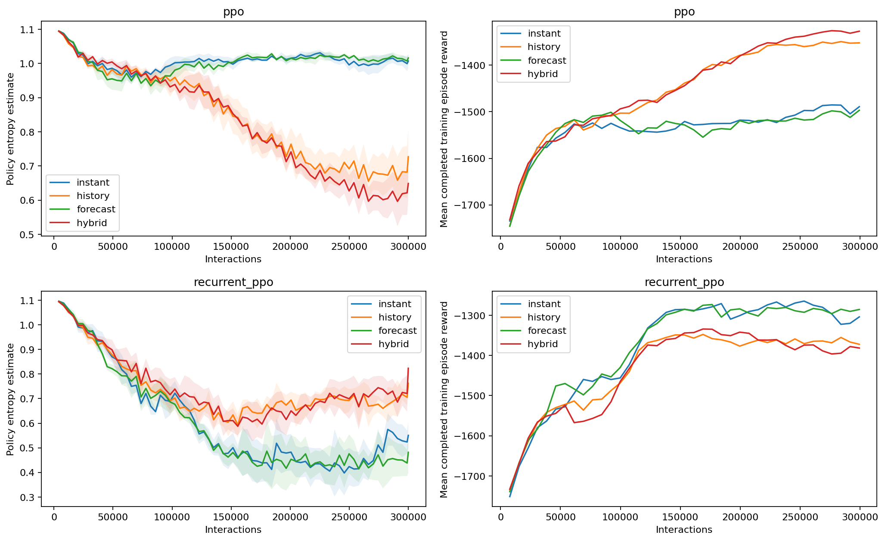

# Final observation-schema ablation — COMCOM-D-26-01061

**Stage 7 complete, with a disclosed preflight data-access exception (§9).**
Improved external forecasting **did not lower selected mean Netflix energy when
added to history for either PPO family**. Recurrent PPO+history has the lowest
Netflix selected mean; PPO+history provides the cheaper primary comparator.
No primary paired contrast is significant after the prespecified adjustment.
On YouTube, every selected learned policy uses more energy than the strong rule.
These are reused-validation, frozen-twin results, not final generalization or
physical QoS evidence. No model/configuration is automatically promoted.

Work date: 23 October 2026. Branch `revision/comcom-clean-evaluation`; HEAD
`c0734715418d3f6d10785e5174aebb4bac24d0da`. All 40 scientific fits completed without
failure/retry: **12000000 interactions, exactly 300000/run**, across 2 algorithms,
4 schemas and 5 seeds. All 560 checkpoint/normalizer pairs, optimizer/episode logs,
selected models and exact endpoints are preserved. Forecasts, twin, reward and
historical artifacts were not changed. No manuscript edit, commit or push occurred.
No final-test performance was evaluated or used for selection. The literal
no-target-access restriction was breached by a legacy preflight reader; that
exception is described explicitly below rather than hidden by the prefix-only
scientific pipeline.

## 1. Observation and timing audit

The submitted §§4.3/6/7.6 describe instantaneous, history-augmented,
forecast-augmented and hybrid schemas. Historical `src/environment.py` replaces
rather than consistently augments some base fields and uses current-interval
load/next-index forecasts. The approved corrected start-of-interval convention
requires **completed** telemetry: at t, use load[t−1], outcome[t−1] and a forecast
for t, then choose/guard/execute the action before scoring actual load[t].
No schema receives realized target-interval load or QoS before choosing its action.

| Schema | Common features | Traffic context added | Dimension |
|---|---:|---|---:|
|instant|13|None|13|
|history|13|96 completed loads, t−96…t−1|109|
|forecast|13|One forecast targeting t, H=1|14|
|hybrid|13|Both the 96 completed loads and forecast|110|

Common features, **in this exact order**, are `completed_load`, `previous_qos`,
`previous_power`, `previous_sec`, `previous_valid`, `configuration_dpdk`,
`configuration_usr1`, `configuration_usr2`, `cooldown`, `time_sin`, `time_cos`,
`weekday_sin`, `weekday_cos`. Load/history/forecast divide by 400; previous power
is attributed W, SEC is J/Mbit, cooldown is elapsed_slots/4. At reset previous
outcome fields are 0 with valid mask 0, configuration is eligible DPDK. The four
calendar coordinates use the known decision timestamp and are common even to
instantaneous control.

History appends `completed_history_0`…`completed_history_95`, oldest first;
forecast appends `causal_target_forecast` last. The most recent history value
intentionally duplicates common completed load. [Exact definition](stage7/OBSERVATION_SPEC.md)
and [machine-readable order](reports/stage7/prepared.json) specify every field.
Forecast-only means **common telemetry plus forecast**, not replacement of load.

The manuscript specifies a96-sample forecast input and symbolic policy W. This
stage explicitly implements the user's W=96 policy history. Stage 4 actually used
95 history values and109 hybrid inputs; its109-dimensional hybrid cannot be
silently loaded as Stage 7's109-dimensional history. Protocol/schema/feature
identities are checked when loading every bundle. Stage 4 comparisons also change
forecast selection/cold starts, so they cannot isolate forecast-quality effects.
Within Stage 7, all four schemas preserve the same common information and horizons;
parameter counts change with input dimension and are reported.

## 2. Frozen experiment and forecasting provenance

[Protocol](stage7/protocol.json) and [pre-fit freeze](reports/stage7/protocol_frozen.json)
prespecified all 40 jobs and five primary energy contrasts. Each algorithm/schema
uses seeds 42,123,456,789,1024, four collectors, n_steps=1024, batch=64, ten optimizer
epochs, lr=.0001, gamma=.995, GAE=.90, entropy=.15, clip=.20 and target-KL=.03.
Recurrent PPO uses shared LSTM128 without a separate critic LSTM. Default PPO
value/gradient settings remain unchanged. Interactions are matched; parameter
counts, recurrent sequence work and early-KL stopping need not match CPU work.

The unchanged exact-budget implementation uses a final 248-step rollout/collector
(992 interactions), trains the tail normally and stops at 300000. Fourteen paired
post-update checkpoints include every 24576 interactions,32768 and300000.
Checkpoint selection maximizes **Netflix validation total reward**, with earlier
step breaking ties. Observation normalization is trained only on Netflix and saved
with each checkpoint; validation/transfer moments remain frozen and rewards
unnormalized. Recurrence persists through 504 decisions and resets only per episode.
Exception-safe checkpoint capture restores Python, NumPy and CPU Torch RNG states.

Each training episode scores 1920 intervals after the common 96-slot context. All
controllers score the identical 504 Netflix validation timestamps, 22 April 2019
00:00–27 April05:45 (126 hours), and the corresponding 504 YouTube timestamps.
Both source readers stop at 2520 and validate Stage 6 authorized-prefix fingerprints.
YouTube policy scoring is gated until **all 40 Netflix selections are frozen**;
none of its outcomes chooses a checkpoint. Its existing validation role is now
explicitly authorized for policy transfer in this new adapter; the older generic
final-report-only transfer gate remains unchanged. Shared `observe`, `actuate`
and `account` semantics are reused, with Netflix equivalence tested.

No forecasting model was fitted. Netflix training consumes the exact frozen causal
prequential ledger: **912 persistence rows (47.5%) and 1008 boosting rows**. Of
these, 576 are minimum-history cold start and 336 the first comparative block;
there is no retrospective winner backfilling. Each validation workload uses its
own frozen full-prefix Poisson boosting service. YouTube-specific external
analytics is not required to transfer from Netflix. Policy transfer therefore
means **Netflix policy/normalizer with target-workload forecasting**, not an
unseen end-to-end zero-training pipeline.

The twin identity remains
`80866f0adf81c3f144190fe49d8cf74e2d5eefe95c90b63a2924fb8da67c465e`.
The exact scalar-inference cache is an optimization, checked against the frozen
twin and pinned before training, not a new fitted outcome model. Actions remain
DPDK/USR1/USR2, initial eligible DPDK, changes at t permit another at t+4 and
blocked commands are discarded. Reward remains −100×SEC −30×score shortfall
−.030 switch-to-DPDK −.012 per USR launch −.003 within-USR scale-down.

## 3. Primary Netflix and transfer comparisons

Energy is process-attributed Wh = sum(P_W×.25h); mean slot SEC is J/Mbit.
Aggregate SEC is separately retained in every seed's full metrics. Dispersion is
sample SD across five training seeds, conditional on one fixed workload/twin.
All eight cells and unfavorable results are reported.

| Workload | Algorithm/schema | Selected energy mean±SD Wh | 300k endpoint mean±SD Wh | Mean SEC | Selected reward mean±SD | Energy wins vs strong rule |
|---|---|---:|---:|---:|---:|---:|
| netflix | ppo_instant | 88.877855 ± 0.371655 | 89.618243 ± 0.720848 | 0.00640947 | -323.365481 ± 1.416631 | 0/5 |
| netflix | ppo_history | 88.193191 ± 0.177649 | 88.827190 ± 0.396239 | 0.00635179 | -320.453178 ± 0.561036 | 3/5 |
| netflix | ppo_forecast | 89.005739 ± 0.578091 | 89.557390 ± 0.332687 | 0.00640560 | -323.225728 ± 1.921720 | 0/5 |
| netflix | ppo_hybrid | 88.303945 ± 0.191569 | 88.883605 ± 0.536337 | 0.00637020 | -321.466828 ± 0.191457 | 1/5 |
| netflix | recurrent_ppo_instant | 88.171001 ± 0.217464 | 88.514295 ± 0.282584 | 0.00635224 | -320.458985 ± 0.920911 | 3/5 |
| netflix | recurrent_ppo_history | 88.019672 ± 0.045100 | 88.960783 ± 1.091705 | 0.00634185 | -319.925988 ± 0.354422 | 5/5 |
| netflix | recurrent_ppo_forecast | 88.242386 ± 0.323306 | 88.595880 ± 0.281219 | 0.00635395 | -320.549844 ± 0.793606 | 3/5 |
| netflix | recurrent_ppo_hybrid | 88.086207 ± 0.116988 | 88.801661 ± 0.256796 | 0.00634630 | -320.172314 ± 0.386399 | 4/5 |
| youtube | ppo_instant | 86.563479 ± 0.697659 | 86.823780 ± 0.467542 | 0.00634710 | -320.224635 ± 2.041747 | 0/5 |
| youtube | ppo_history | 87.576235 ± 1.245820 | 88.075783 ± 1.508515 | 0.00639459 | -322.628127 ± 3.356736 | 0/5 |
| youtube | ppo_forecast | 86.339879 ± 0.614642 | 86.636313 ± 0.491014 | 0.00633786 | -319.780154 ± 2.565995 | 0/5 |
| youtube | ppo_hybrid | 86.681175 ± 0.289108 | 87.119385 ± 1.291584 | 0.00636733 | -321.253997 ± 1.169510 | 0/5 |
| youtube | recurrent_ppo_instant | 86.545713 ± 0.737488 | 86.321909 ± 0.913614 | 0.00633985 | -319.830755 ± 2.389015 | 0/5 |
| youtube | recurrent_ppo_history | 86.327425 ± 0.428599 | 86.627793 ± 0.412888 | 0.00632266 | -318.962833 ± 1.332122 | 0/5 |
| youtube | recurrent_ppo_forecast | 86.151247 ± 0.717986 | 85.923613 ± 0.453894 | 0.00631519 | -318.588655 ± 2.343180 | 0/5 |
| youtube | recurrent_ppo_hybrid | 87.052841 ± 0.962422 | 86.304110 ± 0.525202 | 0.00636358 | -321.074455 ± 2.342223 | 0/5 |

Adding forecasts to history raises Netflix selected mean energy by **.110753 Wh
for PPO** and **.066535 Wh for Recurrent PPO**; only2/5 seed blocks improve in
each case. At the raw300k endpoints the corresponding mean effects are+.056415
and−.159123 Wh, respectively: endpoint behavior is mixed, not an unqualified
forecast benefit. Forecast-only versus instantaneous also raises selected means
by .127883/.071385 Wh. Better forecasting accuracy does not automatically yield
better policy optimization or decisions under this budget.

With improved forecasting, recurrence's selected mean energy advantage over PPO
is.217738 Wh in hybrid, versus.173519 Wh with history. The interaction is
−.044219 Wh, with wide uncertainty. **There is no evidence here that improved
forecasting removes the value of recurrence**, nor a noninferiority/equivalence
result proving it can be dropped. Common clocks/last telemetry already convey
predictive information; all forecast-containing schemas also have slightly
different input dimensions/parameter initializations. No mechanism is assigned
without a further controlled test.

On YouTube, adding forecasts improves PPO relative to its weaker history transfer
mean by.895060 Wh, while worsening recurrent history transfer by.725415 Wh.
Recurrent forecast-only has the lowest transfer mean among learned cells, but
**it is not selected/promoted on that basis**. Every selected learned seed uses
more energy than the strong rule. Accurate target-specific analytics therefore
does not establish policy-transfer superiority. Exact endpoints sometimes improve
transfer despite worse Netflix validation; both are retained without reselection.

### Prespecified paired analysis

Δ means left minus right; negative energy favors the left. Five independent seed
labels form prespecified blocks across conditions. Input/algorithm changes do
not produce identical RNG draws; the test assumes symmetric/exchangeable paired
differences. Intervals are descriptive95% Student-t intervals with n5, conditional
on a normal-difference approximation and this workload, not on surrogate accuracy,
traffic periods or physical campaigns. No practical equivalence margin exists.

Five primary selected-Netflix energy tests (four pairs plus interaction) use the
exact two-sided mean sign-flip procedure with Holm correction. With five blocks,
the theoretical minimum unadjusted two-sided p is .0625; lack of significance is
not evidence of equality. SEC/reward, endpoints, secondary pairs and transfer
contrasts are descriptive and are not additional confirmatory tests.

| Netflix contrast | Δ Wh | Descriptive95% interval | Left lower-energy seeds | Exact p | Holm p |
|---|---:|---|---:|---:|---:|
| ppo_hybrid minus ppo_history | +0.110753 | [-0.267041, +0.488548] | 2/5 | 0.4375 | 1.0000 |
| recurrent_ppo_hybrid minus recurrent_ppo_history | +0.066535 | [-0.098757, +0.231826] | 2/5 | 0.4375 | 1.0000 |
| recurrent_ppo_hybrid minus ppo_hybrid | -0.217738 | [-0.520560, +0.085085] | 4/5 | 0.1250 | 0.6250 |
| recurrent_ppo_history minus ppo_history | -0.173519 | [-0.366563, +0.019525] | 4/5 | 0.1250 | 0.6250 |
| forecast_by_recurrence_interaction | -0.044219 | [-0.498145, +0.409707] | 2/5 | 0.8125 | 1.0000 |

All primary intervals include 0; adjusted p≥.625. Negative/mixed results have the
same reporting status as favorable means. [All seed-block differences](reports/stage7/paired_seed_differences.csv)
and [SEC/reward/endpoint/transfer effects](reports/stage7/paired_effects.json)
retain every planned comparison. No slots or deterministic evaluation repeats
are treated as independent replicates.

## 4. Frozen baseline families

Four dynamic versions represent three families: original SLICES26, separately
versioned `slices_recalibrated_v2`, immutable Stage 4 strong rule and historical
COMCOM binary ranker. The three static actions are additional references.
SLICES utilities/regions and overlap-resolution are unchanged; v2 changes only
its margin to the exact Stage 6 training-calibration MAE:14.268830938789403 Mbps
Netflix and8.353153828365365 Mbps YouTube (k=1). No margin was optimized on PPO,
validation energy or transfer outcomes. The original 26-Mbps files/results remain
unchanged. B retains feasibility preference and 2% power deadband; C retains mixed
.3/.7 utility scales, binary availability and no active plotted 23-Mbps margin.
All execution/reward/event accounting is common; launch costs are not physical Wh.

| Workload | Baseline | Wh | Mean SEC | Min Q | Switches | Scale up/down | Blocked | D/USR1/USR2 slots | Reward | Reconfiguration penalty |
|---|---|---:|---:|---:|---:|---|---:|---|---:|---:|
| netflix | slices_extended_manual_26 | 89.341027 | 0.00647934 | 0.907887 | 11 | 0/0 | 0 | 331/0/173 | -326.852543 | 0.294 |
| netflix | slices_recalibrated_v2 | 88.199815 | 0.00636432 | 0.907887 | 11 | 0/0 | 0 | 348/0/156 | -321.055663 | 0.294 |
| netflix | strong_rule_stage4 | 88.163527 | 0.00635411 | 0.907887 | 15 | 0/0 | 7 | 334/0/170 | -320.649203 | 0.402 |
| netflix | comcom_historical | 88.986442 | 0.00651342 | 0.917614 | 19 | 0/0 | 17 | 346/158/0 | -328.666371 | 0.390 |
| netflix | static_0 | 103.264594 | 0.01029214 | 0.967396 | 0 | 0/0 | 0 | 504/0/0 | -518.724017 | 0.000 |
| netflix | static_1 | 145.257591 | 0.00879901 | 0.917614 | 1 | 0/0 | 0 | 0/504/0 | -443.482319 | 0.012 |
| netflix | static_2 | 149.924831 | 0.00886988 | 0.907887 | 1 | 0/0 | 0 | 0/0/504 | -447.065704 | 0.024 |
| youtube | slices_extended_manual_26 | 86.035795 | 0.00633925 | 0.906826 | 11 | 0/0 | 0 | 359/0/145 | -319.792308 | 0.294 |
| youtube | slices_recalibrated_v2 | 85.233755 | 0.00625469 | 0.906826 | 11 | 0/0 | 0 | 358/0/146 | -315.530420 | 0.294 |
| youtube | strong_rule_stage4 | 85.155469 | 0.00624602 | 0.906826 | 11 | 0/0 | 0 | 353/0/151 | -315.093166 | 0.294 |
| youtube | comcom_historical | 85.812688 | 0.00640914 | 0.916833 | 11 | 0/0 | 0 | 355/149/0 | -323.242478 | 0.222 |
| youtube | static_0 | 103.266538 | 0.01181452 | 0.967432 | 0 | 0/0 | 0 | 504/0/0 | -595.451940 | 0.000 |
| youtube | static_1 | 135.511312 | 0.00876961 | 0.916833 | 1 | 0/0 | 0 | 0/504/0 | -442.000395 | 0.012 |
| youtube | static_2 | 140.337860 | 0.00885297 | 0.906826 | 1 | 0/0 | 0 | 0/0/504 | -446.213871 | 0.024 |

New forecasts reduce unchanged SLICES26 Netflix energy from 90.382301 to 89.341027
Wh and strong-rule energy from 88.277182 to 88.163527 Wh; the historical binary
rule instead rises 88.957901→88.986442 Wh. These deterministic rules ignore the
changed history dimension, so their request/trajectory differences reflect the
new forecast stream. Better RMSE is not uniformly lower controller energy.
Recalibration further reduces A to 88.199815 Wh; it does not establish learning's
contribution. C still excludes USR2, so comparisons with it confound action access.

Only recurrent history/hybrid **selected family means** beat B on Netflix, by
.143855/.077320 Wh (about.163%/.088%). All eight raw 300k mean energies exceed B;
only 2/40 individual endpoints beat it. On YouTube, neither any selected seed nor
any endpoint beats B. The non-learning rule remains a required strong comparator,
not an obstacle to be tuned away.

## 5. All individual seed results

Selected step is chosen on Netflix once and applies to both workloads. SEC is
mean slot J/Mbit; Q is the minimum predicted composite score. SW is type changes,
SC is within-USR up/down, BK is blocked requests. All cases have zero predicted
shortfall slots, mean/max shortfall and QoS penalty; conditional severity is null,
not demonstrated zero physical risk. Full selected and endpoint metrics, including
mean Q, aggregate SEC, launches, penalties, occupancy and endpoint reward/events,
are in [comparison JSON](reports/stage7/comparison.json) and per-workload CSVs.

### netflix

| Algorithm/schema | Seed | Selected step | Selected Wh | Endpoint Wh | SEC | Min Q | SW | SC up/down | BK | Selected reward |
|---|---:|---:|---:|---:|---:|---:|---:|---|---:|---:|
| ppo/instant | 42 | 172032 | 89.428636 | 89.575725 | 0.00645320 | 0.907887 | 13 | 1/3 | 21 | -325.574456 |
| ppo/instant | 123 | 270336 | 88.851647 | 89.249894 | 0.00640001 | 0.907887 | 13 | 1/4 | 19 | -322.920745 |
| ppo/instant | 456 | 196608 | 88.815562 | 90.769665 | 0.00640705 | 0.907887 | 11 | 5/0 | 27 | -323.197203 |
| ppo/instant | 789 | 73728 | 88.384290 | 89.660893 | 0.00637630 | 0.907887 | 11 | 1/0 | 12 | -321.659715 |
| ppo/instant | 1024 | 294912 | 88.909141 | 88.835038 | 0.00641078 | 0.908026 | 13 | 2/4 | 36 | -323.475284 |
| ppo/history | 42 | 98304 | 88.142254 | 88.527561 | 0.00634682 | 0.907887 | 11 | 0/2 | 13 | -320.179858 |
| ppo/history | 123 | 221184 | 88.377892 | 88.410066 | 0.00635942 | 0.907887 | 15 | 0/0 | 13 | -320.916521 |
| ppo/history | 456 | 294912 | 88.367685 | 88.710293 | 0.00636091 | 0.907887 | 11 | 0/3 | 24 | -320.892900 |
| ppo/history | 789 | 49152 | 88.115116 | 89.283383 | 0.00635666 | 0.907887 | 11 | 1/2 | 15 | -320.675897 |
| ppo/history | 1024 | 270336 | 87.963010 | 89.204646 | 0.00633515 | 0.907887 | 11 | 2/1 | 11 | -319.600713 |
| ppo/forecast | 42 | 73728 | 89.116064 | 88.990924 | 0.00641435 | 0.907887 | 13 | 1/2 | 23 | -323.649085 |
| ppo/forecast | 123 | 245760 | 89.107326 | 89.625953 | 0.00644186 | 0.907887 | 13 | 13/13 | 83 | -325.152900 |
| ppo/forecast | 456 | 196608 | 88.869657 | 89.574665 | 0.00638314 | 0.907887 | 13 | 0/0 | 13 | -322.046123 |
| ppo/forecast | 789 | 73728 | 88.163811 | 89.823571 | 0.00635414 | 0.907887 | 11 | 0/0 | 10 | -320.542433 |
| ppo/forecast | 1024 | 300000 | 89.771835 | 89.771835 | 0.00643453 | 0.907887 | 17 | 0/2 | 38 | -324.738100 |
| ppo/hybrid | 42 | 294912 | 88.161267 | 88.733150 | 0.00637002 | 0.908026 | 13 | 11/9 | 61 | -321.532241 |
| ppo/hybrid | 123 | 294912 | 88.232569 | 88.486947 | 0.00636551 | 0.907887 | 15 | 8/5 | 39 | -321.286687 |
| ppo/hybrid | 456 | 221184 | 88.195717 | 88.335494 | 0.00636874 | 0.908026 | 11 | 3/5 | 25 | -321.329530 |
| ppo/hybrid | 789 | 245760 | 88.634935 | 89.243504 | 0.00637530 | 0.907887 | 15 | 4/4 | 36 | -321.765011 |
| ppo/hybrid | 1024 | 147456 | 88.295236 | 89.618929 | 0.00637144 | 0.907887 | 11 | 0/2 | 13 | -321.420670 |
| recurrent_ppo/instant | 42 | 221184 | 87.944490 | 88.390059 | 0.00633251 | 0.907887 | 11 | 0/0 | 16 | -319.452269 |
| recurrent_ppo/instant | 123 | 300000 | 88.144562 | 88.144562 | 0.00635187 | 0.907887 | 11 | 6/0 | 29 | -320.428152 |
| recurrent_ppo/instant | 456 | 147456 | 87.986763 | 88.863029 | 0.00633634 | 0.907887 | 11 | 0/0 | 14 | -319.645652 |
| recurrent_ppo/instant | 789 | 196608 | 88.451427 | 88.454407 | 0.00636912 | 0.907887 | 11 | 2/7 | 35 | -321.342644 |
| recurrent_ppo/instant | 1024 | 122880 | 88.327762 | 88.719419 | 0.00637137 | 0.907887 | 11 | 5/5 | 43 | -321.426207 |
| recurrent_ppo/history | 42 | 147456 | 87.972946 | 88.745589 | 0.00633582 | 0.907887 | 11 | 0/0 | 16 | -319.619123 |
| recurrent_ppo/history | 123 | 196608 | 88.015855 | 88.827505 | 0.00634157 | 0.907887 | 11 | 0/1 | 24 | -319.911962 |
| recurrent_ppo/history | 456 | 221184 | 88.080169 | 90.835079 | 0.00635351 | 0.907887 | 11 | 0/4 | 25 | -320.522965 |
| recurrent_ppo/history | 789 | 172032 | 88.048079 | 88.312225 | 0.00634080 | 0.907887 | 11 | 0/0 | 13 | -319.870420 |
| recurrent_ppo/history | 1024 | 294912 | 87.981313 | 88.083518 | 0.00633753 | 0.907887 | 11 | 4/0 | 12 | -319.705471 |
| recurrent_ppo/forecast | 42 | 172032 | 88.042926 | 88.687719 | 0.00634017 | 0.907887 | 11 | 0/0 | 14 | -319.838745 |
| recurrent_ppo/forecast | 123 | 245760 | 88.108616 | 88.427672 | 0.00635497 | 0.907887 | 11 | 4/2 | 25 | -320.614622 |
| recurrent_ppo/forecast | 456 | 196608 | 88.802958 | 88.849949 | 0.00637907 | 0.907887 | 13 | 0/0 | 13 | -321.853324 |
| recurrent_ppo/forecast | 789 | 172032 | 88.027856 | 88.191382 | 0.00634345 | 0.907887 | 11 | 0/0 | 13 | -320.004013 |
| recurrent_ppo/forecast | 1024 | 122880 | 88.229573 | 88.822679 | 0.00635207 | 0.907887 | 11 | 0/0 | 14 | -320.438515 |
| recurrent_ppo/hybrid | 42 | 172032 | 88.040730 | 88.501839 | 0.00634109 | 0.907887 | 11 | 0/0 | 19 | -319.884807 |
| recurrent_ppo/hybrid | 123 | 270336 | 88.292746 | 88.781615 | 0.00635919 | 0.907887 | 11 | 0/0 | 7 | -320.797122 |
| recurrent_ppo/hybrid | 456 | 245760 | 88.007772 | 88.628138 | 0.00634712 | 0.907887 | 15 | 2/0 | 33 | -320.296941 |
| recurrent_ppo/hybrid | 789 | 245760 | 88.029851 | 88.944306 | 0.00634283 | 0.907887 | 11 | 0/0 | 6 | -319.972593 |
| recurrent_ppo/hybrid | 1024 | 221184 | 88.059935 | 89.152409 | 0.00634129 | 0.907887 | 11 | 1/1 | 31 | -319.910107 |

### youtube

| Algorithm/schema | Seed | Selected step | Selected Wh | Endpoint Wh | SEC | Min Q | SW | SC up/down | BK | Selected reward |
|---|---:|---:|---:|---:|---:|---:|---:|---|---:|---:|
| ppo/instant | 42 | 172032 | 87.617392 | 87.273663 | 0.00640205 | 0.906826 | 13 | 1/4 | 22 | -323.023084 |
| ppo/instant | 123 | 270336 | 86.225617 | 86.612474 | 0.00632188 | 0.907466 | 11 | 2/4 | 16 | -318.940897 |
| ppo/instant | 456 | 196608 | 86.893645 | 87.129327 | 0.00637281 | 0.906826 | 13 | 5/0 | 31 | -321.525679 |
| ppo/instant | 789 | 73728 | 85.859077 | 86.991003 | 0.00630249 | 0.906826 | 11 | 1/0 | 11 | -317.939638 |
| ppo/instant | 1024 | 294912 | 86.221667 | 86.112432 | 0.00633629 | 0.908558 | 11 | 4/5 | 34 | -319.693876 |
| ppo/history | 42 | 98304 | 87.483244 | 86.324017 | 0.00639471 | 0.906826 | 11 | 1/4 | 13 | -322.599539 |
| ppo/history | 123 | 221184 | 88.421119 | 89.236625 | 0.00645091 | 0.906826 | 11 | 0/0 | 6 | -325.420106 |
| ppo/history | 456 | 294912 | 89.177391 | 90.014725 | 0.00646772 | 0.906826 | 19 | 0/0 | 50 | -326.483049 |
| ppo/history | 789 | 49152 | 86.676910 | 87.306500 | 0.00633979 | 0.906826 | 11 | 3/2 | 18 | -319.825558 |
| ppo/history | 1024 | 270336 | 86.122512 | 87.497047 | 0.00631981 | 0.906826 | 11 | 1/0 | 11 | -318.812382 |
| ppo/forecast | 42 | 73728 | 86.191217 | 86.373380 | 0.00633219 | 0.906826 | 11 | 0/0 | 12 | -319.436623 |
| ppo/forecast | 123 | 245760 | 86.692908 | 85.918387 | 0.00639249 | 0.907466 | 13 | 15/14 | 89 | -322.667456 |
| ppo/forecast | 456 | 196608 | 86.116366 | 86.887475 | 0.00631161 | 0.906826 | 11 | 1/0 | 9 | -318.398901 |
| ppo/forecast | 789 | 73728 | 85.538813 | 86.842233 | 0.00627260 | 0.906826 | 11 | 0/0 | 9 | -316.433105 |
| ppo/forecast | 1024 | 300000 | 87.160090 | 87.160090 | 0.00638039 | 0.906826 | 15 | 0/1 | 39 | -321.964688 |
| ppo/hybrid | 42 | 294912 | 86.437326 | 86.956780 | 0.00634896 | 0.906826 | 13 | 6/1 | 31 | -320.350760 |
| ppo/hybrid | 123 | 294912 | 86.409925 | 86.849476 | 0.00634221 | 0.906826 | 13 | 2/2 | 21 | -320.001471 |
| ppo/hybrid | 456 | 221184 | 86.581025 | 85.783864 | 0.00638939 | 0.906826 | 11 | 4/4 | 24 | -322.367040 |
| ppo/hybrid | 789 | 245760 | 87.020407 | 86.733193 | 0.00639355 | 0.906826 | 13 | 5/0 | 36 | -322.582777 |
| ppo/hybrid | 1024 | 147456 | 86.957193 | 89.273614 | 0.00636252 | 0.906826 | 11 | 0/1 | 13 | -320.967935 |
| recurrent_ppo/instant | 42 | 221184 | 86.101280 | 86.330030 | 0.00630824 | 0.906826 | 11 | 0/0 | 10 | -318.229121 |
| recurrent_ppo/instant | 123 | 300000 | 85.503426 | 85.503426 | 0.00627794 | 0.906826 | 11 | 6/0 | 20 | -316.701927 |
| recurrent_ppo/instant | 456 | 147456 | 86.755030 | 85.922132 | 0.00634598 | 0.906826 | 11 | 0/0 | 15 | -320.131224 |
| recurrent_ppo/instant | 789 | 196608 | 87.310856 | 87.869512 | 0.00639404 | 0.906826 | 11 | 1/5 | 38 | -322.580575 |
| recurrent_ppo/instant | 1024 | 122880 | 87.057974 | 85.984444 | 0.00637305 | 0.906826 | 11 | 2/5 | 40 | -321.510927 |
| recurrent_ppo/history | 42 | 147456 | 86.137696 | 86.229094 | 0.00630842 | 0.906826 | 11 | 1/0 | 23 | -318.238557 |
| recurrent_ppo/history | 123 | 196608 | 85.788252 | 86.436483 | 0.00628882 | 0.906826 | 11 | 0/0 | 5 | -317.250437 |
| recurrent_ppo/history | 456 | 221184 | 86.591817 | 87.053179 | 0.00633692 | 0.906826 | 11 | 0/3 | 32 | -319.683662 |
| recurrent_ppo/history | 789 | 172032 | 86.899016 | 87.092100 | 0.00635766 | 0.906826 | 11 | 1/3 | 17 | -320.728958 |
| recurrent_ppo/history | 1024 | 294912 | 86.220346 | 86.328109 | 0.00632150 | 0.906826 | 11 | 5/1 | 23 | -318.912553 |
| recurrent_ppo/forecast | 42 | 172032 | 85.511630 | 85.882954 | 0.00627048 | 0.906826 | 11 | 0/0 | 3 | -316.326004 |
| recurrent_ppo/forecast | 123 | 245760 | 85.917956 | 85.676121 | 0.00630957 | 0.907466 | 11 | 5/3 | 27 | -318.341380 |
| recurrent_ppo/forecast | 456 | 196608 | 86.478354 | 85.527930 | 0.00633076 | 0.906826 | 11 | 0/0 | 5 | -319.364470 |
| recurrent_ppo/forecast | 789 | 172032 | 85.604839 | 85.834952 | 0.00627883 | 0.906826 | 11 | 0/0 | 10 | -316.746855 |
| recurrent_ppo/forecast | 1024 | 122880 | 87.243455 | 86.696108 | 0.00638632 | 0.906826 | 11 | 0/0 | 8 | -322.164564 |
| recurrent_ppo/hybrid | 42 | 172032 | 86.413718 | 87.213784 | 0.00632822 | 0.906826 | 11 | 1/0 | 14 | -319.236144 |
| recurrent_ppo/hybrid | 123 | 270336 | 88.489166 | 86.156145 | 0.00641875 | 0.906826 | 13 | 0/1 | 10 | -323.855775 |
| recurrent_ppo/hybrid | 456 | 245760 | 87.465927 | 86.170995 | 0.00638061 | 0.906826 | 17 | 1/0 | 30 | -322.002620 |
| recurrent_ppo/hybrid | 789 | 245760 | 86.041200 | 86.128850 | 0.00630585 | 0.906826 | 11 | 0/1 | 10 | -318.111952 |
| recurrent_ppo/hybrid | 1024 | 221184 | 86.854193 | 85.850776 | 0.00638450 | 0.906826 | 11 | 10/7 | 54 | -322.165785 |

## 6. Switching, adaptation and QoS limits

| Workload | Cell | Mean D/USR1/USR2 slots | Mean switches | Mean scale up/down | Mean blocked |
|---|---|---|---:|---|---:|
| netflix | ppo_instant | 332.0/38.4/133.6 | 12.2 | 2.0/2.2 | 23.0 |
| netflix | ppo_history | 329.4/8.2/166.4 | 11.8 | 0.6/1.6 | 15.2 |
| netflix | ppo_forecast | 318.4/25.8/159.8 | 13.4 | 2.8/3.4 | 33.4 |
| netflix | ppo_hybrid | 334.2/26.8/143.0 | 13.0 | 5.2/5.0 | 34.8 |
| netflix | recurrent_ppo_instant | 327.6/19.2/157.2 | 11.0 | 2.6/2.4 | 27.4 |
| netflix | recurrent_ppo_history | 336.4/10.0/157.6 | 11.0 | 0.8/1.0 | 18.0 |
| netflix | recurrent_ppo_forecast | 327.6/3.2/173.2 | 11.4 | 0.8/0.4 | 15.8 |
| netflix | recurrent_ppo_hybrid | 332.6/2.4/169.0 | 11.8 | 0.6/0.2 | 19.2 |
| youtube | ppo_instant | 330.4/25.4/148.2 | 11.8 | 2.6/2.6 | 22.8 |
| youtube | ppo_history | 318.6/9.2/176.2 | 12.6 | 1.0/1.2 | 19.6 |
| youtube | ppo_forecast | 333.0/20.8/150.2 | 12.2 | 3.2/3.0 | 31.6 |
| youtube | ppo_hybrid | 331.8/17.0/155.2 | 12.2 | 3.4/1.6 | 25.0 |
| youtube | recurrent_ppo_instant | 336.2/14.4/153.4 | 11.0 | 1.8/2.0 | 24.6 |
| youtube | recurrent_ppo_history | 330.2/10.8/163.0 | 11.0 | 1.4/1.4 | 20.0 |
| youtube | recurrent_ppo_forecast | 336.4/4.0/163.6 | 11.0 | 1.0/0.6 | 10.6 |
| youtube | recurrent_ppo_hybrid | 326.0/15.8/162.2 | 12.6 | 2.4/1.8 | 23.6 |

Both families can scale. Hybrid feedforward PPO averages 10.2 within-USR changes
and 13 type changes on Netflix, versus 2.2/11.8 for its history variant; forecasting
is not demonstrated to suppress reconfiguration. Recurrent history averages 1.8
within-USR changes and 11 type switches. Occupying USR2 can result from a direct
DPDK→USR2 launch; it is not itself a USR1→USR2 scaling event. Scaling's causal
energy contribution is not isolated by these counts or a schema comparison.

The manuscript's FF-hybrid-exclusive scaling and recurrent-instant/forecast static
collapse narratives do not hold for these selected corrected runs. Every selected
learned policy improves over static DPDK on both workloads, but that does not imply
superiority over dynamic rules. Configuration timelines, blocked requests and
[load/rise/fall strata](reports/stage7/adaptation_by_load_and_direction.csv)
provide descriptive adaptation evidence, not real-time alarm-response guarantees.
Realized load direction is used only after decisions for analysis.

All1512 static action/load combinations per validation workload meet point Q≥.90.
Thus every learned/baseline/endpoint rollout has zero predicted shortfalls; this
horizon cannot discriminate QoS-control quality. Profiling false-safe errors,
composite-score semantics, process-attributed power, workload-direction/loss-label
uncertainties, balanced independent USR2 approximation and absent startup/transient
or service-continuity modeling remain binding. Shared surrogate error need not
cancel between different action occupancies. Tiny Wh differences are not measured
whole-server or operational-QoS gains.

## 7. Learning stability and computational trade-offs

All 40 selected checkpoints occur after 32768 interactions, but every cell's final
Netflix mean energy is worse than its selected mean. The last three validation
points (270336,294912,300000) are mixed in 26 runs, decreasing in 9 and increasing
in 5. Neither fluctuations nor an increasing last window demonstrate stationarity.
Best-checkpoint selection remains useful but adds selection optimism; final
endpoints and every unfavorable checkpoint are retained. Entropy/loss diagnostics
are descriptive and do not prove an entropy-collapse cause.

| Cell | Selected step min/max | Late increasing/mixed/decreasing | Mean endpoint−selected Wh | Mean endpoint−32k reward |
|---|---|---|---:|---:|
| ppo/instant | 73728/294912 | 0/4/1 | +0.740388 | +2.910906 |
| ppo/history | 49152/294912 | 0/3/2 | +0.633999 | -0.591321 |
| ppo/forecast | 73728/300000 | 1/2/2 | +0.551651 | +9.291396 |
| ppo/hybrid | 147456/294912 | 1/3/1 | +0.579660 | -0.548305 |
| recurrent_ppo/instant | 122880/300000 | 1/2/2 | +0.343295 | +7.274437 |
| recurrent_ppo/history | 147456/294912 | 0/5/0 | +0.941111 | +11.779924 |
| recurrent_ppo/forecast | 122880/245760 | 1/4/0 | +0.353495 | +10.823476 |
| recurrent_ppo/hybrid | 172032/270336 | 1/3/1 | +0.715455 | -0.804547 |

| Cell | Mean training CPU s | Mean training wall s | Mean sequential inference median/p95 ms | Whole-worker peak RSS MiB | Policy parameters KiB |
|---|---:|---:|---|---:|---:|
| ppo/instant | 113.011 | 113.014 | 0.1880/0.2096 | 1336.20 | 40.52 |
| ppo/history | 123.858 | 123.861 | 0.2161/0.2372 | 1338.13 | 88.52 |
| ppo/forecast | 112.360 | 112.364 | 0.1880/0.2105 | 1336.52 | 41.02 |
| ppo/hybrid | 124.533 | 124.535 | 0.2176/0.2399 | 1338.26 | 89.02 |
| recurrent_ppo/instant | 219.298 | 219.305 | 0.4210/0.4571 | 1373.93 | 384.02 |
| recurrent_ppo/history | 231.463 | 231.479 | 0.4660/0.5124 | 1376.35 | 576.02 |
| recurrent_ppo/forecast | 221.349 | 221.363 | 0.4199/0.4566 | 1372.02 | 386.02 |
| recurrent_ppo/hybrid | 228.624 | 228.632 | 0.4769/0.5378 | 1377.50 | 578.02 |

Total scientific training CPU time is 6872.48s (1.909 CPU hours), including checkpoint
serialization/validation, under 12 independent one-thread workers. Inference was
remeasured sequentially after training on the same trajectories, with normalization
and recurrent-state audit included. Worker timings are also preserved. Recurrent
history costs about 1.87× training CPU and 2.16× policy inference versus PPO history;
its selected mean energy gain is.173519 Wh, conditional on the twin.

RSS includes imported TensorFlow/Torch, caches and shared libraries; it is not
intrinsic policy-only memory. Parameter bytes exclude optimizer/activations.
Forecast execution and profiling-outcome simulation are excluded from policy
latency. Stage 6's separate provider median was about .63/.72ms Netflix/YouTube;
that cost may be shared by analytics consumers but is not zero. Adding separately
measured components is not an end-to-end NWDAF benchmark. Policy inference is
still far below 15 minutes; no physical actuation latency or control/training
energy was measured or added to attributed-UPF Wh.

[Netflix timelines](reports/stage7/figures/netflix_configuration_timelines.png)
and [YouTube timelines](reports/stage7/figures/youtube_configuration_timelines.png)
include all primary seed configurations and dynamic baseline versions, with PDF
exports. [Convergence](reports/stage7/convergence.json),
[optimizer summaries](reports/stage7/optimizer_summary.json) and
[per-seed costs](reports/stage7/computational_cost.json) retain complete evidence.

## 8. Configuration recommendations and scientific boundary

**The question is not answered by a universal hybrid or feedforward winner.**
On Netflix, adding the improved external forecast does not improve selected mean
energy for either family. Recurrence remains descriptively competitive even with
forecasts, but adjusted paired evidence does not establish superiority or prove
that recurrence is necessary. On transfer, forecast benefits depend on family and
schema and the strong rule beats all selected learned policies.

For later, separately authorized reviewer experiments, retain **Recurrent PPO+
history** as the Netflix energy-focused candidate and **PPO+history** as the
lower-cost primary comparator. Keep both hybrid cells as the declared forecast
controls, not as automatically preferred configurations. Instantaneous and
forecast-only cells complete the negative/mixed ablation and must remain in the
record. Do not promote recurrent forecast-only because its YouTube mean happens
to be best among learned cells: that would select on transfer outcomes.

Keep the strong rule and independently calibrated SLICESv2 in every comparison;
include C with its binary-action limitation clearly labeled. More seeds should
follow a precision/endpoints plan, not stopping at significance. Any stability
intervention, algorithm alternative, action-space attribution or reward sweep
requires a new protocol; none begins here. The final test remains unscored, and
no deployment/QoS conclusion follows from these model-conditional results.

The Stage 4 RNG-isolated LSTM campaign remains a separate reference: old hybrid
energy means 88.250821 FF/88.170231 recurrent versus old rule 88.277182 Wh. This
stage changes W95→96 and the complete training forecast/provider/cold-start
process; neither cross-stage means nor pooled repeated seed labels isolate
forecast quality. No old policies are reselected or replaced.

## 9. Verification, data-access exception and preservation

**Final restricted verification: 106 passed.** Tests cover four schema dimensions/
ordering, common telemetry, future-target poisoning, ignored forecast privacy,
reset/last-slot indexing, actual→outcome timing, shared cooldown/accounting,
paired checkpoint identity and normalization, RNG-state restoration, recurrent
state/reset, all 40 budgets/74 updates/156 completed collector episodes, four
120-slot tails/run, all560 paired artifacts, transfer selection guards and
identical 504-slot timestamps. A regression check forbids the legacy full-file
reader in Stage 7 inputs. [Final prefix-guard log](reports/stage7/final_prefix_guard_tests.log).

Original preflight: 4 synthetic assertion failures/92 passes from strict float
equality (3.9699999999999998 versus 3.97). Only the decimal assertion changed;
its log was retained. Two later preflight invocations passed 96 tests before any
scientific run. Two existing 20-interaction synthetic budget fixtures ran in
those legacy checks, separate from the40 scientific fits. The final suite does
not train additional policies or refit forecasts.

**Actual restriction breach:** the reused `test_stage4.py` preflight checks
called `stage3.common.inputs`, whose legacy reader parsed the complete Netflix
CSV, including its final-test suffix, to reconstruct old timeline identities.
It also transforms the full array while constructing partitions. No final-test
values were printed, deliberately inspected, scored, supplied to gradient fitting
or used to select a model/checkpoint. However, literal **no target access was not
satisfied**; this report does not claim otherwise. The intended declaration in
the pre-fit protocol is retained, with this explicit qualification.

The scientific Stage 7 preparation, training and evaluation independently read
only authorized prefixes and verify Stage 6 fingerprints; no demonstrated dataflow
from that incidental legacy parsing affects learned parameters or selections.
Remaining tests exclude the broad legacy real-data identity checks. The safe
[README commands](stage7/README.md) now do likewise. Preserve the
[data-access addendum](reports/stage7/DATA_ACCESS_ADDENDUM.json) and all original
logs. This is an access-boundary failure, **not final-test performance exposure**;
future reports should say unscored final test, not claim targets were never parsed.

All **2210 pre-task scientific files** and original tracked files are verified
unchanged by [integrity](reports/stage7/integrity.json). New isolated code/config/
observation audit is in `revision/stage7/`; model bundles and per-run logs are in
`revision/models/stage7/{algorithm}/{schema}/seed_{seed}/`; full comparison tables,
trajectories, statistics, compute records and plots are in `revision/reports/stage7/`.
[The final freeze manifest](reports/stage7/observation_freeze_manifest.json) lists
every new path/hash and the incident qualification. Prior Stage 4–6 results,
forecast providers and default twin remain intact. No manuscript, Git reference,
commit or remote was changed. **Stop after Stage 7.**
