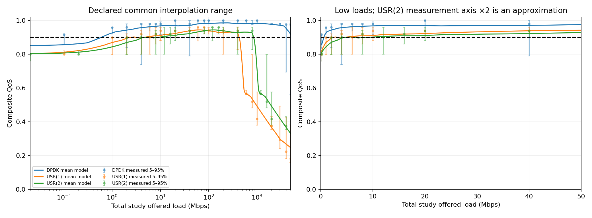
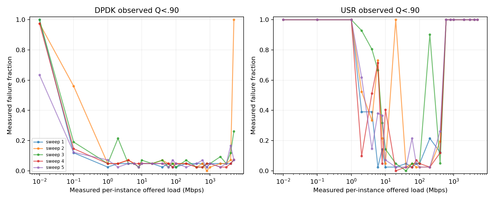
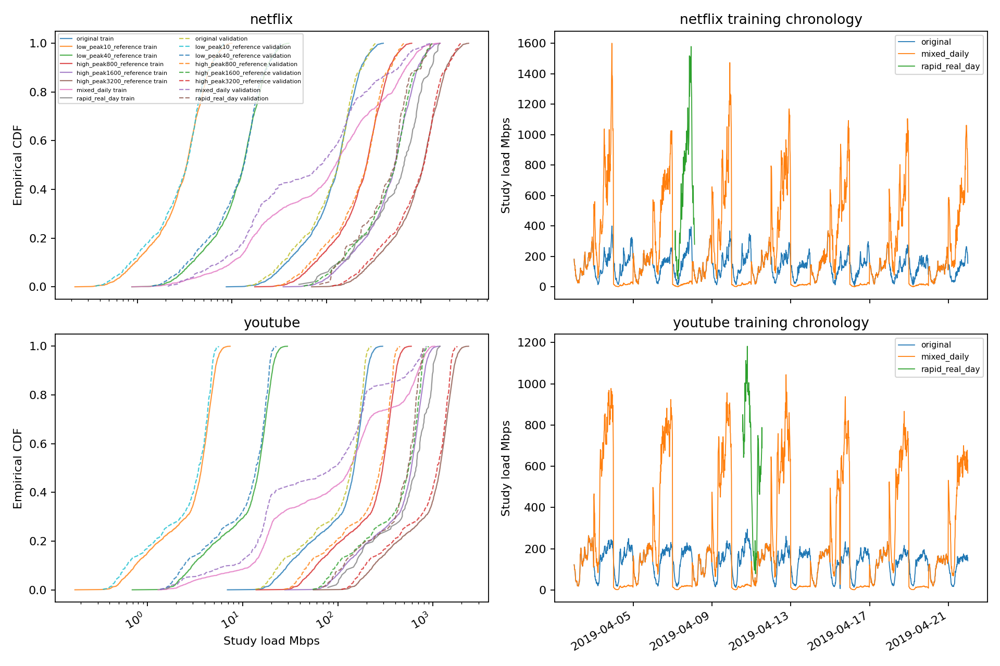

# Existing-trace rescaling and QoS activation — Stage 9

**Conclusion:** deterministic rescaling activates the unchanged QoS penalty inside the measured load range. It does **not** by itself establish a meaningful reward-driven energy–QoS compromise: adding the QoS term changes the immediate minimum-cost action at **0 of 34,320 scenario slots**. Low-load scenarios contain a physical-sign-valid but expensive-to-avoid predicted shortfall; at high loads DPDK already has both lower predicted energy and a feasible point score. These are workload/twin diagnostics, not controller results or proof that temporal RL behavior cannot change.

Date: 23 October 2026. Branch `revision/comcom-clean-evaluation`, HEAD `c0734715418d3f6d10785e5174aebb4bac24d0da`. The frozen twin, score, reward, forecasters, policies, baselines, source traffic and Stages 2–8 artifacts remain unchanged. No model fitting, RL training, controller replay, final-test target access/evaluation, manuscript edit, commit or push.

## 1. Scope, inference and supported domain

Frozen twin: `80866f0adf81c3f144190fe49d8cf74e2d5eefe95c90b63a2924fb8da67c465e`. Data come only from the existing Netflix/YouTube raw `Traffic_bps` authorized prefixes, using the unchanged common Netflix-training workload multiplier **0.19358590710547752**. Training scores source indices 96–2015 (1,920 intervals after common context); validation scores 2016–2519 (504 intervals). The parser stops at 2520. YouTube training-date blocks here characterize a proposed workload suite; they do not retroactively authorize YouTube policy training or alter earlier transfer definitions.

Each component declares **0.01–5,000 Mbps per instance**. The common three-action total-load domain is **0.02–5,000 Mbps**: USR(2) needs at least 0.01 per instance, and DPDK/USR(1) cannot exceed 5,000. USR(2) alone could be queried up to 10,000, but that is not a common three-action comparison. No zero-load model claim, extrapolation or traffic clipping is used. All scenarios stay inside the common domain.

Scenario inference uses **vectorized calls to the unchanged frozen components**, an explicit diagnostic execution profile rather than bitwise-equivalence claims to prior singleton runs. At 404 stratified/near-threshold load checks through the real singleton adapter, maximum QoS/power differences were 1.19e-07 score / 1.79e-07 W, with zero checked threshold-class disagreements. All scenario rows within 1e−5 score of .90 were included. This is sampled numerical agreement, not proof of bitwise equality for every batch position or hardware. [Checks](reports/stage9/inference_profile_checks.json). No invalid model outputs were repaired.

## 2. QoS versus total load

All threshold crossings are located from the scalar ReLU networks’ complete affine-piece decomposition in standardized log1p(load), including inference BatchNorm and dropout semantics. This finds 104 DPDK and 132 USR pieces, rather than assuming a sampled grid finds all crossings. Float64 coefficient calculations differ from actual float32 network inference by at most 1.78e−7 on the checked piece midpoints. The following endpoints are **numerical model boundaries**, rounded to six decimals, not physical capacity limits. Full coefficients’ crossings and singleton float32 transition brackets are in [qos_regions.json](reports/stage9/qos_regions.json). Away from those tiny transition neighborhoods the intervals are:

| Total offered load Mbps | Configurations with predicted Q≥.90 | Region |
|---|---|---|
| 0.020000–0.597729 | none | all_unsafe |
| 0.597729–2.538821 | DPDK | avoidable |
| 2.538821–3.062158 | DPDK, USR(1) | avoidable |
| 3.062158–4.652050 | DPDK | avoidable |
| 4.652050–5.077641 | DPDK, USR(1) | avoidable |
| 5.077641–6.124316 | DPDK, USR(1), USR(2) | all_safe |
| 6.124316–9.304101 | DPDK, USR(1) | avoidable |
| 9.304101–427.703841 | DPDK, USR(1), USR(2) | all_safe |
| 427.703841–855.407682 | DPDK, USR(2) | avoidable |
| 855.407682–5000.000000 | DPDK | avoidable |

Thus all configurations are predicted feasible in two intervals: approximately **5.077641–6.124316** and **9.304101–427.703841 Mbps**. All fail below approximately **0.597729 Mbps** within the common domain. All remaining intervals have some feasible and some infeasible actions. Mathematically Q=.90 is feasible; finite-precision endpoint classifications must use the saved transition brackets/model call rather than the rounded table.

USR has a small predicted-safe island **2.538821–3.062158 Mbps per instance**, between measured levels 2 and 4. Its image for USR(2) is 5.077641–6.124316 total Mbps. There are no intermediate measurements validating this island; it must not become a claimed safe operating band. At high total load, USR(2) extends predicted feasibility relative to USR(1) from about **427.704 to 855.408 Mbps**, conditional on balanced independent instances. This is not direct two-instance measurement.

Dots are measured medians and bars are empirical 5th–95th percentiles, **not confidence intervals**. The USR(2) measurement overlay doubles the single-instance offered-load axis; it is a model approximation. Rare failures below the 5th percentile can be hidden by those bars, so minima and failure counts are retained separately.

## 3. Original profiling evidence and reliability

Unchanged source CSVs have 4,594 DPDK / 4,564 USR rows, five complete sweeps each, 22 load levels and 1,250-byte packets. Their exact SHA-256 identities are checked against the frozen protocol. They are the exposed same-campaign data used in earlier grouped validation, not fresh physical tests. This task neither refits nor reselects a model.

| Per-instance Mbps | DPDK model / measured mean | DPDK measured failures / n | USR model / measured mean | USR measured failures / n |
|---:|---:|---:|---:|---:|
| 0.01 | 0.8501 / 0.8352 | 189/206 | 0.8023 / 0.7699 | 206/206 |
| 0.1 | 0.8560 / 0.8987 | 47/207 | 0.8118 / 0.7893 | 206/206 |
| 1 | 0.9257 / 0.9325 | 10/209 | 0.8688 / 0.8592 | 207/207 |
| 2 | 0.9422 / 0.9409 | 16/209 | 0.8943 / 0.8738 | 107/208 |
| 4 | 0.9564 / 0.9493 | 12/211 | 0.8974 / 0.8981 | 90/206 |
| 6 | 0.9621 / 0.9595 | 10/210 | 0.9045 / 0.8949 | 105/208 |
| 10 | 0.9674 / 0.9571 | 11/210 | 0.9101 / 0.9137 | 29/209 |
| 20 | 0.9690 / 0.9720 | 10/210 | 0.9222 / 0.9185 | 46/207 |
| 100 | 0.9817 / 0.9827 | 8/208 | 0.9383 / 0.9313 | 8/208 |
| 400 | 0.9803 / 0.9813 | 7/207 | 0.9241 / 0.9222 | 31/207 |
| 600 | 0.9806 / 0.9769 | 9/209 | 0.5670 / 0.5657 | 209/209 |
| 800 | 0.9818 / 0.9754 | 6/208 | 0.5353 / 0.5500 | 207/207 |
| 1000 | 0.9820 / 0.9774 | 9/209 | 0.4939 / 0.4494 | 208/208 |
| 3000 | 0.9709 / 0.9626 | 9/209 | 0.2993 / 0.3091 | 208/208 |
| 5000 | 0.9184 / 0.8727 | 62/209 | 0.2474 / 0.2316 | 208/208 |

Important observations:

- **Low loads:** measured USR failures are real and frequent, but not uniform by load or sweep. At 6 Mbps, measured failure fractions span **1/41–30/41** across sweeps while the network predicts Q≈.904532 for everyone. A point-model safe label there hides substantial observed risk. The exact low-load crossing/island is not established by data.
- **DPDK:** the mean model predicts ≥.90 from about .598 through 5,000 Mbps, yet measured failures persist at those measured loads. These are QoS-model limitations, not evidence that a safe DPDK fallback physically prevents every violation.
- **High USR loads:** all measured samples at 600 Mbps and above are below .90. The broad degradation is supported by the available campaign, not only by extrapolation. The precise model crossing at 427.704 lies in the unmeasured **400–600 Mbps gap**; its accuracy and USR(2) extension are not independently validated.
- Combining separate DPDK and USR campaigns cannot establish a measured all-action failure/avoidability rate for a common physical interval. Measured failures are observed at discrete load levels, not validated continuous ranges.

Full per-load distributions, per-sweep failure frequencies, false-safe counts, QoS residuals and **unchanged power-model residuals** are in [load/sweep evidence](reports/stage9/measurement_by_load_sweep.csv) and [regional evidence](reports/stage9/measurement_by_sweep_region.csv). The power diagnostic compares the existing model with measured process-attributed watts; no power search is performed.

## 4. Frozen trace-derived scenarios

The [protocol](stage9/protocol.json) fixes all factors and segment rules before new scenario inference. All individual source indices/factors and timestamp mappings are committed in [scenario definitions](reports/stage9/scenario_definitions_frozen.json) before loading the twin. Parameters are not chosen from validation magnitudes, controller outcomes or expected algorithm rankings.

| Scenario | Transformation of existing study loads | Interpretation |
|---|---|---|
| original | ×1 | Unchanged workload; also the medium-load reference (no duplicate experiment) |
| low_peak10_reference | ×.025 | Netflix training peak 10 Mbps; YouTube keeps its lower proportional peak |
| low_peak40_reference | ×.1 | Netflix training peak 40 Mbps |
| high_peak800_reference | ×2 | Netflix training peak 800 Mbps |
| high_peak1600_reference | ×4 | Netflix training peak 1,600 Mbps |
| high_peak3200_reference | ×8 | Netflix training peak 3,200 Mbps; broad stress diagnostic |
| mixed_daily | Cycle ×.1, ×1, ×4 by absolute source-day index modulo 3 | Contiguous original daily segments; no reordering |
| rapid_real_day | ×4 on strongest contiguous 96-slot training ramp window | Validation: first full day with that training-selected start clock time |

“Peak” names refer to Netflix **training** peaks, not per-partition normalization, runtime caps or promised validation peaks. YouTube is never renormalized to 400 Mbps. Scaling changes amplitude but retains source temporal patterns; these are **trace-derived study scenarios**, not new real measurements or samples from a new traffic population. No random samples, time compression, interpolation, sorting, filling or clipping creates workload rows.

All source timestamps are preserved. Mixed factors change at midnight with joins explicitly flagged. Their jumps are artificial rescaling discontinuities, distinct from the original within-segment ramps. Rapid selection maximizes sum of absolute consecutive changes using only the training prefix, earliest start on ties; no validation window is selected for its magnitude. It is scored for **96 intervals / 24 hours**, so its energy must not be compared as a total against a 504-interval horizon.

Exact peaks, means, p1/p5/p25/p50/p75/p95/p99, absolute quarter-hour ramp distributions, natural versus artificial maximum ramps, join counts and risk-region occupancy are in [scenario_metrics.json](reports/stage9/scenario_metrics.json). Every row’s original load, multiplier, source/derived timestamp, outcome and penalty is retained in [scenario_samples.csv](reports/stage9/scenario_samples.csv). These preserve the raw sources in place and store all transformations separately; no validation segment becomes training material.

## 5. All-scenario QoS, energy and reward diagnostics

Triplets below are **DPDK / USR(1) / USR(2)**. Avoidable means a point-feasible configuration exists, not that it is reachable under cooldown from every preceding state. Energy is attributed `Σ W×.25 h` for holding each configuration, without startup energy or reward-only reconfiguration costs. This is an action-outcome census, not a controller rollout. No forecaster is invoked.

### Netflix — train

| Scenario | n | Violating slots D/U1/U2 | Avoidable / all-unsafe slots | Energy Wh D/U1/U2 | Mean QoS penalty D/U1/U2 |
|---|---:|---:|---:|---:|---:|
| original | 1920 | 0 / 0 / 1 | 1 / 0 | 393.372 / 568.757 / 587.270 | 0.000000 / 0.000000 / 0.000017 |
| low_peak10_reference | 1920 | 56 / 1278 / 1723 | 1667 / 56 | 392.654 / 13.781 / 15.783 | 0.010206 / 0.260874 / 0.642438 |
| low_peak40_reference | 1920 | 0 / 212 / 525 | 525 / 0 | 393.237 / 53.855 / 51.614 | 0.000000 / 0.012618 / 0.080181 |
| high_peak800_reference | 1920 | 0 / 285 / 0 | 285 / 0 | 393.762 / 1021.871 / 1137.513 | 0.000000 / 0.810286 / 0.000000 |
| high_peak1600_reference | 1920 | 0 / 1190 / 285 | 1190 / 0 | 394.324 / 1365.768 / 2043.743 | 0.000000 / 5.906423 / 0.810286 |
| high_peak3200_reference | 1920 | 0 / 1603 / 1190 | 1603 / 0 | 394.982 / 1517.181 / 2731.536 | 0.000000 / 10.623821 / 5.906423 |
| mixed_daily | 1920 | 0 / 494 / 260 | 584 / 0 | 393.657 / 690.754 / 938.609 | 0.000000 / 2.142952 / 0.291765 |
| rapid_real_day | 96 | 0 / 63 / 32 | 63 / 0 | 19.723 / 68.064 / 112.449 | 0.000000 / 7.319924 / 2.149829 |

### Netflix — validation

| Scenario | n | Violating slots D/U1/U2 | Avoidable / all-unsafe slots | Energy Wh D/U1/U2 | Mean QoS penalty D/U1/U2 |
|---|---:|---:|---:|---:|---:|
| original | 504 | 0 / 0 / 0 | 0 / 0 | 103.265 / 145.258 / 149.925 | 0.000000 / 0.000000 / 0.000000 |
| low_peak10_reference | 504 | 22 / 358 / 479 | 457 / 22 | 103.070 / 3.530 / 4.042 | 0.014433 / 0.295889 / 0.678435 |
| low_peak40_reference | 504 | 0 / 67 / 150 | 150 / 0 | 103.219 / 13.749 / 13.194 | 0.000000 / 0.015742 / 0.097548 |
| high_peak800_reference | 504 | 0 / 62 / 0 | 62 / 0 | 103.359 / 262.362 / 290.515 | 0.000000 / 0.868501 / 0.000000 |
| high_peak1600_reference | 504 | 0 / 306 / 62 | 306 / 0 | 103.498 / 351.556 / 524.725 | 0.000000 / 5.846832 / 0.868501 |
| high_peak3200_reference | 504 | 0 / 410 / 306 | 410 / 0 | 103.672 / 393.582 / 703.112 | 0.000000 / 10.338948 / 5.846832 |
| mixed_daily | 504 | 0 / 89 / 66 | 119 / 0 | 103.300 / 142.128 / 182.456 | 0.000000 / 1.290076 / 0.213313 |
| rapid_real_day | 96 | 0 / 56 / 11 | 56 / 0 | 19.712 / 66.479 / 96.491 | 0.000000 / 5.687983 / 0.977722 |

### Youtube — train

| Scenario | n | Violating slots D/U1/U2 | Avoidable / all-unsafe slots | Energy Wh D/U1/U2 | Mean QoS penalty D/U1/U2 |
|---|---:|---:|---:|---:|---:|
| original | 1920 | 0 / 0 / 1 | 1 / 0 | 393.474 / 554.145 / 576.059 | 0.000000 / 0.000000 / 0.000052 |
| low_peak10_reference | 1920 | 109 / 1383 / 1725 | 1616 / 109 | 392.650 / 13.437 / 15.371 | 0.017376 / 0.311906 / 0.626203 |
| low_peak40_reference | 1920 | 0 / 267 / 490 | 490 / 0 | 393.117 / 52.410 / 49.587 | 0.000000 / 0.017481 / 0.111659 |
| high_peak800_reference | 1920 | 0 / 125 / 0 | 125 / 0 | 393.792 / 1048.140 / 1108.289 | 0.000000 / 0.141079 / 0.000000 |
| high_peak1600_reference | 1920 | 0 / 1328 / 125 | 1328 / 0 | 394.285 / 1343.632 / 2096.281 | 0.000000 / 6.632146 / 0.141079 |
| high_peak3200_reference | 1920 | 0 / 1538 / 1328 | 1538 / 0 | 394.955 / 1481.401 / 2687.265 | 0.000000 / 10.422050 / 6.632146 |
| mixed_daily | 1920 | 0 / 548 / 188 | 609 / 0 | 393.649 / 676.858 / 945.260 | 0.000000 / 2.329260 / 0.069870 |
| rapid_real_day | 96 | 0 / 70 / 26 | 70 / 0 | 19.721 / 68.727 / 113.764 | 0.000000 / 7.481252 / 1.283699 |

### Youtube — validation

| Scenario | n | Violating slots D/U1/U2 | Avoidable / all-unsafe slots | Energy Wh D/U1/U2 | Mean QoS penalty D/U1/U2 |
|---|---:|---:|---:|---:|---:|
| original | 504 | 0 / 0 / 0 | 0 / 0 | 103.267 / 135.511 / 140.338 | 0.000000 / 0.000000 / 0.000000 |
| low_peak10_reference | 504 | 50 / 392 / 491 | 441 / 50 | 103.067 / 3.306 / 3.799 | 0.032118 / 0.359885 / 0.702876 |
| low_peak40_reference | 504 | 0 / 86 / 132 | 132 / 0 | 103.163 / 12.691 / 12.107 | 0.000000 / 0.027865 / 0.140515 |
| high_peak800_reference | 504 | 0 / 2 / 0 | 2 / 0 | 103.367 / 259.962 / 271.023 | 0.000000 / 0.002811 / 0.000000 |
| high_peak1600_reference | 504 | 0 / 332 / 2 | 332 / 0 | 103.479 / 344.378 / 519.923 | 0.000000 / 6.016963 / 0.002811 |
| high_peak3200_reference | 504 | 0 / 396 / 332 | 396 / 0 | 103.653 / 381.703 / 688.757 | 0.000000 / 9.875325 / 6.016963 |
| mixed_daily | 504 | 0 / 109 / 49 | 121 / 0 | 103.271 / 136.582 / 177.878 | 0.000000 / 1.334074 / 0.057210 |
| rapid_real_day | 96 | 0 / 65 / 0 | 65 / 0 | 19.710 / 67.441 / 98.054 | 0.000000 / 5.840921 / 0.000000 |

Counts divided by n give violation fractions. “At least one unsafe” equals avoidable plus all-unsafe counts; all-safe is the remaining n. Full exact rates, mean and maximum shortfalls, conditional severity percentiles, violation-associated load minima/maxima, average power and sums of `30×shortfall` are in [action_metrics.csv](reports/stage9/action_metrics.csv) ([JSON](reports/stage9/action_metrics.json)). Conditional severity is null, not zero estimated risk, when an action has no predicted failures.

**Correction to the study premise:** the unchanged validation inputs have zero predicted failures for all actions. The scored original training prefixes have **one USR(2) violation each** (1/1,920=.0521%); they are not entirely penalty-free. DPDK and USR(1) remain point-safe there. This distinction does not alter any existing Stage 7 result.

## 6. Does the penalty create a meaningful choice?

For each actual load, compare minimum power with the maximum immediate reward **before reconfiguration terms**: `−100×P/load−30×max(0,.90−Q)`. This is a state-free counterfactual diagnostic, not a change to reward or a substitute for future guarded trajectories.

| Training scenario | Avoidable slots with cheapest action unsafe: Netflix / YouTube | Sum instantaneous safe-power premium Wh: Netflix / YouTube |
|---|---:|---:|
| original | 0 / 0 | 0.000 / 0.000 |
| low_peak10_reference | 1222 / 1274 | 242.709 / 252.337 |
| low_peak40_reference | 212 / 267 | 41.887 / 52.882 |
| high_peak800_reference | 0 / 0 | 0.000 / 0.000 |
| high_peak1600_reference | 0 / 0 | 0.000 / 0.000 |
| high_peak3200_reference | 0 / 0 | 0.000 / 0.000 |
| mixed_daily | 69 / 81 | 13.669 / 16.062 |
| rapid_real_day | 0 / 0 | 0.000 / 0.000 |

The premium sums slot-wise minimum safe power minus minimum unrestricted power only at avoidable slots; it ignores temporal feasibility and is **not a QoS-constrained scheduling oracle**. All configurations are unavoidably point-unsafe at the very lowest scaled loads. There the existence of a penalty cannot make the target achievable.

At low loads, DPDK safety can have a large SEC cost. For example, Netflix ×.1 training has mean energy reward magnitudes **9.6464 / .8189 / .8259**, versus mean QoS penalty **0 / .0126 / .0802**. The denominator never approaches epsilon. At high loads USR penalties are large, but DPDK is already predicted cheaper and feasible. Across all 32 workload/role combinations, adding the QoS penalty changes immediate candidate ranking **zero times**. Reconfiguration penalties, cooldown and future loads can still affect a trained temporal policy; none was simulated here.

Training examples of action separation (all scenario/role values remain in the JSON):

| Workload / scenario | Mean / max Q spread across actions | USR(2) protects against USR(1) slots | USR(1) protects against USR(2) slots |
|---|---:|---:|---:|
| netflix / original | 0.050809 / 0.067016 | 0 | 1 |
| netflix / low_peak40_reference | 0.062005 / 0.083124 | 0 | 313 |
| netflix / high_peak800_reference | 0.083874 / 0.446422 | 285 | 0 |
| netflix / mixed_daily | 0.132183 / 0.571214 | 324 | 90 |
| youtube / original | 0.052457 / 0.066991 | 0 | 1 |
| youtube / low_peak40_reference | 0.062508 / 0.082445 | 0 | 223 |
| youtube / high_peak800_reference | 0.059135 / 0.413060 | 125 | 0 |
| youtube / mixed_daily | 0.139549 / 0.496171 | 421 | 61 |

Answers to the requested questions:

1. **Can rescaling activate penalties?** Yes, within measured per-instance bounds at both low and high loads; no threshold/coefficient was changed.
2. **Enough safe/unsafe training choices?** For descriptive exposure yes: ×.1 training has 525/1,920 Netflix and 490/1,920 YouTube slots with some unsafe actions and at least one feasible action. This is not an approved statistical sample-size or risk threshold, and temporal correlation remains. More extreme low scaling introduces unavoidable point-failures rather than a solvable task.
3. **Avoidable?** Many failures are avoidable pointwise, particularly through DPDK. Cooldown-constrained avoidance is not established. USR(2) protects against USR(1) overload at 427.704–855.408 total Mbps; at low loads splitting can instead worsen predicted QoS.
4. **Meaningful energy–QoS trade-off?** There is a low-load safe-power premium, but the current scalar reward does not reverse the cheapest action’s immediate ranking. High-load penalties mostly reinforce an existing energy preference. Do not claim that these scenarios have demonstrated an RL QoS benefit merely because penalties are nonzero.
5. **Supported by profiling?** Broad low-load impairment and high-load USR degradation are observed; exact transition loads, the low-load safe island, the DPDK safe fallback and physical two-instance protection are not validated safety facts. High scenarios are retained only as conditional stress cases, **rejected as independently validated evidence of QoS-aware control**. Numerical domain membership alone does not establish reliability.

## 7. Small next suite and scientific boundary

If a later **explicitly authorized model-conditional** control experiment is desired, the smallest useful descriptive suite is: **original** (medium reference), **×.1** (low-load tension without all-unsafe slots in these prefixes), **×2** (moderate overload stress) and **mixed_daily** (documented daily joins). These are retained fixed scenario identities, not newly optimized factors. This recommendation uses the training exposure and measurement interpretation, not a controller ranking or favorable validation result. ×4/×8 and the rapid windows remain secondary stress diagnostics; ×.025 is excluded from a primary solvable-control comparison because it intentionally contains all-unsafe loads.

Training: only transformed rows 96–2015, with causal context transformed by the same declared rule. Validation: transformed rows 2016–2519 with the identical fixed factors/rule, separate from training. Keep original and modified scenarios separately labeled. YouTube-specific policy training versus Netflix-policy transfer must be declared before such a campaign. No training is authorized automatically here.

The ×2 YouTube validation has only **2/504** avoidable-point-risk slots; that limited power is disclosed, not used to increase its factor post hoc. The suite is suitable for exploratory stress testing, **not yet for confirming QoS-aware RL claims**. The present evidence does not supply a four-regime suite with independently established physical safety and reward-sensitive choices. More traffic scaling cannot resolve conditional-mean false-safety or a fixed reward’s low-load balance.

Before stronger claims: obtain or explicitly scope causal workload direction/units, clarify packet-loss and jitter semantics, acquire fresh grouped calibration near the low crossings and 400–600 Mbps, quantify lower-tail risk and multi-instance behavior, and agree what risk/coverage is acceptable. Those are missing evidence, not changes implemented here. The fixed four-component score remains a composite objective, not a formal 5QI guarantee.

**Forecast boundary:** archived forecasts are not valid outputs for the modified trajectories. Future fitting/selection must use the modified training prefix, training-only walk-forward forecasts and properly transformed past context, with validation only after freezing provider choices. Known scheduled factors and mixed joins must be declared as decision-time information rather than assumed known. No new forecasting work is performed here.

Boundary bookkeeping: within-scored-row ramp/join counts omit the preceding context interval. [Context boundary joins](reports/stage9/context_boundary_joins.csv) separately record the first scored transition, including mixed-factor changes at training/validation boundaries, and decompose natural and imposed ramp components. No interval is added to scoring.

## 8. Tests, reproducibility and preservation

**17 tests passed in 3.25 seconds.** Tests cover training-selection invariance to poisoned validation magnitudes, exact source transforms and chronology, disjoint roles, earliest rapid-window ties, flagged mixed joins, full scalar ReLU segmentation, arithmetic of every scenario’s energy/penalties/risk counts, immutable inference identities, singleton-profile agreement, rejection of longer prefixes, and poisoned final-test targets proving the reader stops before them. No model or controller training occurs in tests; the broad legacy suite is not invoked. [Final test log](reports/stage9/final_tests.log).

New code/config: `revision/stage9/{__init__,core,run,evidence,report}.py` and `protocol.json`; tests: `revision/tests/test_stage9.py`; this report; `revision/reports/stage9_prior_sha256.json`; all outputs under `revision/reports/stage9/`. [File manifest](reports/stage9/file_manifest.json) lists every addition. [Integrity evidence](reports/stage9/integrity.json) checks all **5,230 prior scientific files** and Git branch/HEAD/tracked status.

Reproduce in a fresh output namespace with the pinned inputs: `.venv/bin/python -m revision.stage9.run`, then `-m revision.stage9.evidence` and `-m revision.stage9.report`. Writers refuse to overwrite reports/tables. Tests: `.venv/bin/python -m pytest -q revision/tests/test_stage9.py revision/tests/test_forecast_service.py::test_parser_never_converts_final_test_targets revision/tests/test_forecast_service.py::test_prefix_reader_prohibits_final_test_and_uses_raw_fields -p no:cacheprovider`. External profiling measurements still require separate backup; hashes are not copies.

**Stopped after Stage 9.** No subsequent model, forecast or controller campaign starts automatically.
