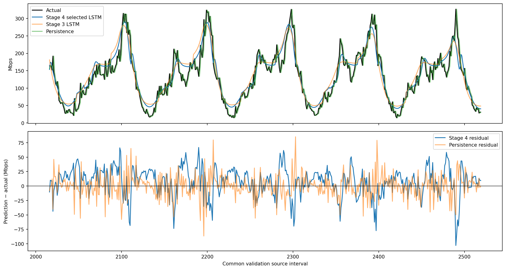
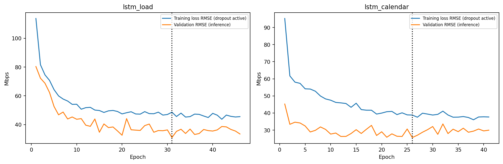
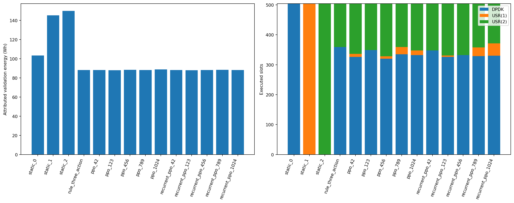
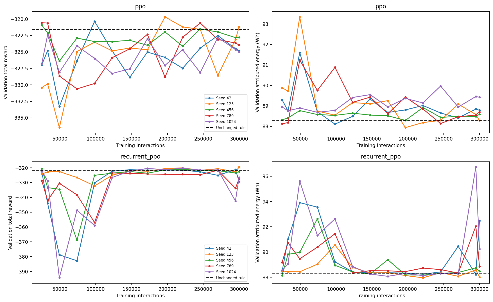
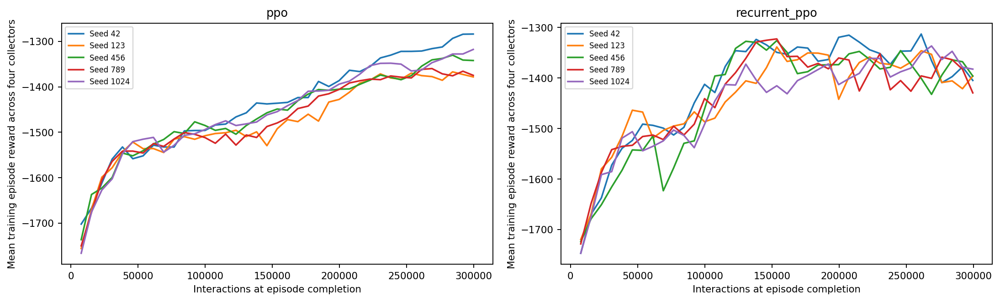
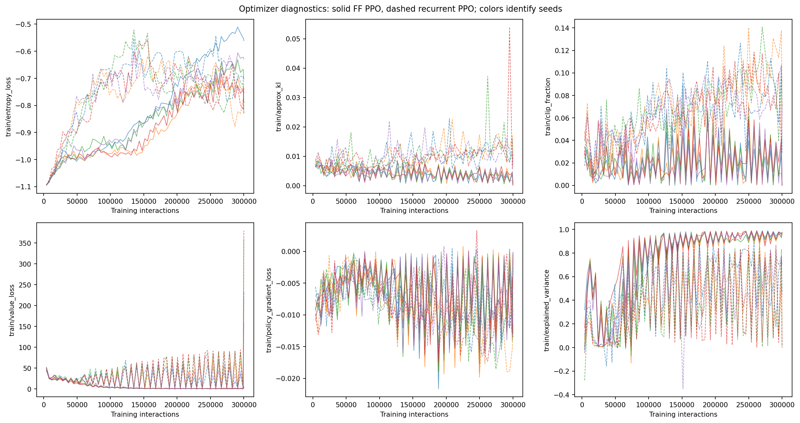

# Full training and convergence evaluation — COMCOM-D-26-01061

**Stage 4 complete.** The primary evidence below uses the corrected, RNG-isolated
campaign: five fresh seeds per PPO family, exactly 300,000 interactions each,
the unchanged frozen digital twin/reward/rule/contract, and the common 504-slot
Netflix validation horizon. Results are exploratory and validation-selected;
the final 840-slot test remains untouched. No manuscript edit, DQN, broad reward
sweep, remaining reviewer campaign, commit or push occurred.

Work date: **23 October 2026**. Branch `revision/comcom-clean-evaluation`, HEAD
`c0734715418d3f6d10785e5174aebb4bac24d0da`.

## 1. Findings at a glance

- **ppo: 88.250821 ± 0.314243 Wh** (sample SD, five seeds), -0.030% relative to rule; 3/5 seeds use less energy and 4/5 have higher total reward. Mean total reward -320.790747.
- **recurrent_ppo: 88.170231 ± 0.116933 Wh** (sample SD, five seeds), -0.121% relative to rule; 4/5 seeds use less energy and 4/5 have higher total reward. Mean total reward -320.690544.
- **Unchanged rule: 88.277182 Wh**, mean SEC 0.00637538 J/Mbit, total reward -321.613068.
- Best-selected and final-endpoint performance must be distinguished. More
  checkpoint opportunities are not themselves evidence of stable convergence.
- All 1,512 action/validation-load pairs meet the frozen point-score target, so
  zero predicted shortfalls is non-discriminating and establishes no safety claim.
- Calendar-LSTM validation accuracy improves, but persistence remains better;
  causal prefix training forecasts become worse. Forecast quality remains a limit.

## 2. Frozen design and necessary implementation correction

[The Stage 4 protocol](stage4/protocol.json) was saved before fitting. Seeds are
42, 123, 456, 789 and 1024 for each algorithm. Stage 3 hyperparameters are retained:
four collectors, n_steps=1024, batch64, ten PPO epochs, lr=.0001, gamma=.995,
GAE=.90, entropy=.15, clip=.20, target-KL=.03; recurrent shared LSTM128, no separate
critic LSTM. Both algorithms use the same 109-element hybrid observation.

All controllers retain DPDK initialization, eligible four-slot cooldown, three
actions, causal completed-interval telemetry, the 95-slot history, 96-slot forecast
input, and the original corrected contract. Rejected commands are discarded;
changes at t permit another at t+4. The reward remains −100×SEC −30×score shortfall
minus .030 switch-to-DPDK, .012 per launched USR instance and .003 within-USR scale
down. No reward coefficients, score formula, twin outputs or rule thresholds are
tuned. The rule still uses all three forecast-conditioned curves, the .90
point-score preference and fixed 2% power deadband. Only its forecast inputs change.

Frozen twin identity:
`80866f0adf81c3f144190fe49d8cf74e2d5eefe95c90b63a2924fb8da67c465e`.
See [final twin validation](FINAL_DIGITAL_TWIN_VALIDATION.md) for the three neural
models plus USR power regression, exact artifacts/scalers, measurement lineage
and unresolved physical assumptions. The [initial frozen protocol](reports/stage4/training_protocol_frozen.json)
and [corrected execution amendment](reports/stage4_rng_isolated/training_protocol_frozen.json)
pin code, config, forecasts, twin identity and the preflight results.

**A confirmed RNG side effect required a complete implementation-correction rerun.**
Ten initial full-budget runs completed. Post-training verification demonstrated
that SB3 checkpoint loading resets Python, NumPy and Torch RNGs: `_setup_model`
sets the saved seed and initializes layers before restoring weights. Because
checkpoint validation ran during training, it altered subsequent exploration and
minibatch draws. This also affects interpreting Stage 3's inherited callback.

[The diagnostic probe](reports/stage4/evaluation_rng_probe.json) and
[RNG-isolation amendment](stage4/RNG_ISOLATION_AMENDMENT.md) record the cause and
correction. The entire checkpoint capture/evaluation now saves/restores all three
CPU RNG states, including on exceptions. No algorithm hyperparameters, forecast
weights, baseline, objective or seed list changed. All ten corrected jobs were
prescribed before their outcomes were known; no seed is discarded or selected
for a favorable rerun. Initial files remain at `models/stage4` / `reports/stage4`;
primary files use **`models/stage4_rng_isolated` / `reports/stage4_rng_isolated`**.
Both campaigns are retained and must not be pooled as ten independent seeds.

The first 24,576-interaction checkpoint metrics match between the two campaigns
for every seed, before validation could perturb the next random stream. Later
trajectories diverge as expected. This supplies a direct implementation-regression
check rather than an unexplained change of scientific protocol. In total there
are 20 full controller fits / six million interactions, but only ten corrected
fits / three million interactions form the primary five-seed-per-algorithm study.

**Exact budget and checkpoint timing:** regular rollouts remain1024 steps per
collector. After299008 interactions, the last rollout is248 steps per collector,
giving992 further interactions and exactly300000 total. Its returns/advantages
and optimizer updates are computed normally; no tail samples are discarded and
there is no unreported303104-step overshoot. The final minibatch may contain32
samples. This budget-boundary behavior is tested for both algorithms.

Each run preserves14 post-update policy/normalizer pairs: every24576 interactions
(approximately25000), an additional32768-step matched pilot-budget checkpoint,
and300000 after the final optimizer update. Selection remains maximum validation
**total reward**, with earlier checkpoint as tie-breaker, never energy superiority.
VecNormalize moments update only during training; rewards remain unnormalized.
Recurrent hidden/cell states persist during evaluation and reset only per episode.

Training data score1920 slots per episode after common warmup. Four collectors
repeat this deterministic workload; they are not independent datasets. Each run
logs74 optimizer updates,156 completed collector episodes and four incomplete
120-slot episode tails. CPU operation is deterministic under the pinned runtime:
Python3.12.3, TensorFlow2.20.0/Keras3.13.2, NumPy2.4.2, Torch2.10.0+cu128,
SB3/sb3-contrib2.7.1, Gymnasium1.2.3; one Torch thread per independent worker.
No GPU training is used. Up to four independent processes run concurrently.

## 3. Forecast training, selection and accuracy

Exactly two LSTM candidates retain Stage 3's 128/64 stacked hidden widths,
96 completed input slots, dropout and nonnegative softplus head: load-only and
six known decision-calendar features. Seed42, batch128, Adam.001, maximum100
epochs, patience15, minimum scaled-MSE improvement1e-6 and plateau reduction
(factor.5 after6 epochs, minimum lr1e-5) were fixed beforehand. No search was
expanded after seeing forecast or controller results.

Full-prefix gradient targets are96..2015; the504-slot validation suffix selects
checkpoint/candidate. The load-only candidate ran46 epochs, selected31; calendar
ran41, selected26 and won by validation RMSE. This is validation-selected accuracy,
not an untouched final test. No controller result selected the forecast.

For training forecasts, selected architecture fits prefixes ending192,608,1024,
1440,1856. Each uses an internal chronological holdout: the last20% of available
sequence targets supplies stopping information, entirely before its subsequent
forecast block. Scalers and gradient labels use only the earlier training subset.
Both gradient and stopping cutoffs are recorded. The initial96 scored training
slots retain explicit persistence cold start (5% of scored training), not an
undisclosed replacement of the LSTM. All validation inputs use the full-training-
prefix selected LSTM. Calendar information is known at decision time; actual
interval-t load never enters its own forecast input.

Seven scientific fits ran227 epochs total of a700-epoch cap. The corrected
campaign copies these artifacts byte for byte; **no forecasts are refitted for
the RNG correction**. Model/scaler manifests, epoch histories and weights are
retained under [forecast artifacts](models/stage4/forecast/), and selection is
[hash-pinned](reports/stage4/forecast_selection.json). The Stage 3 forecaster and
all datasets remain unchanged.

| Forecast / scope | N | MAE Mbps | RMSE Mbps | Bias Mbps | R² |
|---|---|---|---|---|---|
| lstm_load validation | 504 | 22.006491 | 30.978306 | -13.595280 | 0.825836 |
| lstm_calendar validation | 504 | 20.506871 | 25.690384 | +7.062608 | 0.880220 |
| train_lstm | 1920 | 46.060686 | 66.333705 | +26.879732 | 0.218805 |
| train_persistence | 1920 | 15.943239 | 21.795658 | +0.030644 | 0.915660 |
| validation_persistence | 504 | 15.274211 | 20.810623 | +0.247486 | 0.921402 |

The selected validation RMSE improves from Stage 3's28.508475 to25.690384 Mbps,
but still trails persistence20.810623. The causal training-ledger RMSE worsens
from51.358767 to66.333705 Mbps: small earlier prefixes plus internal stopping
produce poorly calibrated early forecasts. More training budget is not proof
that every prefix predictor improves. This weakness is preserved and limits
attribution of controller findings; persistence is saved as a labelled alternative,
not substituted into primary training. No final-test forecast/outcome is evaluated.

[Forecast ledger](reports/stage4_rng_isolated/forecasts.csv) records2424 issued
training/validation predictions and cutoffs. [Accuracy](reports/stage4_rng_isolated/forecast_accuracy.json)
and [persistence ledger](reports/stage4_rng_isolated/persistence_forecasts.csv)
are complete. The selected saved network reproduces its ordered validation
forecasts exactly under the fixed inference profile.

## 4. Complete validation controller comparison

All rows use the same504 quarter-hour timestamps,22 April2019 00:00 through
27 April05:45,126 hours. Horizon hash:
`1d0955ec0c78322db213461b94c8bc4a17d38cfb10679a98994ea3200a0ce0c4`.
Energy is attributed W×.25h inWh; SEC is J/Mbit. Arithmetic mean slot SEC differs
from aggregate energy/offered-traffic SEC. QoS is a predicted composite score.

| Controller | Wh | Mean SEC | Aggregate SEC | Total reward | Mean Q | Min Q | Shortfall fraction |
|---|---|---|---|---|---|---|---|
| static_0 | 103.264594 | 0.01029214 | 0.00619928 | -518.724017 | 0.980784 | 0.967396 | 0.000000 |
| static_1 | 145.257591 | 0.00879901 | 0.00872024 | -443.482319 | 0.933149 | 0.917614 | 0.000000 |
| static_2 | 149.924831 | 0.00886988 | 0.00900043 | -447.065704 | 0.935353 | 0.907887 | 0.000000 |
| rule_three_action | 88.277182 | 0.00637538 | 0.00529954 | -321.613068 | 0.966645 | 0.907887 | 0.000000 |
| ppo_42 | 88.109757 | 0.00635016 | 0.00528949 | -320.363312 | 0.964002 | 0.907887 | 0.000000 |
| ppo_123 | 87.940790 | 0.00633730 | 0.00527935 | -319.693836 | 0.965765 | 0.907887 | 0.000000 |
| ppo_456 | 88.316767 | 0.00636145 | 0.00530192 | -320.911117 | 0.963377 | 0.907887 | 0.000000 |
| ppo_789 | 88.126808 | 0.00635464 | 0.00529051 | -320.570750 | 0.964820 | 0.907887 | 0.000000 |
| ppo_1024 | 88.759984 | 0.00639021 | 0.00532853 | -322.414721 | 0.964433 | 0.907887 | 0.000000 |
| recurrent_ppo_42 | 88.222109 | 0.00636675 | 0.00529624 | -321.232084 | 0.965729 | 0.907887 | 0.000000 |
| recurrent_ppo_123 | 88.017581 | 0.00633511 | 0.00528396 | -319.586635 | 0.963825 | 0.907887 | 0.000000 |
| recurrent_ppo_456 | 88.143064 | 0.00635574 | 0.00529149 | -320.623349 | 0.964392 | 0.907887 | 0.000000 |
| recurrent_ppo_789 | 88.333644 | 0.00637334 | 0.00530293 | -321.678256 | 0.964575 | 0.907887 | 0.000000 |
| recurrent_ppo_1024 | 88.134760 | 0.00634973 | 0.00529099 | -320.332396 | 0.964347 | 0.907887 | 0.000000 |

| Algorithm | Energy mean±sample SD Wh | Mean SEC±SD | Reward mean±SD | Energy below rule | Reward above rule |
|---|---|---|---|---|---|
| ppo | 88.250821 ± 0.314243 | 0.00635875 ± 0.00001967 | -320.790747 ± 1.010704 | 3/5 | 4/5 |
| recurrent_ppo | 88.170231 ± 0.116933 | 0.00635613 ± 0.00001493 | -320.690544 ± 0.809358 | 4/5 | 4/5 |

Dispersion is descriptive across five independently seeded training runs on one
fixed workload, not uncertainty across cities, periods or physical campaigns.
This is not completion of reviewer replication/statistical requirements. No
seed-pooling across stages, per-slot pseudo-replication or superiority p-value is
used. Validation selected forecasts and checkpoints; these are not final-test
claims. Tiny selected energy differences need interpretation relative to model
error and selection optimism, not merely the number of printed decimal places.

| Controller | Sum100×SEC | Sum QoS penalty | Sum reconfiguration penalty | Mean shortfall | Max shortfall |
|---|---|---|---|---|---|
| static_0 | 518.724017 | 0.000000 | 0.000000 | 0.00000000 | 0.00000000 |
| static_1 | 443.470319 | 0.000000 | 0.012000 | 0.00000000 | 0.00000000 |
| static_2 | 447.041704 | 0.000000 | 0.024000 | 0.00000000 | 0.00000000 |
| rule_three_action | 321.319068 | 0.000000 | 0.294000 | 0.00000000 | 0.00000000 |
| ppo_42 | 320.048312 | 0.000000 | 0.315000 | 0.00000000 | 0.00000000 |
| ppo_123 | 319.399836 | 0.000000 | 0.294000 | 0.00000000 | 0.00000000 |
| ppo_456 | 320.617117 | 0.000000 | 0.294000 | 0.00000000 | 0.00000000 |
| ppo_789 | 320.273750 | 0.000000 | 0.297000 | 0.00000000 | 0.00000000 |
| ppo_1024 | 322.066721 | 0.000000 | 0.348000 | 0.00000000 | 0.00000000 |
| recurrent_ppo_42 | 320.884084 | 0.000000 | 0.348000 | 0.00000000 | 0.00000000 |
| recurrent_ppo_123 | 319.289635 | 0.000000 | 0.297000 | 0.00000000 | 0.00000000 |
| recurrent_ppo_456 | 320.329349 | 0.000000 | 0.294000 | 0.00000000 | 0.00000000 |
| recurrent_ppo_789 | 321.216256 | 0.000000 | 0.462000 | 0.00000000 | 0.00000000 |
| recurrent_ppo_1024 | 320.026396 | 0.000000 | 0.306000 | 0.00000000 | 0.00000000 |

All three static actions have minimum predicted Q>.90 on this horizon. Therefore
all1512 action/load combinations satisfy the point target; zero shortfalls do
not distinguish policy QoS behavior. Conditional shortfall severity is undefined
(null) when no shortfall occurs. This cannot establish actual service safety,
formal5QI compliance, or an acceptable false-safe risk. Prior profiling results
already show severe false-safe outcomes, which more controller training does not
repair. No new risk tolerance or conservative replacement score is invented.

## 5. Convergence, pilot comparison and endpoints

The32768-step checkpoint permits a within-run, same-forecast budget comparison.
The best checkpoint available by that budget is the better of24576 and32768.
The full selected result has more selection opportunities, so its improvement
alone is not an unbiased learning-effect estimate. Raw300000-step endpoints and
late trajectories are reported separately.

| Run | Selected step | Best≤32k Wh | 32k endpoint Wh | Selected Wh | 300k endpoint Wh | Reward300k−32k | Late direction | Late slope reward/100k |
|---|---|---|---|---|---|---|---|---|
| ppo_42 | 98304 | 88.750033 | 88.750033 | 88.109757 | 88.786811 | +0.024787 | decreasing | -7.770 |
| ppo_123 | 196608 | 89.726234 | 89.726234 | 87.940790 | 88.285022 | +8.631708 | increasing | +23.931 |
| ppo_456 | 24576 | 88.316767 | 88.413391 | 88.316767 | 88.588948 | -0.666732 | mixed | -2.980 |
| ppo_789 | 24576 | 88.126808 | 88.184876 | 88.126808 | 88.705263 | -3.307462 | decreasing | -2.592 |
| ppo_1024 | 32768 | 88.759984 | 88.759984 | 88.759984 | 89.422835 | -2.564946 | decreasing | -7.289 |
| recurrent_ppo_42 | 294912 | 88.463106 | 91.005488 | 88.222109 | 92.475392 | +14.825800 | mixed | -4.324 |
| recurrent_ppo_123 | 300000 | 88.449792 | 88.449792 | 88.017581 | 88.017581 | +3.139356 | mixed | -0.280 |
| recurrent_ppo_456 | 24576 | 88.143064 | 89.814138 | 88.143064 | 88.477514 | +10.856813 | mixed | -3.465 |
| recurrent_ppo_789 | 270336 | 89.184135 | 90.734527 | 88.333644 | 88.850715 | +14.635027 | mixed | -28.997 |
| recurrent_ppo_1024 | 221184 | 88.550570 | 89.050401 | 88.134760 | 90.245646 | +2.311818 | mixed | -39.051 |

- **ppo:** raw final reward improves over32k in 2/5; raw final energy decreases in 1/5. Mean32k/final/selected energies are 88.766904 / 88.757776 / 88.250821 Wh. 2/5 selected checkpoints occur after32k. Late directions: increasing=1, decreasing=3, mixed=1.
- **recurrent_ppo:** raw final reward improves over32k in 5/5; raw final energy decreases in 3/5. Mean32k/final/selected energies are 89.810869 / 89.613369 / 88.170231 Wh. 4/5 selected checkpoints occur after32k. Late directions: increasing=0, decreasing=0, mixed=5.

The last three validation points are270336,294912,300000. Their directions and
OLS slopes are descriptive, not stationarity/equivalence tests; uneven checkpoint
spacing is retained. A fluctuating or deteriorating final window cannot be
called settled convergence. Falling training losses or improving stochastic
training returns do not override poorer deterministic validation performance.
[Every checkpoint](reports/stage4_rng_isolated/convergence.json) is retained.

The optimizer JSONL logs loss, policy/value loss, entropy loss, approximateKL,
clip fraction, explained variance and update count after each update, with exact
interaction timestamp. Standard SB3 CSV logs can lag an update because its loop
dumps before training; use the explicit JSONL for timing. Monitor CSVs and full-
episode logs preserve stochastic training rewards, energy, score and events.
Negative entropy_loss is expected; it is not itself an optimization failure.
Final entropy estimates remain about .56–.79 for FF and .73–.83 for recurrent
PPO; these do not establish a near-zero entropy-collapse mechanism. Maximum
logged mean approximate KL is .00950 for FF and .05398 for recurrent. The traces
show fluctuations but do not identify a single causal explanation for them.

Stage 3 means (two seeds) were89.900771 FF /88.502157 recurrent Wh versus rule
88.255351. Stage 4 uses five seeds, changed forecasts and RNG-isolated validation;
comparing those means alone cannot isolate training length. The within-Stage 4
matched-budget/endpoints above provide the cleaner budget diagnostic. Neither
stage proves performance on the untouched final840 intervals.

## 6. Switching, scaling and contribution limits

| Controller | DPDK/USR1/USR2 slots | Type switches | Scale up | Scale down | Blocked | USR launches |
|---|---|---|---|---|---|---|
| static_0 | 504/0/0 | 0 | 0 | 0 | 0 | 0 |
| static_1 | 0/504/0 | 1 | 0 | 0 | 0 | 1 |
| static_2 | 0/0/504 | 1 | 0 | 0 | 0 | 2 |
| rule_three_action | 359/0/145 | 11 | 0 | 0 | 0 | 12 |
| ppo_42 | 326/10/168 | 11 | 1 | 3 | 7 | 13 |
| ppo_123 | 349/0/155 | 11 | 0 | 0 | 8 | 12 |
| ppo_456 | 320/8/176 | 11 | 2 | 0 | 9 | 12 |
| ppo_789 | 335/24/145 | 11 | 5 | 1 | 18 | 12 |
| ppo_1024 | 332/16/156 | 13 | 4 | 0 | 15 | 14 |
| recurrent_ppo_42 | 348/0/156 | 13 | 0 | 0 | 13 | 14 |
| recurrent_ppo_123 | 326/5/173 | 11 | 0 | 1 | 24 | 12 |
| recurrent_ppo_456 | 332/0/172 | 11 | 0 | 0 | 0 | 12 |
| recurrent_ppo_789 | 329/29/146 | 15 | 7 | 4 | 47 | 20 |
| recurrent_ppo_1024 | 330/41/133 | 11 | 0 | 4 | 18 | 12 |

| Learned run | Within-USR changes | Changes with lower immediate power | Sum local energy difference Wh |
|---|---|---|---|
| ppo_42 | 4 | 1 | -0.006672 |
| ppo_123 | 0 | 0 | +0.000000 |
| ppo_456 | 2 | 2 | +0.009362 |
| ppo_789 | 6 | 5 | +0.020249 |
| ppo_1024 | 4 | 4 | +0.018723 |
| recurrent_ppo_42 | 0 | 0 | +0.000000 |
| recurrent_ppo_123 | 1 | 0 | -0.004681 |
| recurrent_ppo_456 | 0 | 0 | +0.000000 |
| recurrent_ppo_789 | 11 | 7 | +0.011898 |
| recurrent_ppo_1024 | 4 | 0 | -0.016843 |

Local energy difference compares the executed USR level with holding its previous
level at the same realized slot load. Positive values mean lower executed slot
power. This diagnostic does not propagate cooldown, later state or policy
responses, and is **not a causal no-scaling policy ablation**. It can identify
locally unfavorable scale changes but cannot assign a trajectory energy advantage
to scaling. A no-scaling retraining/ablation is not performed here. Event type,
USR(2) occupancy and launches must remain distinct: a DPDK→USR(2) change launches
two instances but is a type switch, not a within-USR scale-up event.

## 7. Does forecast quality materially change behavior?

Selected Stage 4 policies and normalizers are replayed with unchanged Stage 3 LSTM
or persistence forecasts, without retraining or checkpoint reselection. The rule
uses the same alternate forecast. Earlier outcomes then change subsequent
telemetry and recurrent state. These are inference-sensitivity experiments,
not fully trained forecast-factorial causal comparisons.

| Forecast at inference | Rule Wh | FF mean Wh | Recurrent mean Wh |
|---|---|---|---|
| primary | 88.277182 | 88.250821 | 88.170231 |
| stage3_lstm | 88.255351 | 88.248117 | 88.165833 |
| persistence | 88.323424 | 88.322625 | 88.158780 |

- stage3_lstm, ppo: changed requests range 0–3 of504; energy change range -0.024655–+0.024325 Wh.
- stage3_lstm, recurrent_ppo: changed requests range 0–8 of504; energy change range -0.021994–+0.000000 Wh.
- persistence, ppo: changed requests range 0–6 of504; energy change range -0.014959–+0.209507 Wh.
- persistence, recurrent_ppo: changed requests range 0–5 of504; energy change range -0.057256–+0.000000 Wh.

| Fixed Stage 3 policy | Original Stage 3 forecast Wh | Stage 4 forecast Wh |
|---|---|---|
| ppo_42 | 89.324371 | 89.655850 |
| ppo_123 | 90.477171 | 90.294077 |
| recurrent_ppo_42 | 88.528959 | 88.571406 |
| recurrent_ppo_123 | 88.475354 | 88.475354 |

Forecast accuracy and controller energy are different selection objectives.
These replays quantify effects rather than declaring a post-hoc forecast winner;
the primary LSTM remains validation-RMSE-selected. Training forecasts also changed
and worsened, so this study cannot fully separate training-distribution effects
from inference forecast quality. The short-prefix weakness remains unresolved
within the fixed search budget. [All replay metrics](reports/stage4_rng_isolated/forecast_sensitivity.json)
are retained, with no final-test outcomes.

## 8. Initial campaign, tests, provenance and preservation

The implementation-affected initial campaign is retained, not silently replaced:

| Run | Initial affected selected Wh | RNG-isolated selected Wh |
|---|---|---|
| ppo_42 | 88.213526 | 88.109757 |
| ppo_123 | 88.280266 | 87.940790 |
| ppo_456 | 88.316767 | 88.316767 |
| ppo_789 | 87.998374 | 88.126808 |
| ppo_1024 | 88.752713 | 88.759984 |
| recurrent_ppo_42 | 88.141248 | 88.222109 |
| recurrent_ppo_123 | 88.235114 | 88.017581 |
| recurrent_ppo_456 | 87.866382 | 88.143064 |
| recurrent_ppo_789 | 88.057841 | 88.333644 |
| recurrent_ppo_1024 | 88.058774 | 88.134760 |

These are repeated seed labels under two execution protocols, not20 independent
replicates. Primary status was decided by the implementation fix, not favorable
metrics. The [initial campaign snapshot](reports/stage4_initial_campaign_sha256.json)
preserves all initial results/code. The [pre-Stage 4 snapshot](reports/stage4_prior_sha256.json)
checks490 prior scientific files unchanged. Its original self-reference was a
bookkeeping error: it recorded the snapshot's own empty file at creation. That
entry alone was excluded and the original snapshot retained; no prior artifact
was changed by this correction.

Before initial training:247 tests passed, one post-training check skipped,
28 warnings. Before RNG-isolated training:254 passed, one then-pending artifact
check skipped,28 warnings. New exception-safe RNG-state and actual checkpoint
loading regression tests passed before rerunning. Additional post-training checks
verify both campaigns, exact budgets, all paired checkpoints/scalers, chronology,
forecast cutoffs/reload, final-test rejection, reward/cooldown arithmetic, common
horizons, normalization immutability, recurrent state and fixed-policy replay.

**Final full revision suite: 256 passed, 28 warnings in 29.98s.**

Logs: [initial preflight](reports/stage4_preflight_tests.log),
[corrected preflight](reports/stage4_isolated_preflight_tests.log),
[final tests](reports/stage4_final_tests.log),
[forecast training](reports/stage4_forecasting.log),
[initial workers](reports/stage4_training.log),
[corrected workers](reports/stage4_isolated_training.log).
The28 warnings are the preexisting Keras/NumPy array-copy deprecations. Tiny
synthetic profiling/PPO fits in unit tests are fixtures, not scientific candidates.
All prescribed scientific runs and failures/diagnostic history are preserved.

Primary [model bundles](models/stage4_rng_isolated/controllers/),
[per-seed metrics](reports/stage4_rng_isolated/controller_comparison.json),
[comparison CSV](reports/stage4_rng_isolated/controller_comparison.csv),
[family summaries](reports/stage4_rng_isolated/comparison_summary.json),
[scaling accounting](reports/stage4_rng_isolated/scaling_accounting.json),
[optimizer summary](reports/stage4_rng_isolated/optimizer_diagnostics.json), and
PNG/PDF plots form the evidence package. Each run directory retains optimizer
JSONL, episode JSONL, four Monitor files, partial-episode tails, selection ledger
and14 paired policy/normalizer bundles. Corrected and initial campaigns preserve
280 checkpoint pairs in total. Forecast/scaler artifacts copied into the corrected
namespace have identical hashes; they are not additional fits.

[The final integrity record](reports/stage4_rng_isolated/integrity.json) checks
both preservation snapshots, frozen source/twin/config identities, all model
hashes and unchanged Git branch/HEAD/tracked files. The
[new-file manifest](reports/stage4_rng_isolated/file_manifest.json) lists every
scientific addition and hash, excluding bytecode and the manifest itself. External
profiling exports still need separate backup. Reproducible command order and
runtime correction are documented in [Stage 4 instructions](stage4/README.md) and
the [RNG amendment](stage4/RNG_ISOLATION_AMENDMENT.md). Use the corrected command
sequence in the amendment; the original README/launcher describe the preserved
initial affected execution. The plot adapter supplies a
union CSV schema for static and learned rows; it changes no numeric values.

## 9. Answers to the six scientific questions

1. **Does longer training help?** Selectively. Only 2/5 FF runs select a checkpoint
   after 32k; raw final reward improves over 32k in 2/5 and energy in 1/5.
   Recurrent PPO selects after 32k in 4/5, with final reward improving in 5/5
   and energy in 3/5. Mean endpoint energy barely changes for FF (88.766904 to
   88.757776 Wh) and improves modestly for recurrent (89.810869 to 89.613369 Wh).
   Best-selected means are better, but selection opportunities contribute.
   The Stage 3-to-4 comparison also changes forecasts and RNG handling; it cannot
   isolate training length on its own.
2. **Does either algorithm beat the fair rule?** Yes, narrowly in selected mean
   validation energy: FF by 0.026361 Wh (0.030%) and recurrent by 0.106951 Wh
   (0.121%). Individual energy wins are 3/5 and 4/5; reward wins are 4/5 each.
   This supports near parity and limited conditional plausibility, not robust
   or statistically established superiority. It does not reproduce the historical
   advantage as final held-out evidence.
3. **Are the curves converged at 300k?** No settled convergence is demonstrated.
   FF late reward declines monotonically in 3/5 runs, increases in 1/5 and is
   mixed in 1/5. All recurrent late windows are mixed, with negative fitted
   slopes. Recurrent seed 42 ends at 92.475392 Wh after selecting 88.222109 Wh
   at 294912; seed 1024 spikes to 96.719172 Wh at 294912 and ends at 90.245646 Wh.
   Earlier best-checkpoint selection limits harm but does not establish stability.
4. **Does forecast improvement change behavior?** Yes, but the observed effects
   are usually modest and depend on the policy. Stage 4 policies replayed with
   Stage 3 forecasts change 0–8 requests out of 504 and roughly up to 0.025 Wh;
   persistence changes 0–6 requests and up to +0.209507 Wh for FF. The rule's
   energy also changes. Selected LSTM validation RMSE improves, while its causal
   training forecasts worsen and persistence remains more accurate. These
   inference replays do not isolate the full effect of training with a different
   forecast distribution.
5. **Does scaling cause the energy benefit?** Not established. The lowest-energy
   selected FF seed (123, 87.940790 Wh) makes no within-USR scale changes.
   Some scaling events lower immediate power; others raise it. Local sums span
   −0.016843 to +0.020249 Wh, excluding future responses. Two-instance occupancy
   can still arise through DPDK→USR(2) launches. Within-USR scaling is neither
   demonstrated necessary nor proven causally beneficial by this experiment;
   a controlled policy ablation would be needed for the latter claim.
6. **Which original claims remain?** Energy savings versus static provisioning
   are supported conditionally on the twin. PPO superiority over a fair rule is
   uncertain beyond the tiny, selected validation means above. Predicted-QoS
   compliance is non-discriminating here and provides no measured safety evidence.
   A feedforward-only or scaling-over-switching narrative is unsupported: both
   families can scale, several strong policies do not, and no learned selected
   policy has fewer type switches than the rule's 11.

This closes Stage 4. Five seeds are for convergence investigation, not completion
of reviewer statistical replication. Any later reviewer campaign must retain all
results, prespecify seeds/endpoints/statistics, freeze remaining model choices,
and preserve the final840-slot test until separately authorized. The fixed twin's
process-attribution, workload-direction/loss semantics, correlated campaigns,
conditional QoS false-safety, absent idle/transient measurements and balanced
USR(2) assumptions remain limits that additional policy training cannot remove.
No remaining reviewer experiment or final-test evaluation starts automatically.
